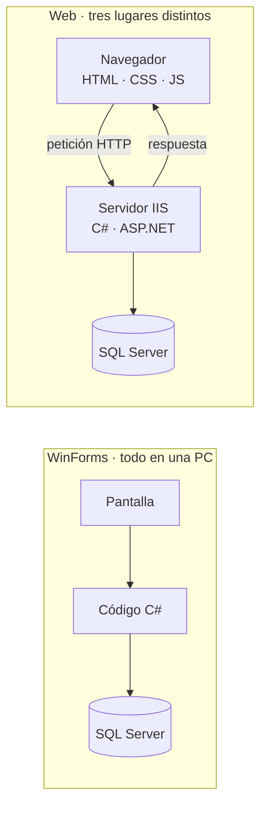
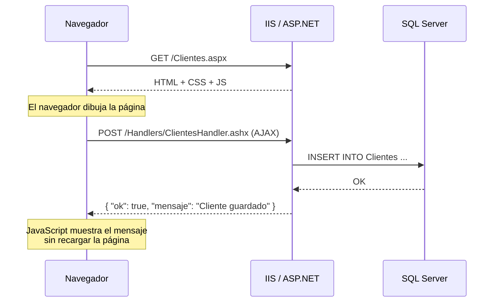
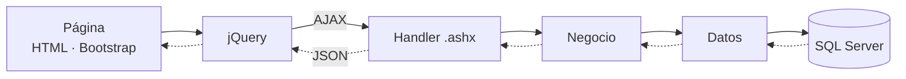

# Apuntes · Día 1 · De WinForms a la web

Resumen de lo que vemos en la primera parte del día. No necesitas copiar nada en clase: todo está aquí.

## 1. Qué vamos a construir

Una aplicación con tres catálogos relacionados:

```
Clientes → Familias → Piezas
```

Al final del curso le agregarás un **registro de producción por lote** usando todo lo aprendido.

## 2. De WinForms a la web

Todo lo que sabes de C# sigue sirviendo. Lo que cambia es **dónde corre cada cosa**.

| WinForms | Web Forms en este curso |
|---|---|
| `Form` | Página `.aspx` |
| Controles en memoria (`TextBox`, `Button`) | HTML que dibuja el navegador (`<input>`, `<button>`) |
| `button1_Click` en C# | Evento `click` en JavaScript |
| La clase del form llama a la base de datos | JavaScript → AJAX → Handler `.ashx` → C# → SQL Server |
| `DataGridView` | `<table>` con Bootstrap Table |
| `MessageBox.Show` | `alert()` o un modal de Bootstrap |
| `App.config` en cada PC | `Web.config` **solo en el servidor** |
| Un `.exe` instalado en cada equipo | Una sola aplicación en IIS; se abre desde el navegador |
| Un usuario por instancia | Muchos usuarios al mismo tiempo en el mismo servidor |
| Las variables viven mientras el form está abierto | El servidor **olvida todo** al terminar cada petición |

### Dónde corre cada cosa



El navegador y el servidor **solo se hablan con mensajes**: no comparten variables ni memoria.

### El viaje de una petición



- La primera petición trae **la página**.
- Las siguientes, con AJAX, traen **solo datos** en formato JSON.

### Sin estado: el contador

📖 [ASP.NET Page Life Cycle Overview](https://learn.microsoft.com/previous-versions/aspnet/ms178472(v=vs.100))

El mismo código, en los dos mundos:

**WinForms**

```csharp
public partial class Form1 : Form
{
    private int contador = 0;

    private void btnSumar_Click(object sender, EventArgs e)
    {
        contador++;
        lblContador.Text = contador.ToString();   // 1, 2, 3...
    }
}
```

**Web Forms**

```csharp
public partial class Contador : System.Web.UI.Page
{
    private int contador = 0;

    protected void btnSumar_Click(object sender, EventArgs e)
    {
        contador++;
        lblContador.Text = contador.ToString();   // siempre 1
    }
}
```

En la web cada clic es **una petición nueva**: ASP.NET crea la página, ejecuta el evento, genera el HTML y la destruye. Por eso en este curso los datos viven en SQL Server y la página los pide cuando los necesita.

### Regla de oro: el navegador no es confiable

Todo lo que llega al navegador el usuario lo puede ver y modificar con F12. Por eso:

- Validar en JavaScript es **comodidad**; validar en C# es **seguridad**. Siempre las dos.
- La cadena de conexión y las contraseñas **nunca** van al navegador.
- Los valores que llegan al servidor van a SQL **con parámetros**, nunca concatenados.

## 3. Herramientas del navegador (F12)

📖 [Chrome DevTools](https://developer.chrome.com/docs/devtools) · [Elements / CSS](https://developer.chrome.com/docs/devtools/css) · [Console](https://developer.chrome.com/docs/devtools/console) · [Network](https://developer.chrome.com/docs/devtools/network)

| Pestaña | Para qué | Úsala cuando… |
|---|---|---|
| **Elements** | Ver y editar el HTML y CSS de la página | Algo no se ve como esperas |
| **Console** | Ejecutar JavaScript y ver errores | "El botón no hace nada" |
| **Network** | Ver cada petición y su respuesta | Algo no se guarda o no carga |

En **Network**:
- Una página son muchas peticiones: el HTML, los CSS, los JS y las imágenes.
- Clic en una fila → *Headers* (método, URL, código) y *Response* (lo que regresó el servidor).
- Filtro **Fetch/XHR**: ahí verás tus llamadas AJAX.

### Códigos de estado

📖 [MDN: códigos de estado HTTP](https://developer.mozilla.org/es/docs/Web/HTTP/Reference/Status)

| Código | Significa | Cuándo lo verás en el curso |
|---|---|---|
| 200 | Todo bien | Siempre que funcione |
| 304 | No cambió, usa tu copia | Al recargar CSS o JS |
| 404 | No existe | URL del handler mal escrita |
| 500 | Error en el servidor | Excepción en C#; el detalle viene en *Response* |

### Para practicar en la consola

```javascript
2 + 2
document.title
document.title = 'Hola desde la consola'
alert('Esto es JavaScript corriendo en el navegador')
```

## 4. Tecnologías del curso

| Capa | Tecnología | Para qué | Día |
|---|---|---|---|
| Navegador | HTML | Estructura | 1 |
| Navegador | CSS + Bootstrap | Apariencia y componentes | 1 |
| Navegador | JavaScript + jQuery | Comportamiento | 2 |
| Comunicación | AJAX + JSON | Pedir y enviar datos sin recargar | 2 |
| Servidor | ASP.NET Web Forms + IIS | Páginas y hospedaje | 1 y 6 |
| Servidor | Handler `.ashx` (C#) | Recibir peticiones AJAX | 2 |
| Servidor | Negocio (C#) | Reglas y validaciones | 2 |
| Servidor | Datos (C# + ADO.NET) | Hablar con SQL Server | 2 |
| Base de datos | SQL Server | Guardar la información | 2–4 |

## 5. El flujo de una funcionalidad

Este flujo se repite en **todo** el curso:



> Página → jQuery → AJAX → Handler → Negocio → Datos → SQL Server, y de regreso como JSON.

### Así se ve un JSON

📖 [json.org en español](https://www.json.org/json-es.html)

```json
{
  "ok": true,
  "mensaje": "Cliente guardado",
  "datos": {
    "clienteId": 3,
    "nombre": "Ensambles León",
    "activo": true
  }
}
```

Todas las respuestas del curso tienen la forma `{ ok, mensaje, datos }`. JavaScript lo lee como un objeto: `respuesta.datos.nombre`.
