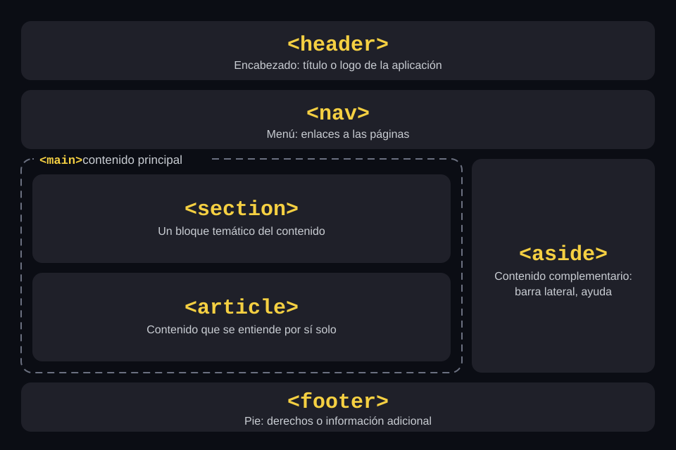

# Paso a paso · Día 1

Lo que construimos juntos en clase. Si te atrasas o algo no te funciona, compáralo con la solución en `final/`.

## 1. Crear el proyecto

1. En Visual Studio: *Archivo → Nuevo → Proyecto*.
2. Busca **Aplicación web ASP.NET (.NET Framework)**. Debe decir **C#**.
3. Configura:
   - Nombre del proyecto: `CursoWeb`
   - Ubicación: tu carpeta de trabajo (por ejemplo `C:\cursos`)
   - Framework: **.NET Framework 4.8**
4. En la siguiente ventana:
   - Plantilla: **Vacío**
   - En *Agregar carpetas y referencias*: marca **Web Forms**
   - Desmarca **Configurar para HTTPS**
5. Clic en *Crear*.

> Usamos la plantilla vacía para que cada archivo del proyecto lo creemos nosotros y sepamos para qué sirve.

### Qué generó Visual Studio

| Archivo | Para qué sirve |
|---|---|
| `CursoWeb.slnx` (o `.sln`) | La solución: agrupa los proyectos, igual que en WinForms |
| `CursoWeb.csproj` | El proyecto: sus archivos y referencias |
| `Web.config` | La configuración de la aplicación. Como `App.config`, pero vive en el servidor y el navegador nunca lo ve |
| `Web.Debug.config` / `Web.Release.config` | Ajustes al `Web.config` al publicar (día 6) |
| `packages.config` | Los paquetes NuGet del proyecto |
| `bin\` y `obj\` | Se generan al compilar; no se guardan en Git |

Si presionas **F5** ahora, el navegador muestra **HTTP Error 403.14 – Forbidden**. Es normal: todavía no hay ninguna página.

## 2. Primera página

1. Clic derecho en el proyecto → *Agregar → Nuevo elemento → Formulario Web Forms*, con el nombre `Default.aspx`.
2. En `Default.aspx`, dentro de `<div>`:
   ```aspx
   <h1>Hola desde el servidor</h1>
   <p>Fecha y hora del servidor: <asp:Label ID="lblFecha" runat="server"></asp:Label></p>
   ```
3. En `Default.aspx.cs`, dentro de `Page_Load`:
   ```csharp
   lblFecha.Text = DateTime.Now.ToString("dd/MM/yyyy HH:mm:ss");
   ```
4. **F5** y recarga varias veces: la hora cambia en cada petición.

### Anatomía de una página Web Forms

Cada página son tres archivos, con el mismo patrón que un formulario de WinForms:

| Web Forms | WinForms | Qué es |
|---|---|---|
| `Default.aspx` | Lo que ves en el diseñador | El marcado: HTML más controles de servidor |
| `Default.aspx.cs` | `Form1.cs` | El **code-behind**: tu código C# |
| `Default.aspx.designer.cs` | `Form1.Designer.cs` | Declaraciones de los controles; lo genera Visual Studio, no se edita |

La primera línea del `.aspx` une el marcado con su clase:

```aspx
<%@ Page Language="C#" AutoEventWireup="true" CodeBehind="Default.aspx.cs" Inherits="CursoWeb.Default" %>
```

- **`runat="server"`**: el servidor procesa ese elemento y lo convierte en un objeto que puedes usar desde C#. Sin `runat`, es HTML normal que el servidor no ve.
- **`ID`**: el nombre del control en C#, como `(Name)` en WinForms.
- **`<form runat="server">`**: los controles `asp:` tienen que estar dentro; solo hay uno por página.
- **`Page_Load`** se ejecuta en **cada** petición. `IsPostBack` indica si la petición vino de un botón de la misma página.

### Los controles se convierten en HTML

Abre el código fuente con **Ctrl+U**:

- El `asp:Label` llegó como `<span id="lblFecha">` y no hay nada de C#.
- El `form runat="server"` se convirtió en `<form method="post" action="./Default.aspx">`: los botones de servidor envían la página a sí misma (*postback*).
- Aparecen dos campos ocultos que agrega el `form runat="server"`: `__VIEWSTATE` y `__VIEWSTATEGENERATOR`.

| Control | HTML que genera | En WinForms se parece a |
|---|---|---|
| `asp:Label` | `<span>` | `Label` |
| `asp:TextBox` | `<input type="text">` | `TextBox` |
| `asp:Button` | `<input type="submit">` | `Button` |
| `asp:DropDownList` | `<select>` | `ComboBox` |
| `asp:CheckBox` | `<input type="checkbox">` | `CheckBox` |
| `asp:HyperLink` | `<a>` | `LinkLabel` |
| `asp:Panel` | `<div>` | `Panel` |
| `asp:HiddenField` | `<input type="hidden">` | — |
| `asp:GridView` | `<table>` | `DataGridView` |

En el curso usaremos pocos controles `asp:`. La mayor parte será HTML normal con jQuery y handlers, para controlar exactamente qué viaja entre el navegador y el servidor.

> El `id` que llega al navegador puede no ser igual al `ID` que escribiste. Dentro de una Master Page, `lblFecha` llega como algo parecido a `MainContent_lblFecha`.

### IIS Express

La página corre en `http://localhost:<puerto>/Default.aspx`; el puerto lo asigna Visual Studio a cada proyecto. `Default.aspx` es el documento por defecto, así que `http://localhost:<puerto>/` también funciona.

## 3. El contador: por qué siempre 1

1. Agrega `Contador.aspx` a tu proyecto y reemplaza sus tres archivos con los de [`ejemplos/webforms/`](ejemplos/webforms/).
2. Clic derecho en `Contador.aspx` → *Ver en el explorador*. Mejor en una **ventana de incógnito**: las extensiones del navegador agregan peticiones propias que confunden.
3. F12 → **Network** y marca **Keep log** (*Conservar registro*) antes de dar clic. Si no, cada clic recarga la página y la lista se limpia.
4. Tres clics en **Sumar**: el número se queda en **1**.
5. Abre una de las peticiones `Contador.aspx`:
   - *Headers*: el método es `POST`.
   - *Payload*: viajan `__VIEWSTATE`, `__VIEWSTATEGENERATOR`, `__EVENTVALIDATION` y `btnSumar`. La variable `contador` no aparece: el servidor no la recibe ni la guardó.

El video [`material/ciclo-de-vida-de-una-pagina.mp4`](material/ciclo-de-vida-de-una-pagina.mp4) lo explica en 25 segundos: en cada petición la página nace con `contador = 0`, pasa por Init, Load, el clic, Render y Unload, y se destruye. El siguiente clic empieza otra vez desde cero.

> En WinForms el formulario vive mientras está abierto. En la web, la página vive lo que dura una petición.

Cada clic de un `asp:Button` envía y recibe la página completa. A partir del día 2 usaremos AJAX y handlers para que solo viaje el dato que importa, y los datos vivirán en SQL Server.

## 4. Master Page y menú

Si la aplicación tiene 20 páginas con el mismo encabezado y menú, agregar una opción al menú significaría cambiar 20 archivos. La **Master Page** guarda ese marco común en un solo lugar; cada página solo pone su contenido. Es parecido a un formulario base heredado en WinForms.

### El layout



| Etiqueta | Para qué | ¿En la Master Page? |
|---|---|---|
| `<header>` | Encabezado: título o logo de la aplicación | Sí |
| `<nav>` | El menú de navegación | Sí |
| `<main>` | El contenido principal; lo único que cambia de página a página | Sí, con el `ContentPlaceHolder` adentro |
| `<section>` | Un bloque temático del contenido | No: dentro de cada página, si hace falta |
| `<article>` | Contenido que se entiende por sí solo | No: dentro de cada página, si hace falta |
| `<aside>` | Contenido complementario, como una barra lateral | No: en este curso no la usamos |
| `<footer>` | Pie de página | Sí |

Se podría hacer todo con `<div>`, pero estas etiquetas dicen qué es cada parte. La Master Page usa `<header>`, `<nav>`, `<main>` y `<footer>` porque es lo que se repite en todas las páginas; `<section>`, `<article>` y `<aside>` van dentro de cada página cuando el contenido lo pide.

### Crear `Site.Master`

1. *Agregar → Nuevo elemento → Página maestra de Web Forms*, con el nombre `Site.Master`.
2. Ponle un título en `<title>` y deja el `<body>` así:

```aspx
<body>
    <form id="form1" runat="server">
        <header>
            <strong>Curso Web Forms</strong>
        </header>

        <nav>
            <a href="Default.aspx">Inicio</a> |
            <a href="Clientes.aspx">Clientes</a> |
            <a href="Familias.aspx">Familias</a> |
            <a href="Piezas.aspx">Piezas</a>
        </nav>

        <main>
            <asp:ContentPlaceHolder ID="MainContent" runat="server">
            </asp:ContentPlaceHolder>
        </main>

        <footer>
            <small>Curso de ASP.NET Web Forms</small>
        </footer>
    </form>

    <asp:ContentPlaceHolder ID="Scripts" runat="server">
    </asp:ContentPlaceHolder>
</body>
```

Los `ContentPlaceHolder` son los huecos que llena cada página:

| Hueco | Para qué |
|---|---|
| `head` | Agregar algo al `<head>`, por ejemplo un CSS propio de la página |
| `MainContent` | El contenido de la página |
| `Scripts` | El JavaScript de la página, al final del `<body>` (desde el día 2) |

### Convertir `Default.aspx`

**Antes** (página completa, sección 2):

```aspx
<%@ Page Language="C#" AutoEventWireup="true" CodeBehind="Default.aspx.cs" Inherits="CursoWeb.Default" %>

<!DOCTYPE html>
<html xmlns="http://www.w3.org/1999/xhtml">
<head runat="server">
    <title></title>
</head>
<body>
    <form id="form1" runat="server">
        <div>
            <h1>Hola desde el servidor</h1>
            <p>Fecha y hora del servidor: <asp:Label ID="lblFecha" runat="server"></asp:Label></p>
        </div>
    </form>
</body>
</html>
```

**Después** (con Master Page):

```aspx
<%@ Page Title="Inicio" Language="C#" AutoEventWireup="true" CodeBehind="Default.aspx.cs" Inherits="CursoWeb.Default" MasterPageFile="~/Site.Master" %>

<asp:Content ID="Content1" ContentPlaceHolderID="MainContent" runat="server">
    <h1>Hola desde el servidor</h1>
    <p>Fecha y hora del servidor: <asp:Label ID="lblFecha" runat="server"></asp:Label></p>
</asp:Content>
```

| Qué cambió | Por qué |
|---|---|
| Se agregó `MasterPageFile="~/Site.Master"` | Indica qué marco usa la página |
| Se agregó `Title="Inicio"` | El título de la pestaña para esta página |
| Se quitaron `<!DOCTYPE>`, `<html>`, `<head>`, `<body>` y `<form>` | Ya los pone `Site.Master` |
| El contenido quedó dentro de `<asp:Content ContentPlaceHolderID="MainContent">` | Indica en qué hueco va |
| El code-behind no cambió | `lblFecha` sigue siendo el mismo control |

> Si dejas el `<html>` o el `<form>` después de agregar `MasterPageFile`, la página no corre: con Master Page solo puede haber controles `<asp:Content>`.

### Páginas de contenido

1. *Agregar → Nuevo elemento → Formulario Web Forms con página maestra* y elige `Site.Master`.
2. Crea `Clientes.aspx`, `Familias.aspx` y `Piezas.aspx`, cada una con un `<h1>` con su nombre dentro del `Content` de `MainContent` y su `Title` en la directiva.

`Contador.aspx` se queda sin Master Page: es la demo de una página completa.

### Probar

1. Clic derecho en `Default.aspx` → **Establecer como página de inicio**. Si no, F5 abre la página que tengas activa en el editor.
2. F5 y navega con el menú: el encabezado, el menú y el pie no cambian; el título de la pestaña sí.
3. En `Default.aspx`, Ctrl+U: el `span` de la fecha llegó como `MainContent_lblFecha`. ASP.NET le agrega el nombre del `ContentPlaceHolder`; lo tomaremos en cuenta al usar jQuery el día 2.
