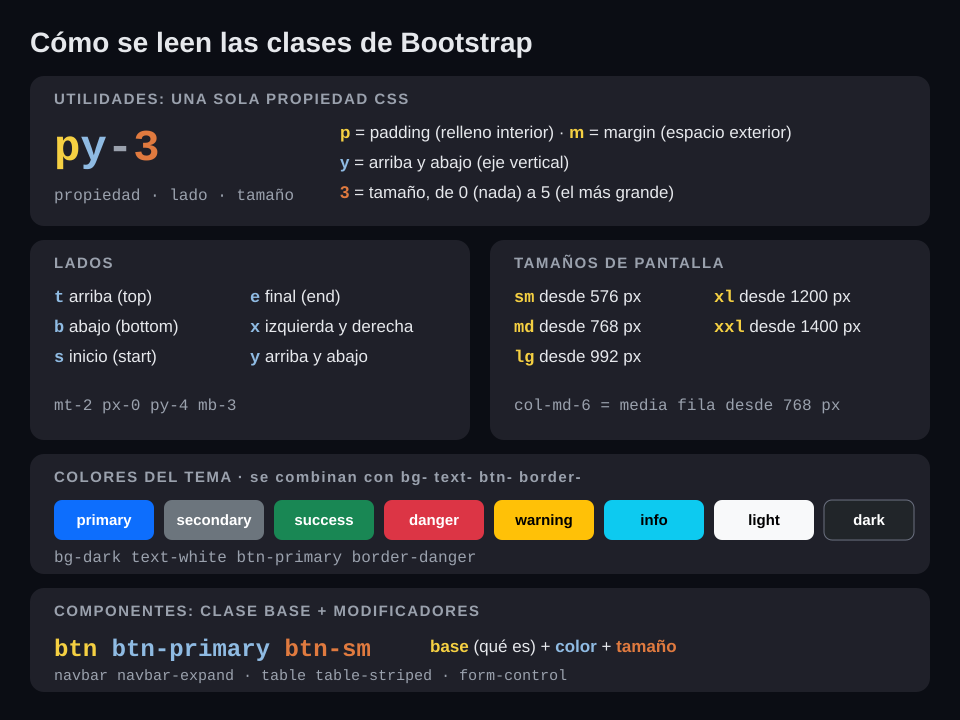

# Paso a paso · Día 1

Lo que construimos juntos en clase. Si te atrasas o algo no te funciona, compáralo con la solución del bloque.

| Bloque | Secciones | Solución para comparar |
|---|---|---|
| **Bloque 2** · Proyecto, primera página y Master Page | [1](#1-crear-el-proyecto) · [2](#2-primera-página) · [3](#3-el-contador-por-qué-siempre-1) · [4](#4-master-page-y-menú) | [`bloque-2/`](bloque-2/) |
| **Bloque 3** · CSS, Bootstrap, Clientes y Git | [5](#5-css) · [6](#6-bootstrap) · [7](#7-ejercicio-maquetar-clientesaspx) | `final/`, al cierre del día |

---

> **Bloque 2 · Proyecto, primera página y Master Page**

## 1. Crear el proyecto

1. En Visual Studio: *Archivo → Nuevo → Proyecto*.
2. Busca **Aplicación web ASP.NET (.NET Framework)**. Debe decir **C#**.
3. Configura:
   - Nombre del proyecto: `CursoWeb`
   - Ubicación: tu carpeta de trabajo (por ejemplo `C:\cursos`)
   - Framework: **.NET Framework 4.8**
4. En la siguiente ventana:
   - Plantilla: **Vacío**
   - En *Agregar carpetas y referencias*: marca **Web Forms**
   - Desmarca **Configurar para HTTPS**
5. Clic en *Crear*.

> Usamos la plantilla vacía para que cada archivo del proyecto lo creemos nosotros y sepamos para qué sirve.

### Qué generó Visual Studio

| Archivo | Para qué sirve |
|---|---|
| `CursoWeb.slnx` (o `.sln`) | La solución: agrupa los proyectos, igual que en WinForms |
| `CursoWeb.csproj` | El proyecto: sus archivos y referencias |
| `Web.config` | La configuración de la aplicación. Como `App.config`, pero vive en el servidor y el navegador nunca lo ve |
| `Web.Debug.config` / `Web.Release.config` | Ajustes al `Web.config` al publicar (día 6) |
| `packages.config` | Los paquetes NuGet del proyecto |
| `bin\` y `obj\` | Se generan al compilar; no se guardan en Git |

Si presionas **F5** ahora, el navegador muestra **HTTP Error 403.14 – Forbidden**. Es normal: todavía no hay ninguna página.

## 2. Primera página

1. Clic derecho en el proyecto → *Agregar → Nuevo elemento → Formulario Web Forms*, con el nombre `Default.aspx`.
2. En `Default.aspx`, dentro de `<div>`:
   ```aspx
   <h1>Hola desde el servidor</h1>
   <p>Fecha y hora del servidor: <asp:Label ID="lblFecha" runat="server"></asp:Label></p>
   ```
3. En `Default.aspx.cs`, dentro de `Page_Load`:
   ```csharp
   lblFecha.Text = DateTime.Now.ToString("dd/MM/yyyy HH:mm:ss");
   ```
4. **F5** y recarga varias veces: la hora cambia en cada petición.

### Anatomía de una página Web Forms

Cada página son tres archivos, con el mismo patrón que un formulario de WinForms:

| Web Forms | WinForms | Qué es |
|---|---|---|
| `Default.aspx` | Lo que ves en el diseñador | El marcado: HTML más controles de servidor |
| `Default.aspx.cs` | `Form1.cs` | El **code-behind**: tu código C# |
| `Default.aspx.designer.cs` | `Form1.Designer.cs` | Declaraciones de los controles; lo genera Visual Studio, no se edita |

La primera línea del `.aspx` une el marcado con su clase:

```aspx
<%@ Page Language="C#" AutoEventWireup="true" CodeBehind="Default.aspx.cs" Inherits="CursoWeb.Default" %>
```

- **`runat="server"`**: el servidor procesa ese elemento y lo convierte en un objeto que puedes usar desde C#. Sin `runat`, es HTML normal que el servidor no ve.
- **`ID`**: el nombre del control en C#, como `(Name)` en WinForms.
- **`<form runat="server">`**: los controles `asp:` tienen que estar dentro; solo hay uno por página.
- **`Page_Load`** se ejecuta en **cada** petición. `IsPostBack` indica si la petición vino de un botón de la misma página.

### Los controles se convierten en HTML

Abre el código fuente con **Ctrl+U**:

- El `asp:Label` llegó como `<span id="lblFecha">` y no hay nada de C#.
- El `form runat="server"` se convirtió en `<form method="post" action="./Default.aspx">`: los botones de servidor envían la página a sí misma (*postback*).
- Aparecen dos campos ocultos que agrega el `form runat="server"`: `__VIEWSTATE` y `__VIEWSTATEGENERATOR`.

| Control | HTML que genera | En WinForms se parece a |
|---|---|---|
| `asp:Label` | `<span>` | `Label` |
| `asp:TextBox` | `<input type="text">` | `TextBox` |
| `asp:Button` | `<input type="submit">` | `Button` |
| `asp:DropDownList` | `<select>` | `ComboBox` |
| `asp:CheckBox` | `<input type="checkbox">` | `CheckBox` |
| `asp:HyperLink` | `<a>` | `LinkLabel` |
| `asp:Panel` | `<div>` | `Panel` |
| `asp:HiddenField` | `<input type="hidden">` | — |
| `asp:GridView` | `<table>` | `DataGridView` |

En el curso usaremos pocos controles `asp:`. La mayor parte será HTML normal con jQuery y handlers, para controlar exactamente qué viaja entre el navegador y el servidor.

> El `id` que llega al navegador puede no ser igual al `ID` que escribiste. Dentro de una Master Page, `lblFecha` llega como algo parecido a `MainContent_lblFecha`.

### IIS Express

La página corre en `http://localhost:<puerto>/Default.aspx`; el puerto lo asigna Visual Studio a cada proyecto. `Default.aspx` es el documento por defecto, así que `http://localhost:<puerto>/` también funciona.

## 3. El contador: por qué siempre 1

1. Agrega `Contador.aspx` a tu proyecto y reemplaza sus tres archivos con los de [`ejemplos/webforms/`](ejemplos/webforms/).
2. Clic derecho en `Contador.aspx` → *Ver en el explorador*. Mejor en una **ventana de incógnito**: las extensiones del navegador agregan peticiones propias que confunden.
3. F12 → **Network** y marca **Keep log** (*Conservar registro*) antes de dar clic. Si no, cada clic recarga la página y la lista se limpia.
4. Tres clics en **Sumar**: el número se queda en **1**.
5. Abre una de las peticiones `Contador.aspx`:
   - *Headers*: el método es `POST`.
   - *Payload*: viajan `__VIEWSTATE`, `__VIEWSTATEGENERATOR`, `__EVENTVALIDATION` y `btnSumar`. La variable `contador` no aparece: el servidor no la recibe ni la guardó.

El video [`material/ciclo-de-vida-de-una-pagina.mp4`](material/ciclo-de-vida-de-una-pagina.mp4) lo explica en 25 segundos: en cada petición la página nace con `contador = 0`, pasa por Init, Load, el clic, Render y Unload, y se destruye. El siguiente clic empieza otra vez desde cero.

> En WinForms el formulario vive mientras está abierto. En la web, la página vive lo que dura una petición.

Cada clic de un `asp:Button` envía y recibe la página completa. A partir del día 2 usaremos AJAX y handlers para que solo viaje el dato que importa, y los datos vivirán en SQL Server.

## 4. Master Page y menú

Si la aplicación tiene 20 páginas con el mismo encabezado y menú, agregar una opción al menú significaría cambiar 20 archivos. La **Master Page** guarda ese marco común en un solo lugar; cada página solo pone su contenido. Es parecido a un formulario base heredado en WinForms.

### El layout


| Etiqueta | Para qué | ¿En la Master Page? |
|---|---|---|
| `<header>` | Encabezado: título o logo de la aplicación | Sí |
| `<nav>` | El menú de navegación | Sí |
| `<main>` | El contenido principal; lo único que cambia de página a página | Sí, con el `ContentPlaceHolder` adentro |
| `<section>` | Un bloque temático del contenido | No: dentro de cada página, si hace falta |
| `<article>` | Contenido que se entiende por sí solo | No: dentro de cada página, si hace falta |
| `<aside>` | Contenido complementario, como una barra lateral | No: en este curso no la usamos |
| `<footer>` | Pie de página | Sí |

Se podría hacer todo con `<div>`, pero estas etiquetas dicen qué es cada parte. La Master Page usa `<header>`, `<nav>`, `<main>` y `<footer>` porque es lo que se repite en todas las páginas; `<section>`, `<article>` y `<aside>` van dentro de cada página cuando el contenido lo pide.

### Crear `Site.Master`

1. *Agregar → Nuevo elemento → Página maestra de Web Forms*, con el nombre `Site.Master`.
2. Ponle un título en `<title>` y deja el `<body>` así:

```aspx
<body>
    <form id="form1" runat="server">
        <header>
            <strong>Curso Web Forms</strong>
        </header>

        <nav>
            <a href="Default.aspx">Inicio</a> |
            <a href="Clientes.aspx">Clientes</a> |
            <a href="Familias.aspx">Familias</a> |
            <a href="Piezas.aspx">Piezas</a>
        </nav>

        <main>
            <asp:ContentPlaceHolder ID="MainContent" runat="server">
            </asp:ContentPlaceHolder>
        </main>

        <footer>
            <small>Curso de ASP.NET Web Forms</small>
        </footer>
    </form>

    <asp:ContentPlaceHolder ID="Scripts" runat="server">
    </asp:ContentPlaceHolder>
</body>
```

Los `ContentPlaceHolder` son los huecos que llena cada página:

| Hueco | Para qué |
|---|---|
| `head` | Agregar algo al `<head>`, por ejemplo un CSS propio de la página |
| `MainContent` | El contenido de la página |
| `Scripts` | El JavaScript de la página, al final del `<body>` (desde el día 2) |

### Convertir `Default.aspx`

**Antes** (página completa, sección 2):

```aspx
<%@ Page Language="C#" AutoEventWireup="true" CodeBehind="Default.aspx.cs" Inherits="CursoWeb.Default" %>

<!DOCTYPE html>
<html xmlns="http://www.w3.org/1999/xhtml">
<head runat="server">
    <title></title>
</head>
<body>
    <form id="form1" runat="server">
        <div>
            <h1>Hola desde el servidor</h1>
            <p>Fecha y hora del servidor: <asp:Label ID="lblFecha" runat="server"></asp:Label></p>
        </div>
    </form>
</body>
</html>
```

**Después** (con Master Page):

```aspx
<%@ Page Title="Inicio" Language="C#" AutoEventWireup="true" CodeBehind="Default.aspx.cs" Inherits="CursoWeb.Default" MasterPageFile="~/Site.Master" %>

<asp:Content ID="Content1" ContentPlaceHolderID="MainContent" runat="server">
    <h1>Hola desde el servidor</h1>
    <p>Fecha y hora del servidor: <asp:Label ID="lblFecha" runat="server"></asp:Label></p>
</asp:Content>
```

| Qué cambió | Por qué |
|---|---|
| Se agregó `MasterPageFile="~/Site.Master"` | Indica qué marco usa la página |
| Se agregó `Title="Inicio"` | El título de la pestaña para esta página |
| Se quitaron `<!DOCTYPE>`, `<html>`, `<head>`, `<body>` y `<form>` | Ya los pone `Site.Master` |
| El contenido quedó dentro de `<asp:Content ContentPlaceHolderID="MainContent">` | Indica en qué hueco va |
| El code-behind no cambió | `lblFecha` sigue siendo el mismo control |

> Si dejas el `<html>` o el `<form>` después de agregar `MasterPageFile`, la página no corre: con Master Page solo puede haber controles `<asp:Content>`.

### Páginas de contenido

1. *Agregar → Nuevo elemento → Formulario Web Forms con página maestra* y elige `Site.Master`.
2. Crea `Clientes.aspx`, `Familias.aspx` y `Piezas.aspx`, cada una con un `<h1>` con su nombre dentro del `Content` de `MainContent` y su `Title` en la directiva.

`Contador.aspx` se queda sin Master Page: es la demo de una página completa.

### Probar

1. Clic derecho en `Default.aspx` → **Establecer como página de inicio**. Si no, F5 abre la página que tengas activa en el editor.
2. F5 y navega con el menú: el encabezado, el menú y el pie no cambian; el título de la pestaña sí.
3. En `Default.aspx`, Ctrl+U: el `span` de la fecha llegó como `MainContent_lblFecha`. ASP.NET le agrega el nombre del `ContentPlaceHolder`; lo tomaremos en cuenta al usar jQuery el día 2.

> Si te atrasaste, el proyecto como debe quedar hasta aquí está en [`bloque-2/`](bloque-2/).

---

> **Bloque 3 · CSS, Bootstrap, Clientes y Git**

## 5. CSS

El HTML dice qué es cada cosa; el CSS dice cómo se ve.

1. Copia [`plantillas/css/site.css`](../plantillas/css/site.css) a una carpeta `css` en tu proyecto.
2. En `Site.Master`, dentro de `<head>` y antes del `ContentPlaceHolder` `head`:
   ```html
   <link href="css/site.css" rel="stylesheet" />
   ```
3. F5: el encabezado, el menú y el pie ya tienen color.

Cada regla tiene un **selector** (a qué elementos aplica) y pares **propiedad: valor**:

```css
nav a {
    color: #1f5f99;
    text-decoration: none;
}
```

Para probar un cambio sin tocar el archivo: **F12 → Elements**, selecciona el elemento y modifícalo en el panel **Styles**.

## 6. Bootstrap

Bootstrap es CSS ya hecho: en lugar de escribir reglas, pones clases en el HTML. Usamos los archivos locales del repo, sin depender de internet.

### Agregarlo al proyecto

1. Copia la carpeta [`plantillas/lib`](../plantillas/lib/) a la raíz de tu proyecto.
2. En el Explorador de soluciones, **Mostrar todos los archivos** → clic derecho en `css` y en `lib` → **Incluir en el proyecto**.
3. En `Site.Master`:
   - En `<head>`, antes de cualquier `<link>`, la etiqueta **viewport**:
     ```html
     <meta name="viewport" content="width=device-width, initial-scale=1" />
     ```
     Sin ella, el celular finge que la pantalla mide unos 980 px y encoge la página, y el diseño adaptable de Bootstrap no funciona. 📖 [Bootstrap: Introduction → Responsive meta tag](https://getbootstrap.com/docs/5.3/getting-started/introduction/)
   - En `<head>`, **antes** de `site.css`:
     ```html
     <link href="lib/bootstrap/css/bootstrap.min.css" rel="stylesheet" />
     ```
   - Al final del `<body>`, **antes y fuera** del `ContentPlaceHolder` `Scripts`:
     ```html
     <script src="lib/bootstrap/js/bootstrap.bundle.min.js"></script>
     ```

| Por qué así | |
|---|---|
| Bootstrap antes de `site.css` | Lo que va después gana; tus estilos pueden ajustar los de Bootstrap |
| `<script>` al final del `<body>` | La página se dibuja primero y el JavaScript carga después |
| `<script>` fuera del `ContentPlaceHolder` | Lo que va dentro de un `ContentPlaceHolder` se reemplaza cuando una página llena ese hueco |

> Si pones el `<script>` dentro del `ContentPlaceHolder` `Scripts`, Bootstrap JS deja de cargarse en las páginas que tienen su `<asp:Content>` de `Scripts`, aunque esté vacío.

### Cómo se leen las clases



Hay dos tipos de clases:

| Tipo | Qué hacen | Ejemplos |
|---|---|---|
| **Componentes** | Arman una pieza completa: una clase base más modificadores | `navbar navbar-expand`, `btn btn-primary btn-sm`, `table table-striped` |
| **Utilidades** | Cambian una sola propiedad CSS | `bg-dark`, `py-3`, `text-body-secondary`, `fw-bold` |

Las utilidades se leen como **propiedad-lado-tamaño**:

| Clase | Se lee | CSS que aplica |
|---|---|---|
| `py-3` | **p**adding, eje **y**, tamaño 3 | `padding-top` y `padding-bottom` |
| `mt-2` | **m**argin **t**op, tamaño 2 | `margin-top` |
| `px-0` | padding, eje x, tamaño 0 | sin padding a los lados |
| `bg-dark` | **b**ack**g**round *dark* | color de fondo |
| `fs-4` / `fw-bold` | **f**ont-**s**ize 4 / **f**ont-**w**eight bold | tamaño y peso de letra |

- **Lados:** `t` arriba, `b` abajo, `s` inicio, `e` final, `x` horizontal, `y` vertical. **Tamaños:** de `0` a `5`.
- **Colores del tema:** `primary`, `secondary`, `success`, `danger`, `warning`, `info`, `light`, `dark`, combinados con `bg-`, `text-`, `btn-` o `border-`.
- **Tamaños de pantalla:** `sm`, `md`, `lg`, `xl`, `xxl` significan *a partir de este ancho*. `col-md-6` es media fila desde 768 px.

**Cómo buscar una clase:**
- En la [documentación de Bootstrap 5.3](https://getbootstrap.com/docs/5.3/), el menú lateral separa *Layout*, *Content*, *Forms*, *Components* y *Utilities*. Cada página trae ejemplos para copiar.
- Con **F12 → Elements → Styles** ves qué CSS aplica cada clase del elemento que selecciones.

No hace falta memorizarlas: basta con saber leerlas y dónde buscarlas. Por ejemplo, si buscas `mb-4` en la documentación no aparece tal cual: aparece la fórmula en *Spacing* (`m` + `b` + `4` = margin abajo, tamaño 4). Busca la familia de la clase, no la clase exacta.

📖 Documentación: [Spacing](https://getbootstrap.com/docs/5.3/utilities/spacing/) · [Colors](https://getbootstrap.com/docs/5.3/utilities/colors/) · [Background](https://getbootstrap.com/docs/5.3/utilities/background/) · [Text](https://getbootstrap.com/docs/5.3/utilities/text/) · [Borders](https://getbootstrap.com/docs/5.3/utilities/borders/) · [Breakpoints](https://getbootstrap.com/docs/5.3/layout/breakpoints/)

### La navbar

En `Site.Master`, reemplaza de `<header>` a `</footer>`:

```aspx
<header class="bg-dark text-white py-3">
    <div class="container">
        <span class="fs-4 fw-bold">Curso Web Forms</span>
    </div>
</header>

<nav class="navbar navbar-expand-md bg-body-tertiary border-bottom">
    <div class="container">
        <button class="navbar-toggler" type="button" data-bs-toggle="collapse" data-bs-target="#menu"
                aria-controls="menu" aria-expanded="false" aria-label="Abrir menú">
            <span class="navbar-toggler-icon"></span>
        </button>
        <div class="collapse navbar-collapse" id="menu">
            <div class="navbar-nav">
                <a class="nav-link" href="Default.aspx">Inicio</a>
                <a class="nav-link" href="Clientes.aspx">Clientes</a>
                <a class="nav-link" href="Familias.aspx">Familias</a>
                <a class="nav-link" href="Piezas.aspx">Piezas</a>
            </div>
        </div>
    </div>
</nav>

<main class="container py-4">
    <asp:ContentPlaceHolder ID="MainContent" runat="server">
    </asp:ContentPlaceHolder>
</main>

<footer class="border-top py-3">
    <div class="container text-body-secondary small">Curso de ASP.NET Web Forms</div>
</footer>
```

Y **quita el `<link>` de `css/site.css`**: sus reglas le dan estilo a las mismas etiquetas y taparían las clases de Bootstrap.

| Clase | Qué hace |
|---|---|
| `container` | Centra el contenido y le da un ancho máximo |
| `bg-dark`, `text-white`, `bg-body-tertiary` | Colores de fondo y de texto |
| `py-3`, `py-4` | Espacio arriba y abajo |
| `navbar`, `navbar-nav`, `nav-link` | La barra de navegación y sus enlaces |
| `navbar-expand-md` | La barra se extiende desde pantallas medianas; en celular los enlaces se colapsan |
| `navbar-toggler`, `navbar-toggler-icon` | El botón ☰ que aparece en celular |
| `collapse navbar-collapse` + `id="menu"` | Lo que se muestra u oculta al dar clic; `data-bs-target="#menu"` lo conecta con el botón |
| `border-top`, `border-bottom` | Bordes |
| `fs-4`, `fw-bold`, `small`, `text-body-secondary` | Tamaño, peso y color del texto |

> En ejemplos de internet verás `text-muted`: en Bootstrap 5.3 está obsoleta y su reemplazo es `text-body-secondary`. Revisa siempre la documentación de la versión que usas (5.3).

📖 Documentación: [Navbar](https://getbootstrap.com/docs/5.3/components/navbar/) · [Collapse](https://getbootstrap.com/docs/5.3/components/collapse/) · [Containers](https://getbootstrap.com/docs/5.3/layout/containers/) · [Colors](https://getbootstrap.com/docs/5.3/utilities/colors/) · [Spacing](https://getbootstrap.com/docs/5.3/utilities/spacing/) · [Borders](https://getbootstrap.com/docs/5.3/utilities/borders/) · [Text](https://getbootstrap.com/docs/5.3/utilities/text/)

Lee cada clase con la regla de arriba: es un componente con modificadores, o una utilidad *propiedad-lado-tamaño*.

El botón ☰ usa el JavaScript de Bootstrap. Pruébalo en modo dispositivo (F12 → icono de dispositivo). Lleva `type="button"`: sin él, como está dentro del `<form runat="server">`, haría postback.

> Si una clase tiene un error de escritura (`navbar-toggle` en lugar de `navbar-toggler`), Bootstrap no avisa: simplemente no la aplica. Revísala letra por letra.

### El grid

En `Default.aspx`, reemplaza el contenido del `<asp:Content>` de `MainContent` (la directiva y el code-behind no cambian):

```aspx
<div class="row">
    <div class="col-md-8">
        <h1>Hola desde el servidor</h1>
        <p class="lead">Catálogo de clientes, familias y piezas.</p>
    </div>
    <div class="col-md-4">
        <div class="card">
            <div class="card-body">
                <h5 class="card-title">Servidor</h5>
                <p class="card-text">Fecha y hora: <asp:Label ID="lblFecha" runat="server"></asp:Label></p>
            </div>
        </div>
    </div>
</div>
```

| Clase | Qué hace |
|---|---|
| `row` | Una fila del grid; se divide en **12 columnas** |
| `col-md-8` / `col-md-4` | Desde pantallas medianas, 8 y 4 de las 12 columnas |
| `card`, `card-body`, `card-title`, `card-text` | El componente tarjeta: base y sus partes |
| `lead` | Párrafo de introducción, con letra más grande |

Bootstrap es **mobile first**: cada clase aplica desde ese tamaño hacia arriba, hasta que otra la reemplace. Solo escribes los tamaños donde el diseño cambia, y van en las columnas, no en el `row`:

| Clases | Celular | Tablet (`md`) | Escritorio (`lg`) |
|---|---|---|---|
| `col-md-6` | Fila completa | Media fila | Media fila |
| `col-6` | Media fila | Media fila | Media fila |
| `col-12 col-md-6 col-lg-4` | Fila completa | 2 por fila | 3 por fila |
| `col` | Partes iguales | Partes iguales | Partes iguales |

📖 Documentación: [Grid](https://getbootstrap.com/docs/5.3/layout/grid/) · [Breakpoints](https://getbootstrap.com/docs/5.3/layout/breakpoints/) · [Card](https://getbootstrap.com/docs/5.3/components/card/) · [Typography](https://getbootstrap.com/docs/5.3/content/typography/) (`lead`)

Pruébalo con la ventana ancha (dos columnas) y en modo dispositivo (la tarjeta baja debajo del texto).

> ¿Por qué hace falta el `viewport`? El primer iPhone dibujaba las páginas en un ancho virtual de 980 px, porque casi todos los sitios eran de escritorio, y luego las encogía. El `viewport` le dice al navegador que tu página sí está hecha para celular y que use el ancho real.

## 7. Ejercicio: maquetar `Clientes.aspx`

La maqueta que el día 2 conectaremos a SQL Server. Usamos `<input>` y `<button>` normales, no controles `asp:`, porque los manejaremos con jQuery y AJAX; por eso los `id` ya llevan el nombre que usaremos (`txtNombre`, `btnGuardar`, `tblClientes`). Los `maxlength` coinciden con las columnas de la tabla `Clientes`.

### El formulario

En `Clientes.aspx`, dentro del `Content` de `MainContent`:

```aspx
<h1 class="mb-4">Clientes</h1>

<div class="card mb-4">
    <div class="card-body">
        <h5 class="card-title">Nuevo cliente</h5>
        <div class="row g-3">
            <div class="col-md-6">
                <label for="txtNombre" class="form-label">Nombre</label>
                <input type="text" id="txtNombre" class="form-control" maxlength="150" />
            </div>
            <div class="col-md-3">
                <label for="txtRFC" class="form-label">RFC</label>
                <input type="text" id="txtRFC" class="form-control" maxlength="13" />
            </div>
            <div class="col-md-3">
                <label for="txtContacto" class="form-label">Contacto</label>
                <input type="text" id="txtContacto" class="form-control" maxlength="100" />
            </div>
            <div class="col-md-6">
                <label for="txtCorreo" class="form-label">Correo</label>
                <input type="email" id="txtCorreo" class="form-control" maxlength="150" />
            </div>
        </div>
        <div class="mt-3">
            <button type="button" id="btnGuardar" class="btn btn-primary">Guardar</button>
            <button type="button" id="btnLimpiar" class="btn btn-outline-secondary">Limpiar</button>
        </div>
    </div>
</div>
```

- `label for="txtNombre"` conecta la etiqueta con su caja: al dar clic en la etiqueta, el cursor entra a la caja.
- `type="email"` hace que el celular muestre el teclado con `@`.
- Los botones llevan `type="button"` para no hacer postback.

### La tabla

Debajo de la tarjeta:

```aspx
<table id="tblClientes" class="table table-striped table-hover">
    <thead>
        <tr>
            <th>Nombre</th>
            <th>RFC</th>
            <th>Contacto</th>
            <th>Correo</th>
            <th class="text-end">Acciones</th>
        </tr>
    </thead>
    <tbody>
        <tr>
            <td>Autopartes del Bajío</td>
            <td>ABA010101AA1</td>
            <td>Laura Méndez</td>
            <td>laura@ejemplo.com</td>
            <td class="text-end">
                <button type="button" class="btn btn-sm btn-outline-primary">Editar</button>
                <button type="button" class="btn btn-sm btn-outline-danger">Eliminar</button>
            </td>
        </tr>
        <tr>
            <td>Componentes Industriales GTO</td>
            <td>CIG020202BB2</td>
            <td>Jorge Ramírez</td>
            <td>jorge@ejemplo.com</td>
            <td class="text-end">
                <button type="button" class="btn btn-sm btn-outline-primary">Editar</button>
                <button type="button" class="btn btn-sm btn-outline-danger">Eliminar</button>
            </td>
        </tr>
    </tbody>
</table>
```

Los renglones están escritos a mano; el día 2 los llenará la base de datos.

### Las clases nuevas

| Clase | Se lee | 📖 Documentación |
|---|---|---|
| `mb-4`, `mt-3` | **m**argin **b**ottom tamaño 4, **m**argin **t**op tamaño 3 | [Spacing](https://getbootstrap.com/docs/5.3/utilities/spacing/) |
| `g-3` | **g**utter tamaño 3: la separación entre las columnas de un `row`, horizontal y vertical. `gx-*` solo horizontal, `gy-*` solo vertical | [Gutters](https://getbootstrap.com/docs/5.3/layout/gutters/) |
| `form-label`, `form-control` | Etiqueta y caja de texto con estilo de formulario | [Form controls](https://getbootstrap.com/docs/5.3/forms/form-control/) |
| `btn btn-primary`, `btn-outline-secondary`, `btn-sm` | Botón: base + color (relleno o solo borde) + tamaño | [Buttons](https://getbootstrap.com/docs/5.3/components/buttons/) |
| `table table-striped table-hover` | Tabla: base + renglones alternados + resaltado al pasar el mouse | [Tables](https://getbootstrap.com/docs/5.3/content/tables/) |
| `text-end` | Texto alineado al final (a la derecha) | [Text](https://getbootstrap.com/docs/5.3/utilities/text/) |

> Quita `g-3` y vuelve a ponerlo: sin él, las cajas del formulario quedan pegadas entre sí, sobre todo en celular.

### Probar

1. En pantalla ancha: el formulario en dos filas y la tabla debajo.
2. En modo dispositivo: los campos se apilan uno por fila.
3. Cambia `btn-primary` por `btn-success` y `table-striped` por `table-bordered` consultando la documentación, y luego regrésalos.
