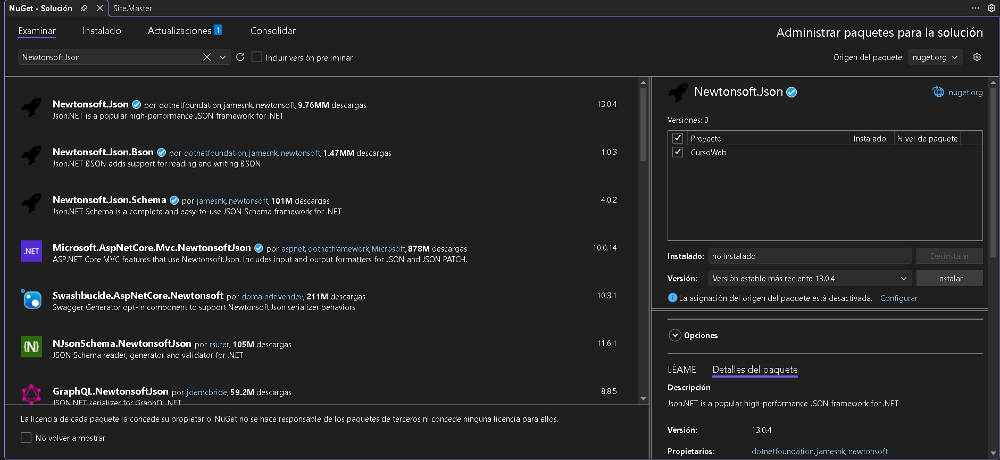
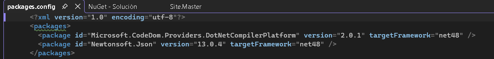

# Paso a paso · Día 2

Lo que construimos juntos en clase. Si te atrasas o algo no te funciona, compáralo con la solución en `final/` al cierre del día.

---

> **Bloque 1 · Preparar el proyecto, JavaScript y jQuery**

## 1. Preparar el proyecto: las librerías del día

Al inicio del día agregamos las tres librerías que vamos a usar:

| Librería | Para qué | Se usa en |
|---|---|---|
| jQuery | Manejar la página desde JavaScript | Bloque 1 |
| Newtonsoft.Json | Convertir objetos de C# a JSON en el handler | Bloque 2 |
| Bootstrap Table | Mostrar el listado de clientes | Bloque 3 |

### 1.1 jQuery y Bootstrap Table (archivos locales)

📖 [jQuery API](https://api.jquery.com/) · [Bootstrap Table: Getting Started](https://bootstrap-table.com/docs/getting-started/introduction/)

1. Copia las carpetas [`plantillas/lib/jquery`](../plantillas/lib/jquery/) y [`plantillas/lib/bootstrap-table`](../plantillas/lib/bootstrap-table/) a la carpeta `lib` de tu proyecto, e inclúyelas en el proyecto (*Mostrar todos los archivos → Incluir en el proyecto*).
2. En `Site.Master`, en `<head>`, **después** de `bootstrap.min.css`:
   ```html
   <link href="lib/bootstrap-table/bootstrap-table.min.css" rel="stylesheet" />
   ```
3. Al final del `<body>`, el orden completo queda así:
   ```html
   <script src="lib/jquery/jquery-3.7.1.min.js"></script>
   <script src="lib/bootstrap/js/bootstrap.bundle.min.js"></script>
   <script src="lib/bootstrap-table/bootstrap-table.min.js"></script>
   <script src="lib/bootstrap-table/locale/bootstrap-table-es-MX.min.js"></script>

   <asp:ContentPlaceHolder ID="Scripts" runat="server">
   </asp:ContentPlaceHolder>
   ```

El orden importa:
- **jQuery primero**: Bootstrap Table y el código de cada página dependen de él.
- **Bootstrap Table después de Bootstrap**, y su archivo de idioma (`es-MX`) al final, porque lo modifica.
- **El `ContentPlaceHolder` `Scripts` al último**, para que el código de cada página ya encuentre todo cargado.

### 1.2 Newtonsoft.Json (NuGet)

📖 [Instalar paquetes en Visual Studio con NuGet](https://learn.microsoft.com/es-es/nuget/consume-packages/install-use-packages-visual-studio) · [Newtonsoft.Json](https://www.newtonsoft.com/json)

Newtonsoft.Json convierte objetos de C# a JSON (y al revés). Se instala desde NuGet, el administrador de paquetes de .NET: se descarga una vez y al publicar el sitio viaja en la carpeta `bin/`.

1. Clic derecho en el proyecto `CursoWeb` → **Administrar paquetes NuGet...**
2. Pestaña **Examinar**, busca `Newtonsoft.Json`. Revisa que sea el del autor verificado (✔) y la versión **13.0.4**, y da clic en **Instalar**:

   

3. Al terminar, `packages.config` tiene una línea nueva:

   

> Necesitas acceso a `nuget.org` solo para instalarlo. Si abres una solución descargada (por ejemplo `final/`), Visual Studio vuelve a descargar los paquetes al compilar.

### 1.3 Comprobar

F5 y en F12 → **Console**:

```javascript
$.fn.jquery
$.fn.bootstrapTable.Constructor.VERSION
```

Deben responder `'3.7.1'` y `'1.28.0'`. Newtonsoft.Json se comprueba en `packages.config`.

## 2. JavaScript en la consola

Todos los ejercicios van en F12 → **Console**, con `Clientes.aspx` abierta. Cada uno construye una pieza que después usaremos en `js/clientes.js`.

| # | Ejercicio | Pieza que construye | Dónde se usa después |
|---|---|---|---|
| 1 | Variables y textos | Mensajes al usuario | Validación y respuesta del servidor |
| 2 | Objetos | El objeto `cliente` | Lo que se envía al handler |
| 3 | JSON | `stringify` y la respuesta `{ ok, mensaje, datos }` | Ida y vuelta con el handler |
| 4 | Arreglos | La lista de clientes | Lo que recibe Bootstrap Table |
| 5 | Funciones | `validarCliente()` | El botón Guardar |
| 6 | La página desde JavaScript | Leer las cajas y escuchar el clic | El puente a jQuery |

### Ejercicio 1 · Variables y textos

📖 [`let`](https://developer.mozilla.org/en-US/docs/Web/JavaScript/Reference/Statements/let) · [`const`](https://developer.mozilla.org/en-US/docs/Web/JavaScript/Reference/Statements/const) · [`var`](https://developer.mozilla.org/en-US/docs/Web/JavaScript/Reference/Statements/var) · [Plantillas de texto](https://developer.mozilla.org/es/docs/Web/JavaScript/Reference/Template_literals)

```javascript
let nombre = 'Autopartes del Bajío';
const maxNombre = 150;
typeof nombre
typeof maxNombre
`El nombre tiene ${nombre.length} de ${maxNombre} caracteres`
```

Las comillas invertidas permiten meter variables dentro del texto con `${}`.

**`let`, `const` y `var`.** En C#, una variable vive dentro de sus llaves. En JavaScript eso es cierto para `let` y `const`, pero no para `var`:

```javascript
if (true) {
    var a = 1;
    let b = 2;
}
a
b
const limite = 150;
limite = 200;
```

`a` responde `1` porque `var` se "sale" del `if`; `b` da `ReferenceError` porque `let` solo existe dentro de sus llaves; y `limite = 200` da `TypeError` porque `const` no se puede reasignar.

| | `var` | `let` | `const` |
|---|---|---|---|
| Alcance | La función completa | Solo su bloque `{ }` | Solo su bloque `{ }` |
| Se puede reasignar | Sí | Sí | No |
| Se puede volver a declarar | Sí | No | No |
| Cuándo usarla | Evítala; la verás en código viejo | Cuando el valor va a cambiar | **Por defecto** |

Regla del curso: `const` siempre, `let` solo si el valor cambia, y `var` nunca.

> Hoy `var` está **desaconsejado**. `let` y `const` llegaron en 2015 (ES2015) justamente para corregir sus problemas de alcance, y las guías de estilo y los analizadores de código lo marcan como error (en ESLint, la regla `no-var`). Sigue funcionando solo para no romper código viejo, así que lo verás en ejemplos antiguos de internet. 📖 [ESLint: `no-var`](https://eslint.org/docs/latest/rules/no-var)

### Ejercicio 2 · Objetos

📖 [Trabajar con objetos](https://developer.mozilla.org/es/docs/Web/JavaScript/Guide/Working_with_objects)

```javascript
const cliente = {
    clienteId: 0,
    nombre: 'Autopartes del Bajío',
    rfc: 'ABA010101AA1',
    contacto: 'Laura Méndez',
    correo: 'laura@ejemplo.com'
};
cliente.nombre
cliente.rfc = 'ABA010101AA2';
cliente
```

- Las propiedades se llaman igual que las columnas de la tabla `Clientes`, en camelCase. `clienteId: 0` significa "cliente nuevo".
- `cliente` es `const` y aun así pudimos cambiar `rfc`: `const` protege la variable, no el contenido del objeto.

### Ejercicio 3 · JSON

📖 [`JSON.stringify`](https://developer.mozilla.org/es/docs/Web/JavaScript/Reference/Global_Objects/JSON/stringify) · [`JSON.parse`](https://developer.mozilla.org/es/docs/Web/JavaScript/Reference/Global_Objects/JSON/parse)

```javascript
const texto = JSON.stringify(cliente);
texto

const respuesta = JSON.parse('{"ok":true,"mensaje":"Cliente guardado","datos":{"clienteId":3,"nombre":"Autopartes del Bajío"}}');
respuesta.ok
respuesta.mensaje
respuesta.datos.clienteId
```

`stringify` convierte el objeto en el texto que viaja al servidor; `parse` hace lo inverso con lo que regresa. Todos nuestros handlers responderán con la forma `{ ok, mensaje, datos }`.

### Ejercicio 4 · Arreglos

📖 [Array](https://developer.mozilla.org/es/docs/Web/JavaScript/Reference/Global_Objects/Array) · [`forEach`](https://developer.mozilla.org/es/docs/Web/JavaScript/Reference/Global_Objects/Array/forEach) · [`filter`](https://developer.mozilla.org/es/docs/Web/JavaScript/Reference/Global_Objects/Array/filter) · [`find`](https://developer.mozilla.org/es/docs/Web/JavaScript/Reference/Global_Objects/Array/find) · [Funciones flecha](https://developer.mozilla.org/es/docs/Web/JavaScript/Reference/Functions/Arrow_functions)

```javascript
const clientes = [
    { clienteId: 1, nombre: 'Autopartes del Bajío', rfc: 'ABA010101AA1' },
    { clienteId: 2, nombre: 'Componentes Industriales GTO', rfc: 'CIG020202BB2' }
];
clientes.length
clientes.push({ clienteId: 3, nombre: 'Ensambles León', rfc: 'ELE030303CC3' });
clientes.forEach(c => console.log(c.nombre));
clientes.filter(c => c.nombre.includes('GTO'))
clientes.find(c => c.clienteId === 2)
```

- El listado que mande el handler será un arreglo como este, y Bootstrap Table lo recibe tal cual.
- `c => ...` es una función flecha: lo mismo que una lambda de C#. `filter` es como `Where` de LINQ y `find` como `FirstOrDefault`.

### Ejercicio 5 · Funciones

📖 [Funciones](https://developer.mozilla.org/es/docs/Web/JavaScript/Guide/Functions)

```javascript
function validarCliente(c) {
    const errores = [];
    if (!c.nombre.trim()) {
        errores.push('El nombre es obligatorio.');
    }
    if (c.nombre.length > 150) {
        errores.push('El nombre no puede pasar de 150 caracteres.');
    }
    if (c.correo && !c.correo.includes('@')) {
        errores.push('El correo no es válido.');
    }
    return errores;
}

validarCliente(cliente)
validarCliente({ nombre: '   ', correo: 'sin-arroba' })
```

Regresa un arreglo de errores: vacío significa válido. Esta función la usaremos tal cual en `clientes.js`. El servidor también valida: la validación en JavaScript es comodidad, no seguridad.

### Ejercicio 6 · La página desde JavaScript

📖 [`getElementById`](https://developer.mozilla.org/es/docs/Web/API/Document/getElementById) · [`addEventListener`](https://developer.mozilla.org/es/docs/Web/API/EventTarget/addEventListener)

```javascript
document.getElementById('txtNombre').value = 'Prueba desde la consola';
document.getElementById('txtNombre').value

document.getElementById('btnGuardar').addEventListener('click', () => {
    console.log('Clic en Guardar:', document.getElementById('txtNombre').value);
});
```

Escribe algo en **Nombre** y da clic en **Guardar**: aparece en la consola.

`txtNombre` se encontró con su `id` tal cual, sin el `MainContent_` del día 1, porque es un `<input>` normal y no un control `asp:`. Con jQuery, `document.getElementById('txtNombre').value` se escribe `$('#txtNombre').val()`: es lo que sigue.

## 3. jQuery: el archivo `clientes.js`

### Seleccionar elementos

📖 [jQuery: Selectors](https://api.jquery.com/category/selectors/) · [MDN: `querySelector`](https://developer.mozilla.org/es/docs/Web/API/Document/querySelector) · [MDN: `querySelectorAll`](https://developer.mozilla.org/es/docs/Web/API/Document/querySelectorAll)

| Buscar | JavaScript puro | jQuery |
|---|---|---|
| Por `id` | `document.getElementById('txtNombre')` | `$('#txtNombre')` |
| Por clase | `document.querySelectorAll('.form-control')` | `$('.form-control')` |
| Por etiqueta | `document.querySelectorAll('input')` | `$('input')` |
| Por atributo | `document.querySelectorAll('input[type=email]')` | `$('input[type=email]')` |
| Varios a la vez | `document.querySelectorAll('#txtNombre, #txtRFC')` | `$('#txtNombre, #txtRFC')` |
| Dentro de otro | `document.querySelectorAll('#tblClientes tbody tr')` | `$('#tblClientes tbody tr')` |

- Lo que va entre comillas es un **selector CSS**: `#` es id, `.` es clase y sin símbolo es la etiqueta.
- jQuery siempre regresa una colección, aunque encuentre uno o ninguno, así que **no marca error** si el `id` está mal escrito: simplemente no hace nada. Para revisarlo: `$('#txtNombr').length` responde `0`.
- Con controles `asp:` el `id` cambia (`MainContent_lblFecha`, día 1). Con `<input>` normales, es el que escribiste.

### Cuándo corre el código: `$(function () { ... })`

📖 [jQuery: `.ready()`](https://api.jquery.com/ready/) · [Learn jQuery: `$( document ).ready()`](https://learn.jquery.com/using-jquery-core/document-ready/) · [MDN: `DOMContentLoaded`](https://developer.mozilla.org/es/docs/Web/API/Document/DOMContentLoaded_event)

| Forma | Cuándo corre |
|---|---|
| `$(document).ready(function () { ... })` | Cuando el HTML ya está construido, **sin** esperar imágenes |
| `$(function () { ... })` | Igual que la anterior: es su forma corta, la que usamos en el curso |
| `$(window).on('load', function () { ... })` | Cuando **todo** terminó de cargar, incluidas imágenes. Solo si el código necesita algo de ellas |

- Es la forma corta de `$(document).ready(function () { ... })`: lo de adentro corre **una sola vez, cuando el navegador terminó de construir la página**, sin esperar a las imágenes. Es como el evento `Load` de un formulario de WinForms.
- Las funciones que están afuera solo se **definen** al cargar el archivo; no hacen nada hasta que alguien las llama.

### Crear `clientes.js`

📖 [jQuery: `.val()`](https://api.jquery.com/val/) · [jQuery: `.on()`](https://api.jquery.com/on/) · [jQuery: `.trigger()`](https://api.jquery.com/trigger/)

1. En `Clientes.aspx`, debajo del `<h1>`:
   ```html
   <div id="divMensaje" class="alert d-none" role="alert"></div>
   ```
   Y en el `Content` de `Scripts`:
   ```html
   <script src="js/clientes.js"></script>
   ```
2. Crea la carpeta `js` y el archivo `clientes.js`:
   ```javascript
   $(function () {
       $('#btnGuardar').on('click', guardar);
       $('#btnLimpiar').on('click', limpiar);
   });

   function obtenerCliente() {
       return {
           clienteId: 0,
           nombre: $('#txtNombre').val().trim(),
           rfc: $('#txtRFC').val().trim(),
           contacto: $('#txtContacto').val().trim(),
           correo: $('#txtCorreo').val().trim()
       };
   }

   function validarCliente(c) {
       const errores = [];
       if (!c.nombre.trim()) {
           errores.push('El nombre es obligatorio.');
       }
       if (c.nombre.length > 150) {
           errores.push('El nombre no puede pasar de 150 caracteres.');
       }
       if (c.correo && !c.correo.includes('@')) {
           errores.push('El correo no es válido.');
       }
       return errores;
   }

   function mostrarMensaje(texto, tipo) {
       $('#divMensaje')
           .removeClass('d-none alert-success alert-danger')
           .addClass('alert-' + tipo)
           .text(texto);
   }

   function ocultarMensaje() {
       $('#divMensaje').addClass('d-none').empty();
   }

   function guardar() {
       ocultarMensaje();
       const cliente = obtenerCliente();
       const errores = validarCliente(cliente);
       if (errores.length > 0) {
           mostrarMensaje(errores.join(' '), 'danger');
           return;
       }
       enviarCliente(cliente);
   }

   function enviarCliente(cliente) {
       // En el bloque 3 esta función se conecta con el servidor
       console.log('Se enviará al servidor:', JSON.stringify(cliente));
   }

   function limpiarCampos() {
       $('#txtNombre, #txtRFC, #txtContacto, #txtCorreo').val('');
       $('#txtNombre').trigger('focus');
   }

   function limpiar() {
       limpiarCampos();
       ocultarMensaje();
   }
   ```

| Pieza | Viene de |
|---|---|
| `$('#txtNombre').val()` | Ejercicio 6: `document.getElementById('txtNombre').value` |
| `.on('click', guardar)` | Ejercicio 6: `addEventListener('click', ...)` |
| `obtenerCliente()` | Ejercicio 2: el objeto `cliente`, ahora leído de las cajas |
| `validarCliente()` | Ejercicio 5, tal cual |
| `errores.join(' ')` | Ejercicio 4: arreglos |
| `JSON.stringify(cliente)` | Ejercicio 3: lo que después se enviará al handler |
| `enviarCliente()` aparte de `guardar()` | Por ahora solo muestra el JSON en la consola. En el bloque 3 solo se reescribe esta función |
| `limpiarCampos()` aparte de `limpiar()` | Después de guardar se vacían las cajas sin quitar el mensaje |

Cada función hace una sola cosa: cuando el código crezca, se agrega o se cambia una función sin reescribir las demás.

### El mensaje: `alert` y `d-none`

📖 [Bootstrap: Alerts](https://getbootstrap.com/docs/5.3/components/alerts/) · [Bootstrap: Display](https://getbootstrap.com/docs/5.3/utilities/display/) · [jQuery: `.addClass()`](https://api.jquery.com/addClass/) · [jQuery: `.removeClass()`](https://api.jquery.com/removeClass/)

| Clase | Qué hace | De dónde viene |
|---|---|---|
| `alert` | Caja de aviso | Componente *Alerts* de Bootstrap |
| `alert-danger` / `alert-success` | Rojo para errores, verde para éxito | Componente *Alerts* |
| `d-none` | **d**isplay: **none**: oculta el elemento por completo | Utilidades *Display* de Bootstrap |

- `d-none` se lee con la regla de la hoja de nomenclatura: `d` = display, `none` = valor. También existen `d-block`, `d-flex` y, por tamaño de pantalla, `d-md-none`.
- El mensaje nace oculto con `d-none`. Para mostrarlo, jQuery quita `d-none` y pone el color; para ocultarlo, vuelve a poner `d-none`. Mostrar y ocultar con JavaScript casi siempre es **poner y quitar clases**.
- `role="alert"` hace que los lectores de pantalla anuncien el mensaje.
- **`.text()` y no `.html()`**: `.text()` muestra el texto tal cual; `.html()` lo interpreta como HTML. Si alguien captura `` como nombre de cliente y se muestra con `.html()`, ese código se ejecuta en el navegador de quien vea la pantalla. Eso es **XSS** (*cross-site scripting*), el equivalente de la inyección de SQL del lado del navegador. Lo que viene del usuario o del servidor se muestra con `.text()`. 📖 [jQuery: `.text()`](https://api.jquery.com/text/) · [OWASP: XSS](https://owasp.org/www-community/attacks/xss/)

### Probar

Con F12 → Console abierta:

1. **Guardar** con todo vacío → mensaje rojo *"El nombre es obligatorio."*
2. Un nombre y en Correo `sin-arroba` → *"El correo no es válido."*
3. Corrige el correo → el mensaje desaparece y en la consola sale el JSON.
4. **Limpiar** → cajas vacías, sin mensaje y el cursor en Nombre.

---

> **Bloque 2 · Base de datos, capas y handler**

## 4. La tabla `Clientes` en SQL Server

📖 [CREATE TABLE](https://learn.microsoft.com/es-es/sql/t-sql/statements/create-table-transact-sql) · [IDENTITY](https://learn.microsoft.com/es-es/sql/t-sql/statements/create-table-transact-sql-identity-property) · [nchar y nvarchar](https://learn.microsoft.com/es-es/sql/t-sql/data-types/nchar-and-nvarchar-transact-sql) · [datetime2](https://learn.microsoft.com/es-es/sql/t-sql/data-types/datetime2-transact-sql) · [datetime](https://learn.microsoft.com/es-es/sql/t-sql/data-types/datetime-transact-sql) · [SYSDATETIME](https://learn.microsoft.com/es-es/sql/t-sql/functions/sysdatetime-transact-sql)

Escríbelo a mano en SSMS (**Nueva consulta**). Si algo no te funciona, compara con [`sql/01-esquema.sql`](../sql/01-esquema.sql).

### Crear la base y la tabla

```sql
CREATE DATABASE CursoWeb;
GO
USE CursoWeb;
GO

CREATE TABLE dbo.Clientes
(
      ClienteId      INT IDENTITY(1,1) NOT NULL CONSTRAINT PK_Clientes PRIMARY KEY
    , Nombre         NVARCHAR(150)     NOT NULL
    , RFC            VARCHAR(13)       NULL
    , Contacto       NVARCHAR(100)     NULL
    , Correo         VARCHAR(150)      NULL
    , Activo         BIT               NOT NULL CONSTRAINT DF_Clientes_Activo DEFAULT (1)
    , FechaAlta      DATETIME2(0)      NOT NULL CONSTRAINT DF_Clientes_FechaAlta DEFAULT (SYSDATETIME())
);
```

| Línea | Qué significa |
|---|---|
| `IDENTITY(1,1)` | SQL Server genera el número solo, empezando en 1. Por eso el objeto de JavaScript trae `clienteId: 0` |
| `CONSTRAINT PK_...` / `DF_...` | Nombres propios para la llave primaria y los valores por defecto |
| `NVARCHAR` vs `VARCHAR` | `NVARCHAR` es Unicode: acepta cualquier carácter. El RFC y el correo no lo necesitan |
| `NOT NULL` / `NULL` | El nombre es obligatorio; lo demás no (igual que en `validarCliente()`) |
| `Activo ... DEFAULT (1)` | Eliminación lógica: no se borra, se marca `0` |
| `DATETIME2(0)` y `SYSDATETIME()` | Fecha y hora del servidor, en segundos |

### Por qué `DATETIME2` y no `DATETIME`

Microsoft recomienda evitar `DATETIME` en desarrollos nuevos:

| | `DATETIME` | `DATETIME2` |
|---|---|---|
| Rango de fechas | 1753-01-01 a 9999-12-31 | 0001-01-01 a 9999-12-31 |
| Precisión | Redondea a .000, .003 o .007 segundos | Configurable de 0 a 7 decimales |
| Tamaño | 8 bytes | 6 a 8 bytes (`DATETIME2(0)` = 6) |
| Estándar | No cumple ANSI ni ISO 8601 | Cumple el estándar SQL |
| Hora actual | `GETDATE()` | `SYSDATETIME()` |

`(0)` son cero decimales en los segundos: para saber cuándo se dio de alta un cliente bastan los segundos.

### Insertar y consultar

```sql
INSERT INTO dbo.Clientes (Nombre, RFC, Contacto, Correo)
VALUES
      (N'Autopartes del Bajío',        'ABA010101AA1', N'Laura Méndez',  'laura@ejemplo.com')
    , (N'Componentes Industriales GTO', 'CIG020202BB2', N'Jorge Ramírez', 'jorge@ejemplo.com');

SELECT
      c.ClienteId   AS ClienteId
    , c.Nombre      AS Nombre
    , c.RFC         AS RFC
    , c.Activo      AS Activo
    , c.FechaAlta   AS FechaAlta
FROM
    dbo.Clientes AS c;
```

`ClienteId`, `Activo` y `FechaAlta` se llenaron solos.

### La `N` delante del texto

Sin la `N`, el texto se convierte a la página de códigos de la base de datos y lo que no exista en ella se pierde:

```sql
SELECT 'ñ á 漢 😀' AS SinN, N'ñ á 漢 😀' AS ConN;
```

`SinN` devuelve `ñ á ? ??` y `ConN` lo devuelve completo. Con una intercalación en español, los acentos y la ñ sí se conservan; lo que se pierde es lo que queda fuera (emojis, otros alfabetos, algunos símbolos). Regla: **con columnas `NVARCHAR`, la `N` siempre**. En la aplicación no hará falta, porque los parámetros de C# ya envían Unicode.

> Si `dbo.Clientes` no aparece en el *Explorador de objetos*: clic derecho en *Tables* → **Refresh**.

## 5. Usuario dedicado y cadena de conexión

📖 [Modo de autenticación del servidor](https://learn.microsoft.com/es-es/sql/database-engine/configure-windows/change-server-authentication-mode) · [CREATE LOGIN](https://learn.microsoft.com/es-es/sql/t-sql/statements/create-login-transact-sql) · [CREATE USER](https://learn.microsoft.com/es-es/sql/t-sql/statements/create-user-transact-sql) · [GRANT (esquema)](https://learn.microsoft.com/es-es/sql/t-sql/statements/grant-schema-permissions-transact-sql) · [Cadenas de conexión y archivos de configuración](https://learn.microsoft.com/es-es/previous-versions/dotnet/netframework-4.0/ms254494(v=vs.100))

La aplicación no debe entrar a la base con tu usuario de Windows (que seguramente es administrador) ni con `sa`. Le damos un usuario propio con lo mínimo que necesita: si alguien lograra inyectar SQL o se filtrara la cadena, el daño se limita a eso.

### Verificar la autenticación mixta

```sql
SELECT
    SERVERPROPERTY('IsIntegratedSecurityOnly') AS SoloWindows;
```

- `0`: la autenticación mixta está activa. Sigue.
- `1`: solo Windows. En SSMS, clic derecho en el servidor → **Properties → Security** → *SQL Server and Windows Authentication mode* → OK, y después clic derecho en el servidor → **Restart**.

### Crear el usuario

```sql
USE master;
GO
CREATE LOGIN usrCursoWeb WITH PASSWORD = N'cursoweb', CHECK_POLICY = OFF;
GO

USE CursoWeb;
GO
CREATE USER usrCursoWeb FOR LOGIN usrCursoWeb;
GRANT SELECT, INSERT, UPDATE ON SCHEMA::dbo TO usrCursoWeb;
GO
```

| Pieza | Por qué |
|---|---|
| `LOGIN` en `master` y `USER` en `CursoWeb` | El *login* es la llave para entrar al servidor; el *usuario* es quién eres dentro de una base |
| `CHECK_POLICY = OFF` y `cursoweb` | **Solo para tu equipo de desarrollo en el curso.** En un servidor real va `CHECK_POLICY = ON` y una contraseña fuerte |
| `GRANT SELECT, INSERT, UPDATE` | Solo lo que la aplicación hace: sin `DELETE` (usamos eliminación lógica) y sin poder crear ni borrar tablas |
| `ON SCHEMA::dbo` | Aplica a todas las tablas de `dbo`, también a las que crearemos después |

Pruébalo: conéctate en SSMS con *SQL Server Authentication* como `usrCursoWeb`. Un `SELECT` sobre `dbo.Clientes` funciona; un `DELETE` da error de permisos.

### La cadena de conexión, fuera de Git

La contraseña no debe quedar en un archivo que se sube a Git. Por eso la cadena vive en un archivo aparte:

1. En `Web.config`, dentro de `<configuration>`:
   ```xml
   <connectionStrings configSource="connectionStrings.config" />
   ```
2. Crea `connectionStrings.config` en la raíz del proyecto (**no se sube a Git**):
   ```xml
   <?xml version="1.0" encoding="utf-8"?>
   <connectionStrings>
     <add name="CursoWeb" connectionString="Data Source=.\SQLEXPRESS;Initial Catalog=CursoWeb;User ID=usrCursoWeb;Password=cursoweb"
          providerName="System.Data.SqlClient"/>
   </connectionStrings>
   ```
3. Crea `connectionStrings.ejemplo.config` con lo mismo pero `Password=TU_CONTRASEÑA`. Este sí se sube: es la plantilla.
4. Revisa que tu `.gitignore` tenga la línea `connectionStrings.config` (ya viene en [`plantillas/VisualStudio.gitignore`](../plantillas/VisualStudio.gitignore)). Con `git status` no debe aparecer.

- `.\SQLEXPRESS`: el punto significa *este equipo*, así la cadena funciona igual en cualquier máquina.
- Si abres una solución descargada (por ejemplo `final/`), copia `connectionStrings.ejemplo.config` como `connectionStrings.config` y pon tu contraseña antes de correrla.

## 6. Capa de Datos

📖 [SqlConnection](https://learn.microsoft.com/es-es/dotnet/api/system.data.sqlclient.sqlconnection) · [SqlCommand](https://learn.microsoft.com/es-es/dotnet/api/system.data.sqlclient.sqlcommand) · [SqlCommand.Parameters](https://learn.microsoft.com/es-es/dotnet/api/system.data.sqlclient.sqlcommand.parameters) · [SqlDataReader](https://learn.microsoft.com/es-es/dotnet/api/system.data.sqlclient.sqldatareader) · [ExecuteScalar](https://learn.microsoft.com/es-es/dotnet/api/system.data.sqlclient.sqlcommand.executescalar) · [SCOPE_IDENTITY](https://learn.microsoft.com/es-es/sql/t-sql/functions/scope-identity-transact-sql) · [Instrucción `using`](https://learn.microsoft.com/es-es/dotnet/csharp/language-reference/statements/using) · [Inyección de código SQL](https://learn.microsoft.com/es-es/sql/relational-databases/security/sql-injection)

Todo el SQL vive en la capa de Datos: la página y el handler nunca lo escriben.

### Las carpetas

Crea en tu proyecto las carpetas de las capas:

```
CursoWeb/
├─ Modelos/     ← clases que representan un renglón de una tabla
├─ Datos/       ← todo el SQL
├─ Negocio/     ← reglas y validaciones
└─ Handlers/    ← reciben las peticiones AJAX
```

### El modelo: `Modelos/Cliente.cs`

```csharp
using System;

namespace CursoWeb.Modelos
{
    public class Cliente
    {
        public int ClienteId { get; set; }
        public string Nombre { get; set; }
        public string RFC { get; set; }
        public string Contacto { get; set; }
        public string Correo { get; set; }
        public bool Activo { get; set; }
        public DateTime FechaAlta { get; set; }
    }
}
```

Una propiedad por columna, con su tipo de C#: `INT` → `int`, `NVARCHAR` → `string`, `BIT` → `bool`, `DATETIME2` → `DateTime`.

### Por qué parámetros: la inyección de SQL

Si el SQL se arma pegando lo que escribe el usuario:

```csharp
// NUNCA así
string sql = "SELECT ClienteId, Nombre FROM dbo.Clientes WHERE Nombre = '" + nombre + "'";
```

y alguien escribe `' OR 1=1 --` como nombre, el SQL que llega al servidor es:

```sql
SELECT
      c.ClienteId   AS ClienteId
    , c.Nombre      AS Nombre
FROM
    dbo.Clientes AS c
WHERE
    c.Nombre = '' OR 1=1 --';
```

Regresa **todos** los clientes: el `'` cerró el texto, `OR 1=1` siempre es verdadero y `--` comentó el resto. Con `'; DROP TABLE dbo.Clientes; --` intentaría borrar la tabla (con `usrCursoWeb` falla por permisos). Con **parámetros**, el valor viaja aparte del SQL y nunca se interpreta como código.

### `Datos/ClientesDatos.cs`

Por ahora solo listar e insertar; editar y eliminar son del día 3.

```csharp
using System;
using System.Collections.Generic;
using System.Configuration;
using System.Data;
using System.Data.SqlClient;
using CursoWeb.Modelos;

namespace CursoWeb.Datos
{
    public class ClientesDatos
    {
        private readonly string cadena = ConfigurationManager.ConnectionStrings["CursoWeb"].ConnectionString;

        public List<Cliente> Listar()
        {
            const string sql = @"
SELECT
      c.ClienteId   AS ClienteId
    , c.Nombre      AS Nombre
    , c.RFC         AS RFC
    , c.Contacto    AS Contacto
    , c.Correo      AS Correo
    , c.Activo      AS Activo
    , c.FechaAlta   AS FechaAlta
FROM
    dbo.Clientes AS c
WHERE
    c.Activo = 1
ORDER BY
    c.Nombre;";

            var lista = new List<Cliente>();
            using (var cn = new SqlConnection(cadena))
            using (var cmd = new SqlCommand(sql, cn))
            {
                cn.Open();
                using (var dr = cmd.ExecuteReader())
                {
                    while (dr.Read())
                    {
                        lista.Add(new Cliente
                        {
                            // NOT NULL en la tabla: siempre trae valor, se lee con su tipo exacto
                            ClienteId = dr.GetInt32(dr.GetOrdinal("ClienteId")),
                            Nombre = dr.GetString(dr.GetOrdinal("Nombre")),
                            // Aceptan NULL: con GetString truena si viene NULL; "as string" lo deja en null
                            RFC = dr["RFC"] as string,
                            Contacto = dr["Contacto"] as string,
                            Correo = dr["Correo"] as string,
                            // NOT NULL
                            Activo = dr.GetBoolean(dr.GetOrdinal("Activo")),
                            FechaAlta = dr.GetDateTime(dr.GetOrdinal("FechaAlta"))
                        });
                    }
                }
            }
            return lista;
        }

        public int Insertar(Cliente c)
        {
            const string sql = @"
INSERT INTO dbo.Clientes (Nombre, RFC, Contacto, Correo)
VALUES (@Nombre, @RFC, @Contacto, @Correo);

SELECT
    CAST(SCOPE_IDENTITY() AS INT) AS ClienteId;";

            using (var cn = new SqlConnection(cadena))
            using (var cmd = new SqlCommand(sql, cn))
            {
                cmd.Parameters.Add("@Nombre", SqlDbType.NVarChar, 150).Value = c.Nombre;
                cmd.Parameters.Add("@RFC", SqlDbType.VarChar, 13).Value = (object)c.RFC ?? DBNull.Value;
                cmd.Parameters.Add("@Contacto", SqlDbType.NVarChar, 100).Value = (object)c.Contacto ?? DBNull.Value;
                cmd.Parameters.Add("@Correo", SqlDbType.VarChar, 150).Value = (object)c.Correo ?? DBNull.Value;

                cn.Open();
                return (int)cmd.ExecuteScalar();
            }
        }
    }
}
```

| Pieza | Para qué |
|---|---|
| `ConfigurationManager.ConnectionStrings["CursoWeb"]` | Lee la cadena de conexión por su `name` |
| `@"..."` | Texto de varias líneas: el SQL queda con el mismo formato que en SSMS |
| `using (var cn = ...)` | Cierra la conexión siempre, aunque haya error |
| `Parameters.Add("@Nombre", SqlDbType.NVarChar, 150)` | El valor viaja aparte del SQL, con el tipo y tamaño de la columna |
| `(object)c.RFC ?? DBNull.Value` | Si el valor es `null`, se guarda `NULL` en SQL |
| `ExecuteReader` / `dr.Read()` | Recorre los renglones uno por uno |
| `dr["RFC"] as string` | Lee columnas que aceptan `NULL` sin error. `GetString`, `GetInt32`, etc. **solo** para columnas `NOT NULL` |
| `WHERE c.Activo = 1` | Los inactivos (eliminados lógicamente) no se listan |
| `SCOPE_IDENTITY()` + `ExecuteScalar` | Regresa el `ClienteId` que SQL acaba de generar |

### Cómo se prueba

No se prueba por separado: cuando tengamos el handler, abrir `Handlers/ClientesHandler.ashx?accion=listar` en el navegador ejecuta de una vez la capa de Negocio, la de Datos, el usuario `usrCursoWeb` y la cadena de conexión.

## 7. Capa de Negocio

Aquí viven las reglas: recibe lo que manda la página, lo limpia, lo vuelve a validar y decide si llama a Datos. La validación de JavaScript es comodidad; esta es la que manda, porque alguien puede saltarse el navegador.

### `Modelos/Respuesta.cs`

La forma `{ ok, mensaje, datos }` de todas las respuestas, como clase de C#:

```csharp
namespace CursoWeb.Modelos
{
    public class Respuesta
    {
        public bool Ok { get; set; }
        public string Mensaje { get; set; }
        public object Datos { get; set; }

        public static Respuesta Exito(string mensaje, object datos = null)
        {
            return new Respuesta { Ok = true, Mensaje = mensaje, Datos = datos };
        }

        public static Respuesta Error(string mensaje)
        {
            return new Respuesta { Ok = false, Mensaje = mensaje };
        }
    }
}
```

### `Negocio/ClientesNegocio.cs`

```csharp
using System.Collections.Generic;
using CursoWeb.Datos;
using CursoWeb.Modelos;

namespace CursoWeb.Negocio
{
    public class ClientesNegocio
    {
        private readonly ClientesDatos datos = new ClientesDatos();

        public Respuesta Listar()
        {
            return Respuesta.Exito("", datos.Listar());
        }

        public Respuesta Guardar(Cliente c)
        {
            Normalizar(c);

            var errores = Validar(c);
            if (errores.Count > 0)
            {
                return Respuesta.Error(string.Join(" ", errores));
            }

            c.ClienteId = datos.Insertar(c);
            return Respuesta.Exito("Cliente guardado.", c);
        }

        private static void Normalizar(Cliente c)
        {
            c.Nombre = Limpiar(c.Nombre);
            c.RFC = Limpiar(c.RFC)?.ToUpper();
            c.Contacto = Limpiar(c.Contacto);
            c.Correo = Limpiar(c.Correo);
        }

        private static string Limpiar(string valor)
        {
            if (string.IsNullOrWhiteSpace(valor))
            {
                return null;
            }
            return valor.Trim();
        }

        private static List<string> Validar(Cliente c)
        {
            var errores = new List<string>();

            if (c.Nombre == null)
            {
                errores.Add("El nombre es obligatorio.");
            }
            else if (c.Nombre.Length > 150)
            {
                errores.Add("El nombre no puede pasar de 150 caracteres.");
            }

            if (c.RFC != null && (c.RFC.Length < 12 || c.RFC.Length > 13))
            {
                errores.Add("El RFC debe tener 12 o 13 caracteres.");
            }

            if (c.Contacto != null && c.Contacto.Length > 100)
            {
                errores.Add("El contacto no puede pasar de 100 caracteres.");
            }

            if (c.Correo != null && (!c.Correo.Contains("@") || c.Correo.Length > 150))
            {
                errores.Add("El correo no es válido.");
            }

            return errores;
        }
    }
}
```

| Pieza | Para qué |
|---|---|
| `Normalizar` | Quita espacios y convierte lo vacío en `null`, para que en SQL quede `NULL` y no `''`. El RFC queda en mayúsculas |
| `Validar` | Las reglas de `validarCliente()` más las que el navegador no revisa (largo del RFC y del contacto) |
| `Respuesta.Error` / `Respuesta.Exito` | Negocio decide si salió bien o mal; el handler solo lo convierte a JSON |
| `?.ToUpper()` | Si `RFC` es `null`, no truena: `?.` solo llama a `ToUpper` cuando hay valor |

## 8. Handler `.ashx`

📖 [IHttpHandler](https://learn.microsoft.com/es-es/dotnet/api/system.web.ihttphandler) · [HttpRequest.InputStream](https://learn.microsoft.com/es-es/dotnet/api/system.web.httprequest.inputstream) · [Newtonsoft: Serialization Settings](https://www.newtonsoft.com/json/help/html/SerializationSettings.htm) · [MDN: métodos HTTP](https://developer.mozilla.org/es/docs/Web/HTTP/Reference/Methods) · [MDN: 405](https://developer.mozilla.org/es/docs/Web/HTTP/Reference/Status/405)

El handler es la puerta de entrada del servidor para AJAX: no tiene página, ni `ViewState`, ni ciclo de vida. Recibe la petición, llama a Negocio y escribe JSON.

1. Clic derecho en la carpeta `Handlers` → *Agregar → Nuevo elemento →* **Controlador genérico**, nombre `ClientesHandler.ashx`.
2. Reemplaza el contenido de `ClientesHandler.ashx.cs`:

```csharp
using System;
using System.IO;
using System.Web;
using CursoWeb.Modelos;
using CursoWeb.Negocio;
using Newtonsoft.Json;
using Newtonsoft.Json.Serialization;

namespace CursoWeb.Handlers
{
    public class ClientesHandler : IHttpHandler
    {
        private static readonly JsonSerializerSettings Json = new JsonSerializerSettings
        {
            ContractResolver = new CamelCasePropertyNamesContractResolver(),
            DateFormatString = "yyyy-MM-ddTHH:mm:ss"
        };

        public void ProcessRequest(HttpContext context)
        {
            context.Response.ContentType = "application/json";
            Respuesta respuesta;

            try
            {
                var negocio = new ClientesNegocio();
                switch (context.Request.QueryString["accion"])
                {
                    case "listar":
                        respuesta = negocio.Listar();
                        break;

                    case "guardar":
                        if (context.Request.HttpMethod != "POST")
                        {
                            context.Response.StatusCode = 405;
                            respuesta = Respuesta.Error("Para guardar se usa POST.");
                            break;
                        }

                        var cliente = LeerCuerpo<Cliente>(context);
                        respuesta = cliente == null
                            ? Respuesta.Error("No llegaron los datos del cliente.")
                            : negocio.Guardar(cliente);
                        break;

                    default:
                        respuesta = Respuesta.Error("Acción no válida.");
                        break;
                }
            }
            catch (Exception ex)
            {
                respuesta = Respuesta.Error(context.IsDebuggingEnabled
                    ? ex.Message
                    : "Ocurrió un error en el servidor.");
            }

            context.Response.Write(JsonConvert.SerializeObject(respuesta, Json));
        }

        private static T LeerCuerpo<T>(HttpContext context)
        {
            using (var lector = new StreamReader(context.Request.InputStream))
            {
                return JsonConvert.DeserializeObject<T>(lector.ReadToEnd(), Json);
            }
        }

        public bool IsReusable => false;
    }
}
```

| Pieza | Para qué |
|---|---|
| `IHttpHandler` / `ProcessRequest` | Recibe la petición y escribe la respuesta |
| `ContentType = "application/json"` | Le dice al navegador que la respuesta es JSON |
| `QueryString["accion"]` | La acción va en la URL. Un handler por catálogo y una acción por operación |
| `HttpMethod != "POST"` → `405` | Guardar nunca por `GET` |
| `LeerCuerpo<T>` | Lee el body completo y lo convierte al objeto; sirve también para Familias y Piezas |
| `try / catch` con `IsDebuggingEnabled` | En desarrollo ves el error real; publicado, un mensaje genérico |
| `IsReusable => false` | Cada petición usa una instancia nueva |

### `JsonSerializerSettings`

La configuración de cómo Newtonsoft convierte entre C# y JSON. Se crea una sola vez y se reutiliza:

| Propiedad | Qué hace |
|---|---|
| `ContractResolver = new CamelCasePropertyNamesContractResolver()` | Propiedades en camelCase (`ClienteId` → `clienteId`), igual que en JavaScript |
| `DateFormatString = "yyyy-MM-ddTHH:mm:ss"` | Fechas en formato ISO 8601, que JavaScript entiende |

Al leer, Newtonsoft no distingue mayúsculas: `clienteId` en el JSON llena `ClienteId` en C#.

### `GET` y `POST`

| | `GET` | `POST` |
|---|---|---|
| Para qué | Consultar (`listar`) | Crear o cambiar (`guardar`) |
| Dónde van los datos | En la URL | En el **body** de la petición |

Los datos de un `GET` quedan en el historial y en los logs del servidor, y tienen límite de tamaño. Por eso la acción va en la URL y el cliente en el body, como el mismo `JSON.stringify(cliente)` del ejercicio 3.

### Probar

F5 y en el navegador, con el puerto de tu proyecto:

1. `/Handlers/ClientesHandler.ashx?accion=listar` → el JSON con tus clientes.
2. `/Handlers/ClientesHandler.ashx?accion=guardar` → **405**: *"Para guardar se usa POST."*
3. En `Clientes.aspx`, F12 → Console:
   ```javascript
   $.ajax({
       url: 'Handlers/ClientesHandler.ashx?accion=guardar',
       type: 'POST',
       contentType: 'application/json',
       data: JSON.stringify({ nombre: '   ', rfc: 'abc' })
   }).done(r => console.log(r));
   ```
   → `ok: false` con *"El nombre es obligatorio. El RFC debe tener 12 o 13 caracteres."*

Si la prueba 1 responde, funcionan juntos Negocio, Datos, el usuario y la cadena de conexión.

---

> **Bloque 3 · AJAX y listado**

## 9. Guardar con `$.ajax`

📖 [jQuery: `$.ajax()`](https://api.jquery.com/jQuery.ajax/) · [jQuery: `.prop()`](https://api.jquery.com/prop/) · [MDN: Content-Type](https://developer.mozilla.org/es/docs/Web/HTTP/Reference/Headers/Content-Type) · [Chrome DevTools: Network](https://developer.chrome.com/docs/devtools/network)

La página ya valida y arma el JSON (bloque 1); el handler ya lo recibe y lo guarda (bloque 2). Ahora se unen. En `js/clientes.js`, **solo se reescribe `enviarCliente`**: en el bloque 1 mostraba el JSON en la consola; ahora lo manda al handler. Lo demás no se toca.

```javascript
function enviarCliente(cliente) {
    $('#btnGuardar').prop('disabled', true);

    $.ajax({
        url: 'Handlers/ClientesHandler.ashx?accion=guardar',
        type: 'POST',
        contentType: 'application/json',
        data: JSON.stringify(cliente),
        dataType: 'json'
    })
        .done(function (r) {
            if (!r.ok) {
                mostrarMensaje(r.mensaje, 'danger');
                return;
            }
            mostrarMensaje(r.mensaje, 'success');
            limpiarCampos();
        })
        .fail(function (xhr) {
            mostrarMensaje('No se pudo comunicar con el servidor (' + xhr.status + ').', 'danger');
        })
        .always(function () {
            $('#btnGuardar').prop('disabled', false);
        });
}
```

| Pieza | Para qué |
|---|---|
| `url: '...?accion=guardar'` | La acción va en la URL |
| `type: 'POST'` + `contentType: 'application/json'` | El cliente viaja en el body, como JSON |
| `data: JSON.stringify(cliente)` | El ejercicio 3 de la consola, ahora de verdad |
| `dataType: 'json'` | jQuery convierte la respuesta en objeto; no hace falta `JSON.parse` |
| `.done` | El servidor respondió: revisa `r.ok`, porque puede ser un error de validación |
| `.fail` | No hubo respuesta válida: servidor caído, error 500, 405 o URL mal escrita |
| `.always` | Corre en los dos casos: vuelve a habilitar el botón |
| `prop('disabled', true)` | Evita que un doble clic guarde dos veces |

Esto es lo que se gana con haber separado `enviarCliente` en el bloque 1: la validación y el armado del cliente no cambian, solo cómo se envía.

El código después de `$.ajax` **no espera** la respuesta: la pantalla no se congela. Lo que pasa al terminar va en `.done`, `.fail` y `.always`.

### Verlo en Network

Con F12 → **Network** y el filtro **Fetch/XHR**, guarda un cliente y abre la petición `ClientesHandler.ashx?accion=guardar`:

| Pestaña | Qué ves |
|---|---|
| *Headers* | `POST`, `Status Code: 200`, `Content-Type: application/json` |
| *Payload* | El JSON que mandó la página |
| *Response* | `{ ok, mensaje, datos }` con el `clienteId` nuevo |

A diferencia del contador del día 1, no viaja la página completa ni el `__VIEWSTATE`: solo el cliente, y la página no se recarga.

### Probar

1. Guarda un cliente válido → mensaje verde *"Cliente guardado."* y cajas vacías.
2. Abre `Handlers/ClientesHandler.ashx?accion=listar` → el cliente nuevo aparece.
3. Un nombre válido y RFC `abc` → *"El RFC debe tener 12 o 13 caracteres."* Esa regla solo existe en el servidor.
4. Doble clic rápido en **Guardar** → se guarda una sola vez.

## 10. El listado con Bootstrap Table

📖 [Bootstrap Table: opciones de tabla](https://bootstrap-table.com/docs/api/table-options/) · [Opciones de columna](https://bootstrap-table.com/docs/api/column-options/) · [Métodos (`refresh`)](https://bootstrap-table.com/docs/api/methods/) · [MDN: `toLocaleDateString`](https://developer.mozilla.org/es/docs/Web/JavaScript/Reference/Global_Objects/Date/toLocaleDateString)

Aquí el código solo crece: se agregan dos funciones y dos líneas.

### 1. La tabla vacía

En `Clientes.aspx`, reemplaza la tabla de ejemplo (con sus renglones escritos a mano) por:

```html
<table id="tblClientes"></table>
```

### 2. Agrega `inicializarTabla()` y `formatoFecha()`

Al final de `js/clientes.js`:

```javascript
function inicializarTabla() {
    $('#tblClientes').bootstrapTable({
        url: 'Handlers/ClientesHandler.ashx?accion=listar',
        responseHandler: function (r) {
            return r.ok ? r.datos : [];
        },
        classes: 'table table-striped table-hover',
        escape: true,
        search: true,
        pagination: true,
        pageSize: 10,
        locale: 'es-MX',
        columns: [
            { field: 'nombre', title: 'Nombre', sortable: true },
            { field: 'rfc', title: 'RFC' },
            { field: 'contacto', title: 'Contacto' },
            { field: 'correo', title: 'Correo' },
            { field: 'fechaAlta', title: 'Alta', sortable: true, formatter: formatoFecha }
        ]
    });
}

function formatoFecha(valor) {
    return valor ? new Date(valor).toLocaleDateString('es-MX') : '';
}
```

### 3. Llámala al arrancar

En `$(function () { ... })`, una línea más:

```javascript
$(function () {
    $('#btnGuardar').on('click', guardar);
    $('#btnLimpiar').on('click', limpiar);
    inicializarTabla();
});
```

### 4. Refresca la tabla después de guardar

En `enviarCliente`, dentro de `.done`, después de `limpiarCampos();`:

```javascript
$('#tblClientes').bootstrapTable('refresh');
```

Las opciones se dividen en dos grupos, igual que en la documentación: las de la **tabla** completa y las de **cada columna**. La columna *Por defecto* te dice qué estamos cambiando y qué no.

**Opciones de la tabla**

| Opción | Qué hace | Por defecto | Por qué este valor |
|---|---|---|---|
| `url` | Dirección a la que la tabla pide los datos (con `GET`) | Ninguna | El handler con `?accion=listar`, la misma URL que probaste en el navegador |
| `responseHandler` | Recibe la respuesta del servidor y regresa lo que la tabla va a mostrar | Usa la respuesta tal cual | El handler responde `{ ok, mensaje, datos }` y la tabla espera solo un arreglo: le pasamos `datos`. Si `ok` es `false`, la tabla queda vacía en lugar de tronar |
| `classes` | Clases de Bootstrap de la `<table>` | `table table-bordered table-hover` | La reemplazamos por renglones alternados (`table-striped`) sin bordes, como la maqueta del día 1 |
| `escape` | Convierte `<`, `>`, `&`… en texto para que no se interpreten como HTML | `false` | `true`, para evitar XSS (ver abajo) |
| `search` | Muestra el cuadro **Buscar**, que filtra en todas las columnas | `false` | Le sirve al usuario y no requiere código |
| `pagination` | Divide los renglones en páginas | `false` | Con muchos clientes la tabla sería enorme. Con menos registros que `pageSize` no se ven botones de página |
| `pageSize` | Renglones por página | `10` | Es el valor por defecto; está escrito para que veas dónde cambiarlo |
| `locale` | Idioma de los textos de la tabla | El del último archivo de idioma cargado | El archivo `es-MX` ya lo aplica; escribirlo deja claro cuál usamos |
| `undefinedText` | Lo que se muestra cuando un valor viene en `null` | `-` | No la escribimos: el valor por defecto nos sirve |
| `columns` | La lista de columnas; su orden es el orden en pantalla | Ninguna | Ver la tabla siguiente |

`search` y `pagination` trabajan en el navegador: el handler manda todos los clientes y la tabla filtra y pagina. Para miles de registros se pagina en el servidor (`sidePagination: 'server'`), fuera del alcance del curso.

**Opciones de cada columna**

| Opción | Qué hace | Por defecto | Por qué este valor |
|---|---|---|---|
| `field` | Propiedad del JSON que se muestra en la columna | Ninguno | Debe coincidir **exacto**, en camelCase. Si escribes `Nombre` en lugar de `nombre`, la columna sale con `-` en todos los renglones, sin ningún error |
| `title` | Texto del encabezado | Vacío | Lo que lee el usuario; puede ser distinto de `field` (`fechaAlta` → *Alta*) |
| `sortable` | Permite ordenar al dar clic en el encabezado | `false` | Solo en *Nombre* y *Alta*, las que tiene sentido ordenar |
| `formatter` | Función que transforma el valor antes de mostrarlo | Ninguna | `formatoFecha` convierte `2026-11-09T20:44:26` en `9/11/2026` |

Y `$('#tblClientes').bootstrapTable('refresh')` vuelve a pedir la lista al handler: el cliente nuevo aparece sin recargar la página.

### `escape: true`

Bootstrap Table **no escapa el HTML por defecto** (la opción `escape` viene en `false`). Sin `escape: true`, un cliente llamado `<b>Prueba</b>` se vería en negritas, y uno con `` ejecutaría código: el mismo XSS de `.text()`. Cada vez que muestres datos del usuario, revisa si se escapan.

### Probar

1. Abre `Clientes.aspx` → la tabla con tus clientes, el cuadro **Buscar** y el pie *"Mostrando 1 a N de N filas"*.
2. Guarda un cliente nuevo → aparece en la tabla sin recargar.
3. Busca por nombre y ordena por **Nombre** y por **Alta**.
4. Un cliente sin contacto ni correo → esas columnas muestran `-`.

> Para pensar: si ejecutaste dos veces el `INSERT` de prueba, verás clientes duplicados. ¿Qué regla agregarías para evitarlo, y en qué capa?

### Al terminar el día

1. Guarda tu avance: `git add .`, `git commit -m "Día 2: alta y listado de clientes"` y `git push`.
2. En el repo del curso: `git pull origin main` para traer `dia-2/final/`. Para correrla, copia `connectionStrings.ejemplo.config` como `connectionStrings.config` y pon tu contraseña.
