# Paso a paso · Día 6 · Excel del integrador y publicación

**Primera parte (secciones «Antes de empezar» a 6):** agregar el Excel al integrador «Producción por lote». **Segunda parte (secciones 7 a 11):** publicar la aplicación en IIS. Las dos se hacen sobre el mismo proyecto, el de `inicio/`.

El proyecto de partida, [`inicio/`](inicio/), **ya trae el integrador «Producción por lote» construido** en todas sus capas: datos, negocio, handler, página, menú y JavaScript. **Lo único que le falta es exportar a Excel.** Eso es lo que agregas aquí, con lo mismo que ya hiciste en Piezas y en Clientes.

Cada sección corresponde a una capa y tiene dos partes: **lo que ya viene en `inicio/`** (para que lo repases: qué hace y por qué) y **lo que agregas** (los cambios, en formato Antes / Después). Los cambios son pequeños: cinco archivos y ningún archivo nuevo.

| Archivo | Qué se hace |
|---|---|
| `LotesDatos.cs` | Nada: el Excel reutiliza `Listar` |
| `LotesNegocio.cs` | **Agregar** `ExportarExcel` y dos `using` |
| `LotesHandler.ashx.cs` | **Agregar** la acción `exportar` |
| `Produccion.aspx` | **Agregar** el botón **Exportar a Excel** |
| `js/produccion.js` | **Agregar** el evento del botón y la función `exportar` |

**Antes de abrir `inicio/`:** copia `connectionStrings.ejemplo.config` como `connectionStrings.config` con tu contraseña y ejecuta [`sql/04-lotes.sql`](../sql/04-lotes.sql) en SSMS. La tabla `Lotes` no viene incluida en tu base de datos y la pantalla **Producción** no abre sin ella. El detalle de qué incluye `inicio/` y qué falta está en el [`README`](README.md) de esta carpeta.

El requerimiento, el diseño, la tabla `Lotes` y el modelo `Lote` están en las secciones 7 a 10 de [`opcional-filtro-excel-con-filtro-y-lotes.md`](opcional-filtro-excel-con-filtro-y-lotes.md). La solución completa, con Excel, está en [`final/`](final/): si algo no te funciona, compara tu archivo con el de esa carpeta.

---

## Antes de empezar: instalar ClosedXML

📖 [Microsoft: Install-Package en la consola de Visual Studio](https://learn.microsoft.com/es-es/nuget/consume-packages/install-use-packages-powershell) · [Microsoft: `packages.config`](https://learn.microsoft.com/es-es/nuget/reference/packages-config) · [ClosedXML: documentación](https://docs.closedxml.io/en/latest/)

`inicio/` solo trae `Newtonsoft.Json` y el compilador de Roslyn; **no trae ClosedXML**, así que `using ClosedXML.Excel;` no compilaría. Es el mismo paquete del día 5.

En Visual Studio: *Herramientas → Administrador de paquetes NuGet → Consola del Administrador de paquetes*. Verifica que **Proyecto predeterminado** diga `CursoWeb` y ejecuta:

```powershell
Install-Package ClosedXML -Version 0.105.1
```

Compila con **Ctrl+Shift+B**: debe compilar sin errores. Se necesita internet solo para instalar el paquete. Igual que en el día 5, aparecen en `packages.config` ClosedXML **y sus dependencias**, y en `Web.config` los `bindingRedirect` que hagan falta. Si faltaran, la aplicación falla **al ejecutar**, no al compilar.

## 1. Datos

📖 [SqlCommand.ExecuteScalar](https://learn.microsoft.com/es-es/dotnet/api/system.data.sqlclient.sqlcommand.executescalar) · [SCOPE_IDENTITY](https://learn.microsoft.com/es-es/sql/t-sql/functions/scope-identity-transact-sql) · [Tipos de datos de fecha y hora](https://learn.microsoft.com/es-es/sql/t-sql/data-types/date-transact-sql) · [IS NULL](https://learn.microsoft.com/es-es/sql/t-sql/queries/is-null-transact-sql)

**Ya viene en `inicio/`:** `Datos/LotesDatos.cs`. **No se cambia.** El Excel llama a `LotesDatos.Listar` con los mismos filtros de la tabla: así el archivo y la pantalla no pueden discrepar.

| Pieza | Qué hace | Por qué |
|---|---|---|
| Tres `INNER JOIN` | Lotes → Piezas → Familias → Clientes | Todas las llaves son `NOT NULL` con llave foránea: ninguna fila se pierde |
| `(@Desde IS NULL OR l.FechaProduccion >= @Desde)` | Si no hay fecha inicial, no filtra | Es el parámetro opcional del filtro de Piezas, pero con **fechas**: `NULL` significa «sin límite» (en los números era `0`) |
| `DateTime?` | Una fecha que puede no existir | Es la forma de decir «sin límite» en C# |
| `(object)desde ?? DBNull.Value` | Manda `NULL` a SQL cuando no hay fecha | ADO.NET no acepta un `null` de C# como parámetro |
| `SqlDbType.Date` | El tipo del parámetro | El mismo de la columna: solo fecha |
| `Turno = dr.GetByte(...)` | Lee un `TINYINT` | `GetInt32` falla con `TINYINT`: cada tipo de SQL tiene su lector exacto |
| `(byte)l.Turno` al insertar | Convierte a `byte` | El parámetro es `TinyInt` |
| `ORDER BY l.FechaProduccion DESC` | Lo más reciente primero | Es lo que se espera de un registro de producción |
| `ExisteNumeroLote(piezaId, numeroLote, loteId)` | Cuenta lotes con ese número **para esa pieza**, activos o eliminados, sin el que se edita | Es `ExisteNumeroParte` con una llave compuesta |

El código completo está en [`inicio/…/Datos/LotesDatos.cs`](inicio/CursoWeb/CursoWeb/Datos/LotesDatos.cs).

## 2. Negocio

📖 [DateTime.Today](https://learn.microsoft.com/es-es/dotnet/api/system.datetime.today) · [Nullable&lt;T&gt;](https://learn.microsoft.com/es-es/dotnet/api/system.nullable-1) · [ClosedXML: documentación](https://docs.closedxml.io/en/latest/)

**Ya viene en `inicio/`:** `Negocio/LotesNegocio.cs` con `Listar`, `Guardar`, `Eliminar` y las validaciones.

| Pieza | Qué hace | Por qué |
|---|---|---|
| `Listar` valida el rango | Si `desde` es mayor que `hasta`, responde un error | La pantalla ya lo avisa, pero Negocio es quien decide |
| `Validar`: fecha futura | `FechaProduccion.Date > DateTime.Today` | La regla que no puede vivir en la tabla |
| `FechaProduccion == default(DateTime)` | Detecta que no llegó fecha | Una fecha que falta llega como `0001-01-01` |
| `Cantidad <= 0`, `Turno < 1 || Turno > 3` | Reglas de rango | También viven en los `CHECK` de la tabla: aquí dan un mensaje claro |
| `ExisteNumeroLote` antes de guardar | Mensaje claro si el lote ya existe para esa pieza | El `UNIQUE` sigue siendo la última defensa |

**Agregar** a `Negocio/LotesNegocio.cs`.

*1. Los `using` de arriba.*

Antes:

```csharp
using System;
using System.Collections.Generic;
using CursoWeb.Datos;
using CursoWeb.Modelos;
```

Después:

```csharp
using System;
using System.Collections.Generic;
using System.IO;
using ClosedXML.Excel;
using CursoWeb.Datos;
using CursoWeb.Modelos;
```

*2. El método, entre `Listar` y `Guardar`.*

```csharp
        // Genera el Excel de los lotes con los mismos filtros del listado y regresa los bytes del archivo
        public byte[] ExportarExcel(int piezaId, DateTime? desde, DateTime? hasta)
        {
            var lotes = datos.Listar(piezaId, desde, hasta);

            using (var libro = new XLWorkbook())
            {
                var hoja = libro.AddWorksheet("Lotes");

                hoja.Cell(1, 1).Value = "Cliente";
                hoja.Cell(1, 2).Value = "Familia";
                hoja.Cell(1, 3).Value = "Número de parte";
                hoja.Cell(1, 4).Value = "Número de lote";
                hoja.Cell(1, 5).Value = "Cantidad";
                hoja.Cell(1, 6).Value = "Fecha de producción";
                hoja.Cell(1, 7).Value = "Turno";
                hoja.Row(1).Style.Font.Bold = true;

                int fila = 2;
                foreach (var l in lotes)
                {
                    hoja.Cell(fila, 1).Value = l.ClienteNombre;
                    hoja.Cell(fila, 2).Value = l.FamiliaNombre;
                    hoja.Cell(fila, 3).Value = l.NumeroParte;
                    hoja.Cell(fila, 4).Value = l.NumeroLote;
                    hoja.Cell(fila, 5).Value = l.Cantidad;
                    hoja.Cell(fila, 6).Value = l.FechaProduccion;
                    hoja.Cell(fila, 7).Value = l.Turno;
                    fila++;
                }

                hoja.Column(6).Style.DateFormat.Format = "dd/MM/yyyy";
                hoja.Columns().AdjustToContents();

                using (var memoria = new MemoryStream())
                {
                    libro.SaveAs(memoria);
                    return memoria.ToArray();
                }
            }
        }
```

| Pieza | Qué hace | Por qué |
|---|---|---|
| `datos.Listar(piezaId, desde, hasta)` | Pide los lotes con los filtros recibidos | **La misma consulta** del listado: el Excel y la tabla no pueden discrepar |
| `.Value = l.FechaProduccion` | Escribe una **fecha**, no un texto | Excel la reconoce como fecha: se puede ordenar y filtrar |
| `Column(6).Style.DateFormat.Format = "dd/MM/yyyy"` | Solo fecha, sin hora | La columna es `DATE`: no hay hora que mostrar (en Piezas, `Alta` sí llevaba hora) |
| `byte[]` como resultado | Negocio regresa **los bytes**, no escribe la respuesta | Negocio no sabe de HTTP: quien responde es el handler |

Es `PiezasNegocio.ExportarExcel` con otras columnas y con los filtros de pieza y fechas.

## 3. Handler

📖 [Microsoft: `HttpResponse.OutputStream`](https://learn.microsoft.com/es-es/dotnet/api/system.web.httpresponse.outputstream) · [Microsoft: `HttpResponse.AddHeader` (la página indica usar `AppendHeader`)](https://learn.microsoft.com/es-es/dotnet/api/system.web.httpresponse.addheader)

**Ya viene en `inicio/`:** `Handlers/LotesHandler.ashx` y `LotesHandler.ashx.cs` con las acciones `listar`, `guardar` y `eliminar`. El `.ashx` solo apunta a la clase y no se toca.

| Pieza | Qué hace | Por qué |
|---|---|---|
| `LeerFecha` | Lee `aaaa-mm-dd` de la URL y regresa `null` si falta o no es válida | `<input type="date">` entrega ese formato. Una fecha que no llega es «sin límite» |
| `TryParseExact` con `CultureInfo.InvariantCulture` | Convierte solo ese formato | No depende de la configuración regional del servidor |
| `LeerEntero` | El de Piezas | Igual: `0` si falta |
| `guardar` y `eliminar` solo con `POST` | Con otro método responden 405 | Las acciones que escriben solo se aceptan por `POST`; `listar` y `exportar` son de lectura (`GET`) |

**Agregar** en `Handlers/LotesHandler.ashx.cs`, entre `listar` y `guardar`.

Antes:

```csharp
                    case "listar":
                        respuesta = negocio.Listar(LeerEntero(context, "piezaId"), LeerFecha(context, "desde"), LeerFecha(context, "hasta"));
                        break;

                    case "guardar":
```

Después:

```csharp
                    case "listar":
                        respuesta = negocio.Listar(LeerEntero(context, "piezaId"), LeerFecha(context, "desde"), LeerFecha(context, "hasta"));
                        break;

                    case "exportar":
                        byte[] archivo = negocio.ExportarExcel(LeerEntero(context, "piezaId"), LeerFecha(context, "desde"), LeerFecha(context, "hasta"));
                        context.Response.ContentType = "application/vnd.openxmlformats-officedocument.spreadsheetml.sheet";
                        context.Response.AppendHeader("Content-Disposition", "attachment; filename=Lotes_" + DateTime.Now.ToString("yyyyMMdd_HHmm") + ".xlsx");
                        context.Response.OutputStream.Write(archivo, 0, archivo.Length);
                        return;

                    case "guardar":
```

| Pieza | Qué hace | Por qué |
|---|---|---|
| `exportar` | **Idéntico al de Piezas**, salvo los filtros que se leen de la URL | `ContentType`, `Content-Disposition` y `OutputStream`, con `return;` |
| `return;` en lugar de `break;` | Termina **sin** escribir el JSON del final | Si no, se pegaría un JSON al final del archivo y Excel se quejaría |
| `negocio.ExportarExcel(...)` **antes** de tocar la respuesta | Genera el archivo primero | Si algo falla, el `catch` todavía puede responder un JSON de error |

Prueba rápida con la aplicación corriendo: abre `Handlers/LotesHandler.ashx?accion=exportar` en el navegador. Baja `Lotes_….xlsx`; ábrelo en Excel. También funciona con filtros en la URL, por ejemplo `&desde=2026-11-01&hasta=2026-11-30`.

## 4. La página y el menú

**Ya viene en `inicio/`:** `Produccion.aspx` con el filtro, la tabla, el modal de alta y edición, y el modal de confirmación. El enlace **Producción** del menú de `Site.Master` también.

| Pieza | Qué hace | Por qué |
|---|---|---|
| `<input type="date">` | Calendario del navegador | Entrega `aaaa-mm-dd` siempre, sin importar la región |
| `type="number" min="1"` en la cantidad | Solo enteros desde 1 | Ayuda al usuario; la regla real sigue en Negocio |
| `cboTurno` con tres `<option>` fijos | Las opciones no vienen del servidor | Solo hay tres turnos: no hace falta un handler |
| Tres combos con `disabled` | `cboFamilia` y `cboPieza` empiezan deshabilitados | Cada uno espera al anterior |
| Ids distintos del filtro y del modal | `cboFiltroPieza`, `txtDesde`, `txtHasta` en el filtro; `cboCliente`, `cboFamilia`, `cboPieza`, `txtFecha` en el modal | Controles diferentes, con prefijo que dice qué son |

**Agregar** en `Produccion.aspx`: el botón va junto a **Buscar** y **Limpiar**, dentro de la barra del filtro.

Antes:

```html
            <button type="button" id="btnBuscar" class="btn btn-primary">Buscar</button>
            <button type="button" id="btnLimpiarFiltro" class="btn btn-outline-secondary">Limpiar</button>
```

Después:

```html
            <button type="button" id="btnBuscar" class="btn btn-primary">Buscar</button>
            <button type="button" id="btnLimpiarFiltro" class="btn btn-outline-secondary">Limpiar</button>
            <button type="button" id="btnExportar" class="btn btn-success">Exportar a Excel</button>
```

El botón está en la barra del **filtro** porque el Excel respeta los filtros.

## 5. JavaScript

📖 [jQuery: `.on()`](https://api.jquery.com/on/) · [jQuery: `$.ajax()`](https://api.jquery.com/jQuery.ajax/) · [jQuery: `.val()`](https://api.jquery.com/val/) · [jQuery: `.prop()`](https://api.jquery.com/prop/) · [jQuery: `.append()`](https://api.jquery.com/append/) · [Bootstrap Table: métodos (`refresh`)](https://bootstrap-table.com/docs/api/methods/)

**Ya viene en `inicio/`:** `js/produccion.js` con la tabla, el filtro, los combos encadenados y guardar, editar y eliminar. Lo que importa para el Excel es `filtroAplicado`.

| Pieza | Qué hace | Por qué |
|---|---|---|
| `cargarFamilias(clienteId, familiaId, piezaId)` | Llena familias y, al editar, encadena `cargarPiezas` | Tres niveles: la pieza no se puede seleccionar hasta que lleguen las familias. Es la misma asincronía del día 4, un nivel más |
| `cargarPiezas(familiaId, piezaId)` | Pide las piezas con `PiezasHandler?accion=listar&familiaId=` | **Reutiliza** el filtro de Piezas del día 5: `clienteId` no llega y vale `0` («todos») |
| Descartar la respuesta tardía en los dos niveles | Compara con el combo actual | Mismo cuidado que en Piezas |
| `cargarPiezasFiltro` | Todas las piezas, para el filtro | En el filtro basta un combo; los tres niveles son del alta |
| `hoy()` y el atributo `max` | La fecha de hoy con formato `aaaa-mm-dd` | Evita elegir una fecha futura sin escribirla a mano. Negocio la valida de todos modos |
| `desde > hasta` como texto | Compara fechas `aaaa-mm-dd` | Ese formato ordena igual como texto que como fecha |
| `filtroAplicado` | Los filtros con los que se pidió la tabla por última vez | El Excel coincide con lo que se ve, aunque hayas cambiado un control sin pulsar **Buscar** |
| `l.fechaProduccion.substring(0, 10)` al editar | Se queda con `aaaa-mm-dd` del JSON | El JSON trae `2026-11-10T00:00:00` y el `<input type="date">` solo entiende los diez primeros caracteres |

**Agregar** en `js/produccion.js`. Son dos cambios.

*1. El evento, al arrancar.*

Antes:

```javascript
    $('#btnLimpiarFiltro').on('click', limpiarFiltro);
```

Después:

```javascript
    $('#btnLimpiarFiltro').on('click', limpiarFiltro);
    $('#btnExportar').on('click', exportar);
```

*2. La función, justo después de `limpiarFiltro`.*

```javascript
// Descarga el Excel con los mismos filtros que tiene la tabla
function exportar() {
    window.location = 'Handlers/LotesHandler.ashx?accion=exportar' + filtroAplicado;
}
```

| Pieza | Qué hace | Por qué |
|---|---|---|
| `window.location = …` | Le dice al **navegador** que vaya al handler | Un archivo no se pide con `$.ajax`: queremos que el navegador lo reciba y lo guarde. Como la respuesta trae `attachment`, descarga y la página se queda donde está |
| `+ filtroAplicado` | Agrega `&piezaId=…&desde=…&hasta=…` | Son los mismos filtros con los que se pidió la tabla; el handler los lee igual que en `listar` |

## 6. Probar

1. Ejecuta y abre **Producción**: la tabla muestra los lotes (vacía al principio).
2. **Nuevo lote**: **Familia** y **Pieza** están deshabilitadas. Elige un cliente: se habilita **Familia**. Elige una familia: se habilita **Pieza** con solo sus piezas.
3. Guarda un lote válido: aparece en la tabla.
4. Prueba las validaciones: cantidad `0`, fecha futura escrita a mano, turno sin elegir, y el mismo número de lote para la misma pieza (debe decir que ya existe; con otra pieza sí se permite).
5. **Editar**: cliente, familia y pieza quedan seleccionados. Cambia la cantidad y guarda.
6. **Eliminar** → confirmar: desaparece.
7. **Filtro**: por pieza; por rango de fechas; con «desde» posterior a «hasta» avisa.
8. **Exportar a Excel** sin filtro: baja `Lotes_….xlsx` y la página no cambia. En Excel debe haber una fila por lote activo, con los acentos bien y **Fecha de producción** como fecha.
9. **Exportar a Excel** con filtro: filtra por pieza o por fechas, pulsa **Buscar** y exporta. El Excel trae las mismas filas que la tabla.
10. Elimina un lote y exporta otra vez: ya no aparece.

Si algo falla:

| Si pasa esto | Revisa |
|---|---|
| Visual Studio no reconoce `XLWorkbook` | El `using ClosedXML.Excel;` y que ClosedXML esté en `packages.config` (sección «Antes de empezar») |
| «No se puede cargar el archivo o ensamblado» al ejecutar | Los `bindingRedirect` en `Web.config`; reinstala el paquete si faltan |
| Excel no abre el archivo o se queja | Que `exportar` termine con `return;` y no con `break;` |
| Baja como `.ashx` o se muestra como texto | El `Content-Disposition` y el `ContentType` |
| Variable repetida en el `switch` | `archivo` solo se declara en el `case "exportar"` |
| El botón no hace nada | Que `#btnExportar` esté enlazado en el arranque, y F12 → Console |
| El Excel trae más filas que la tabla | Que la función `exportar` agregue `filtroAplicado` a la URL |
| El combo de pieza no se llena | Que la URL sea `PiezasHandler.ashx?accion=listar&familiaId=…` (F12 → Network) y que esa familia tenga piezas activas |
| Al editar, la pieza no queda seleccionada | Que `editar` llame `cargarFamilias(l.clienteId, l.familiaId, l.piezaId)` con los tres valores |
| La fecha aparece vacía al editar | Que se recorte con `substring(0, 10)` |
| El filtro por fechas no filtra | Que las fechas viajen como `aaaa-mm-dd` y que `LeerFecha` use ese formato |
| La tabla sale vacía pero el handler sí responde | Los `field` de las columnas contra el JSON (camelCase: `numeroLote`, no `NumeroLote`) |
| Visual Studio no reconoce `Lote`, `LotesDatos`… | Que el archivo esté incluido en el proyecto (*Mostrar todos los archivos → Incluir en el proyecto*) |
| Acentos raros (`Producción`) | Guarda `Produccion.aspx` con *UTF-8 con firma* |

---

# Segunda parte · Publicación

Dejar la aplicación corriendo en IIS, sin Visual Studio. Antes de empezar comprueba que Piezas y Producción exportan a Excel y que la aplicación compila. Si algo falla, compara con [`final/`](final/).

## 7. De desarrollo a producción

📖 [Microsoft: identidades del grupo de aplicaciones](https://learn.microsoft.com/es-es/iis/manage/configuring-security/application-pool-identities)

Hasta hoy la aplicación corre en IIS Express, en tu máquina, con tu usuario. **Publicar** es dejarla en un servidor para que otros la usen. Cambian tres cosas: quién la ejecuta, cómo se compila y dónde está la base de datos.

| Tema | En desarrollo | En producción |
|---|---|---|
| Servidor | IIS Express, con tu usuario de Windows | IIS, con la **identidad del Application Pool** |
| `debug` en `Web.config` | `true` | `false` |
| Errores | Se ve el mensaje técnico | `customErrors` oculta el detalle |
| Cadena de conexión | `connectionStrings.config`, con tu usuario de SQL (`usrCursoWeb`) | La de `Web.Release.config`, con la identidad del pool (sección 10) |
| Librerías | Las del proyecto | Las de `bin/`: el servidor no necesita internet ni NuGet |

`connectionStrings.config` no se sube a Git y lleva la contraseña de desarrollo. Mientras esté incluido en el proyecto como contenido, **se copia a la carpeta publicada**: en la primera publicación pasa. En la sección 10 dejamos una cadena para depurar y otra para publicar, y ese archivo deja de copiarse.

**Por qué publicamos a una carpeta y no con Web Deploy.** La guía de Microsoft que se cita más en internet para este tema usa *Web Platform Installer* (WPI) y *Web Deploy* hacia `localhost`. WPI ya no existe: su soporte terminó el 1 de julio de 2022 y su feed se retiró el 31 de diciembre de 2022. Publicar a una carpeta no instala nada extra, funciona sin red y te deja **ver exactamente qué se despliega**, que es lo que queremos entender. Web Deploy sigue siendo una opción válida en servidores reales; hoy no lo usamos.

## 8. Publicar a una carpeta

📖 [Microsoft: publicar en una carpeta del sistema de archivos](https://learn.microsoft.com/es-es/visualstudio/deployment/quickstart-deploy-to-local-folder)

1. En el Explorador de soluciones, clic derecho en el proyecto **CursoWeb** (no en la solución) → **Publicar…**. También está en el menú **Compilar → Publicar CursoWeb**.

   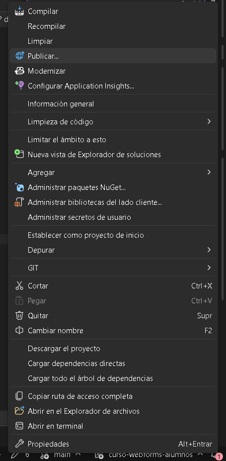

2. En **Destino** elige **Carpeta** y pulsa **Siguiente**. Las otras opciones (Azure, Docker, FTP, Servidor web IIS con Web Deploy) son otras formas de publicar; hoy usamos la más simple.

   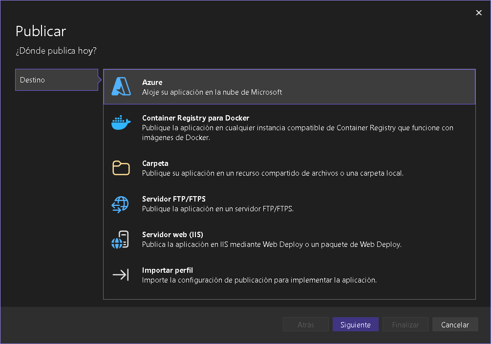

3. En **Ubicación de la carpeta** escribe `C:\sitios\CursoWeb` y pulsa **Finalizar**. La carpeta se crea sola si no existe. El porqué de la ruta está más abajo.

   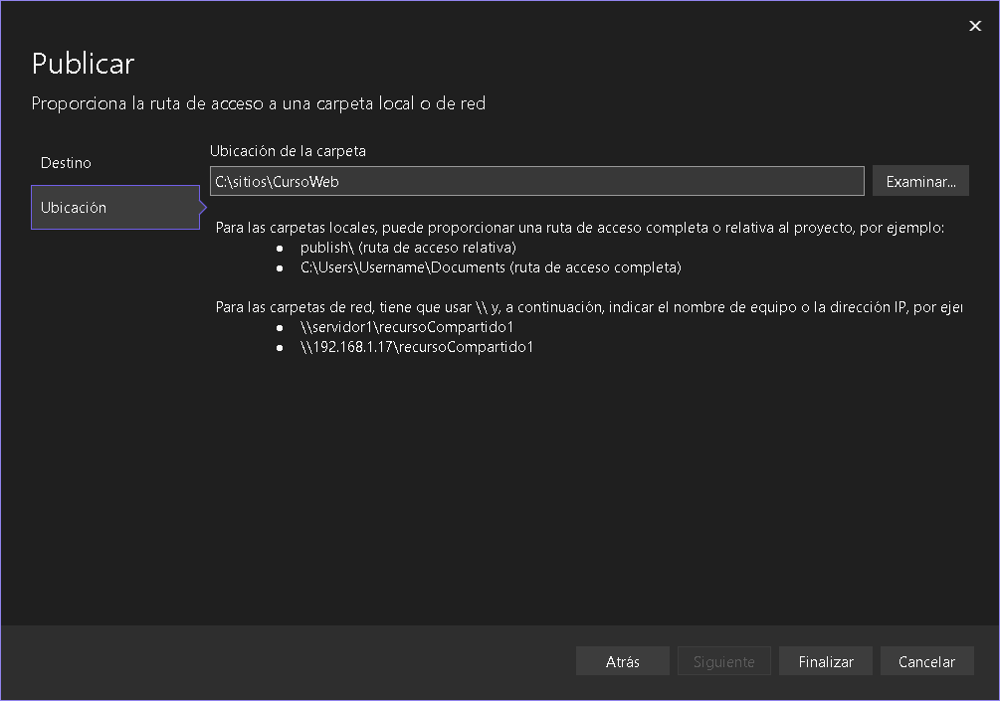

4. Se crea el perfil `FolderProfile.pubxml` y aparece su resumen. Revisa la **Ubicación de destino** y que la **Configuración** diga **Release**. **Eliminar archivos existentes** queda en `false`: al republicar, los archivos que ya no existan en el proyecto se quedan en la carpeta. Pulsa **Publicar**.

   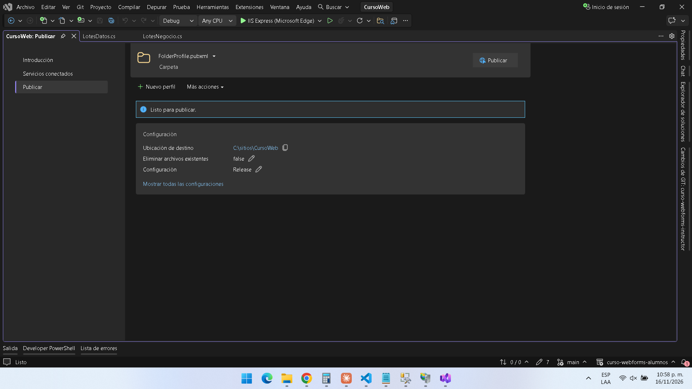

5. Al terminar aparece *La publicación se ha realizado correctamente* y, en la ventana **Salida**, la lista de carpetas publicadas y *Publicación: 1 correctos, 0 con error*.

   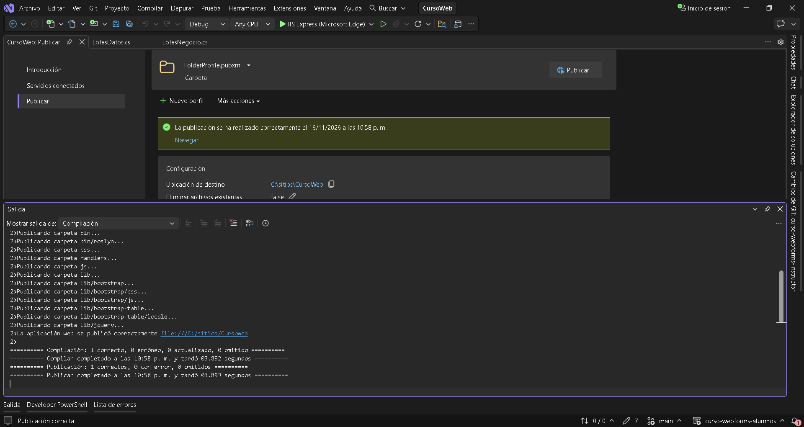

6. Abre `C:\sitios\CursoWeb` en el Explorador de archivos.

   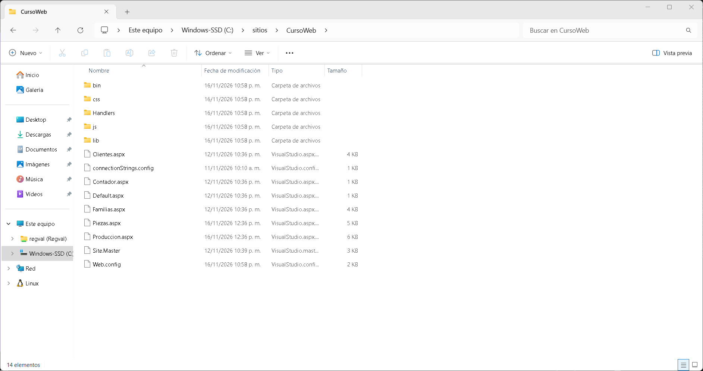

| Qué revisar | Qué debe verse |
|---|---|
| `bin/` | Las DLL del proyecto y de las librerías (`CursoWeb.dll`, `ClosedXML.dll`…) |
| `.aspx`, `.ashx`, `Site.Master` | Sí están |
| Archivos `.cs` | **No** están: ya se compilaron dentro de `CursoWeb.dll` |
| `lib/`, `css/`, `js/` | Sí están |
| `Web.config` | Sin `debug="true"` |
| `connectionStrings.config` | Aparece en esta primera publicación, con la contraseña de desarrollo. No debe quedarse en el servidor: se corrige en la sección 10 |

**¿Por qué `C:\sitios\CursoWeb` y no `C:\inetpub`?**

Al activar IIS, Windows crea `C:\inetpub`. Dentro está `C:\inetpub\wwwroot`, la carpeta del *Default Web Site* (el sitio que IIS trae por omisión, en el puerto 80). En muchos servidores las aplicaciones se publican ahí, en una subcarpeta, así que es normal encontrarlas en esa ruta.

En el curso usamos otra carpeta por tres razones:

| Razón | Explicación |
|---|---|
| Publicar sin ser administrador | Escribir en `C:\inetpub` normalmente exige permisos de administrador. Con `C:\sitios` Visual Studio publica con tu usuario de siempre |
| No mezclar con el sitio por omisión | `C:\inetpub\wwwroot` ya es de otro sitio. Una carpeta propia deja claro qué archivos son de `CursoWeb` y es fácil de borrar y volver a publicar |
| Sacar el contenido web del disco del sistema | Es una recomendación habitual de seguridad para IIS. En un servidor real suele ser otro disco |

La ruta no cambia nada de lo demás: IIS sirve el sitio desde la **Ruta de acceso física** que le indiques, y los permisos se dan sobre esa carpeta, esté donde esté. Si publicas en `C:\inetpub\wwwroot\CursoWeb`, solo cambia esa ruta en el publicar, en el sitio de IIS y en el `icacls`.

## 9. IIS: Application Pool, sitio y permisos de carpeta

📖 [Microsoft: identidades del grupo de aplicaciones](https://learn.microsoft.com/es-es/iis/manage/configuring-security/application-pool-identities) · [Microsoft: permisos de carpeta para la identidad del grupo](https://learn.microsoft.com/es-es/aspnet/web-forms/overview/deployment/visual-studio-web-deployment/setting-folder-permissions)

Necesitas IIS con **ASP.NET 4.8** activado (*Activar o desactivar las características de Windows*) y permisos de administrador. Si no puedes instalarlo, sigue la clase en la pantalla del instructor.

**El Administrador de IIS.** Ábrelo con **Win + R**, escribe `inetmgr` y Enter. Tiene tres zonas: a la izquierda **Conexiones**, el árbol de tu equipo con **Grupos de aplicaciones** y **Sitios** (lo que selecciones ahí es lo que configuras); en el centro, la **página principal** de lo seleccionado, con íconos como *Cadenas de conexión* o *Autenticación*; y a la derecha **Acciones**, los comandos de lo seleccionado. Los íconos y los comandos cambian según selecciones el servidor o un sitio.

La relación entre las dos ramas del árbol es la clave: un **sitio** (dirección, puerto y carpeta) se ejecuta dentro de un **grupo de aplicaciones** (el proceso y la identidad con que corre). Por eso se crean en ese orden: primero el grupo y después el sitio que lo usa.

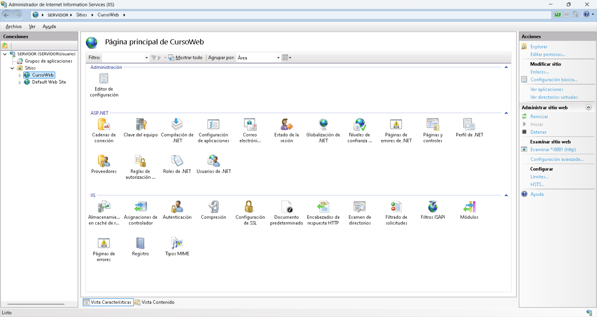

La captura es del sitio `CursoWeb` ya creado, para que veas los íconos y comandos que se usan más adelante. El nombre del equipo se sustituyó por *SERVIDOR*; en tu pantalla verás el tuyo. El otro sitio del árbol, *Default Web Site*, es el que IIS trae por omisión y escucha en el puerto 80.

**Application Pool.** *Administrador de IIS → Grupos de aplicaciones → Agregar grupo de aplicaciones…* (en el panel **Acciones**).

Un **grupo de aplicaciones** es un proceso de Windows (`w3wp.exe`) con su propia identidad y su propia configuración, donde se ejecutan una o más aplicaciones. Dos grupos distintos no se afectan entre sí: si uno falla o se reinicia, el otro sigue. Al abrir **Grupos de aplicaciones** ya hay algunos creados por IIS (`DefaultAppPool`, `.NET v4.5`, `.NET v4.5 Classic`); la lista muestra su estado, versión de .NET, modo de canalización, identidad y cuántas aplicaciones usan cada uno.

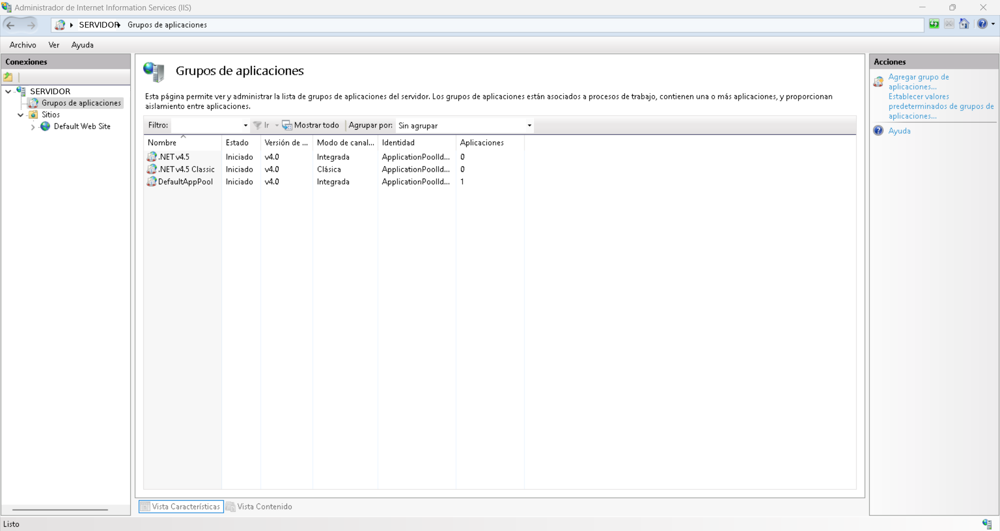

| Campo | Valor | Por qué |
|---|---|---|
| Nombre | `CursoWeb` | La identidad se llamará `IIS AppPool\CursoWeb` |
| Versión de .NET CLR | `.NET CLR versión v4.0.30319` | Es el runtime de **todo** .NET Framework 4.x, incluido el 4.8: el número no cambia entre 4.0 y 4.8. Ver abajo |
| Modo de canalización administrada | **Integrada** | El modo recomendado. Ver la comparación de abajo |
| Iniciar grupo de aplicaciones inmediatamente | Marcado | Queda corriendo al aceptar |

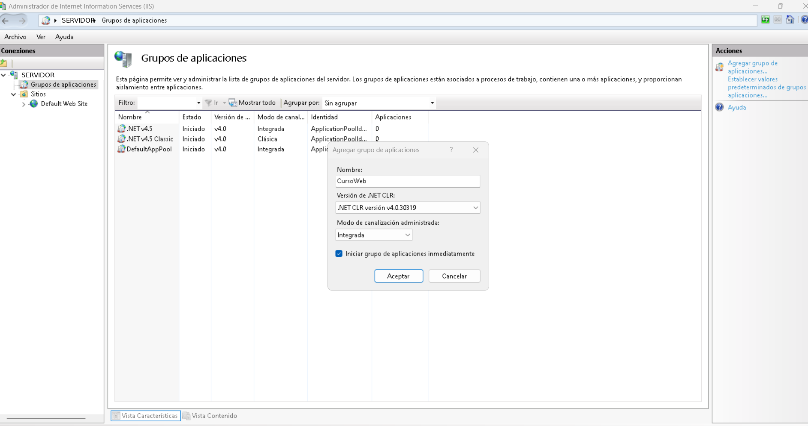

**¿Por qué `v4.0.30319` si usamos .NET 4.8?** Porque .NET Framework 4.0 a 4.8 comparten el mismo CLR (el motor que ejecuta el código): las versiones 4.5, 4.6, 4.7 y 4.8 se instalan encima de la 4.0 y la reemplazan. La lista de IIS dice solo `v4.0`; la versión exacta de .NET Framework la fija `targetFramework="4.8"` en el `Web.config`. Las otras opciones, `v2.0`, son para aplicaciones de .NET 2.0 a 3.5.

**Integrada o Clásica: qué es el modo de canalización.** La *canalización* es el camino que sigue cada petición dentro de IIS (autenticar, autorizar, ejecutar el controlador, responder). El modo dice cómo participa ASP.NET en ese camino:

| | **Integrada** | **Clásica** |
|---|---|---|
| Cómo funciona | ASP.NET está **dentro** de la canalización de IIS: sus módulos corren junto a los de IIS | ASP.NET es una extensión externa (ISAPI, `aspnet_isapi.dll`): IIS le pasa solo las peticiones que reconoce como ASP.NET |
| Qué alcanza | Todas las peticiones, incluso imágenes y archivos estáticos | Solo el contenido ASP.NET |
| Dónde se configuran módulos y controladores | `system.webServer` en el `Web.config` | `system.web` |
| Cuándo se usa | **Siempre que se pueda**: es el predeterminado desde IIS 7 | Solo por compatibilidad con aplicaciones antiguas, por ejemplo las que usan suplantación con `<identity impersonate="true">` |

CursoWeb es una aplicación nueva y no usa nada de eso, así que va en **Integrada**. El modo se define por grupo, así que una aplicación antigua puede vivir en un grupo Clásica en el mismo servidor sin afectar a las demás. 📖 [Microsoft: integración de ASP.NET con IIS](https://learn.microsoft.com/es-es/iis/application-frameworks/building-and-running-aspnet-applications/aspnet-integration-with-iis)

**¿Por qué `ApplicationPoolIdentity`?** La *identidad* es la cuenta de Windows con la que corre el proceso del grupo: todo lo que la aplicación hace (leer archivos, conectarse a SQL Server) lo hace con esa cuenta. Se ve en *Configuración avanzada → Modelo de proceso → Identidad*, y IIS ofrece varias:

| Identidad | Qué es | Problema o ventaja |
|---|---|---|
| `NetworkService` | Cuenta integrada de Windows, sin contraseña y con privilegios limitados. Era la predeterminada en IIS 6.0 y 7.0 | **La comparten otros servicios de Windows y otros grupos**: si una aplicación se compromete, tiene los mismos permisos que todos los demás que usan esa cuenta |
| **`ApplicationPoolIdentity`** | Una cuenta **virtual** que IIS crea **por cada grupo**, con el nombre del grupo: `IIS AppPool\CursoWeb`. Es la predeterminada desde IIS 7.5 | **Aislamiento**: cada grupo tiene su propia identidad, así que se le dan permisos solo a él. **Sin contraseña** que crear ni guardar. **Mínimo privilegio** por defecto |
| Cuenta personalizada | Una cuenta de Windows o de dominio que tú indicas (aquí entra la gMSA de la sección 10) | La eliges cuando la identidad debe existir fuera de este equipo, por ejemplo para entrar a un SQL Server en otro servidor |

Por eso la dejamos en `ApplicationPoolIdentity`: es lo más seguro sin configurar nada. La consecuencia: **conviene darle permisos explícitos y mínimos** en la carpeta y en SQL Server (secciones 9 y 10), en lugar de depender de lo que la carpeta herede. No es un usuario real: no aparece en la administración de usuarios de Windows, pero sí puedes escribir su nombre al asignar permisos. 📖 [Microsoft: identidades del grupo de aplicaciones](https://learn.microsoft.com/es-es/iis/manage/configuring-security/application-pool-identities)

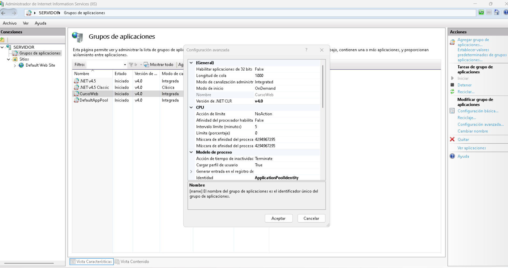

**Sitio.** *Sitios → Agregar sitio web…* (clic derecho en **Sitios**, o el panel **Acciones**). Un **sitio** es la dirección (puerto y nombre) y la carpeta que IIS responde, y se ejecuta dentro de un grupo de aplicaciones.

| Campo | Valor | Qué es |
|---|---|---|
| Nombre del sitio | `CursoWeb` | El nombre que verás en IIS. No afecta la dirección |
| Grupo de aplicaciones | `CursoWeb` | El grupo que creaste. Como el sitio se llama igual, IIS lo propone solo; con **Seleccionar…** puedes cambiarlo |
| Ruta de acceso física | `C:\sitios\CursoWeb` | La carpeta publicada |
| Tipo | `http` | Sin certificado. En un servidor real sería `https` |
| Dirección IP | Todas las no asignadas | Responde por cualquier dirección del equipo |
| Puerto | `8081` | El 80 ya lo usa *Default Web Site*; dos sitios no pueden compartir puerto sin otro nombre de host |
| Nombre de host | Vacío | Solo hace falta para varios sitios en el mismo puerto |
| Iniciar sitio web inmediatamente | Marcado | Queda corriendo al aceptar |

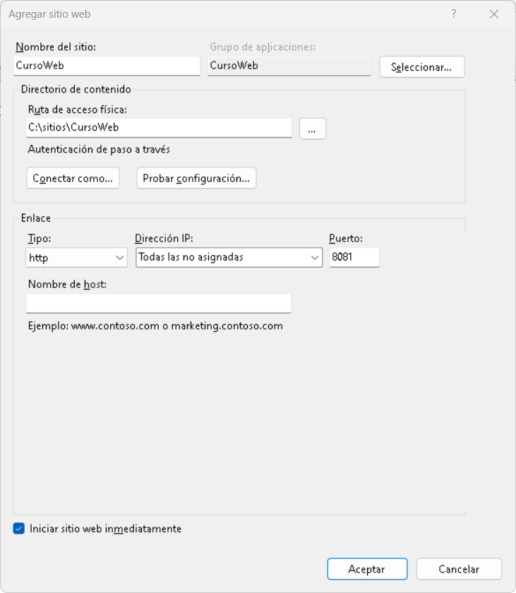

**Seleccionar…** abre una lista de grupos y muestra sus propiedades: aquí se confirma que `CursoWeb` es `.NET CLR 4.0` en modo **Integrada**.

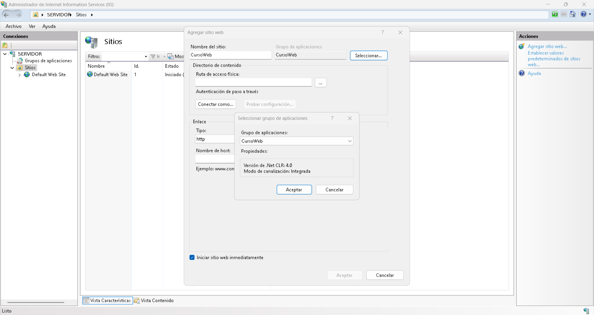

**Conectar como… y Probar configuración…** (opcional). *Conectar como…* define con qué credenciales lee IIS la carpeta. Se deja en **Usuario de la aplicación (autenticación de paso a través)**: IIS lee los archivos con **la identidad del grupo de aplicaciones**, la misma de la sección anterior. La otra opción, *Usuario específico*, sirve cuando el contenido está en un recurso de red que pide otras credenciales.

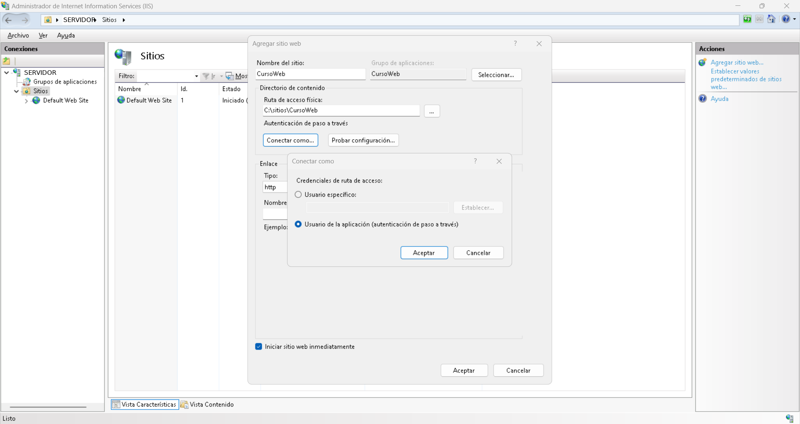

*Probar configuración…* revisa dos cosas. **Autenticación**: confirma que la identidad del grupo es válida (en nuestra prueba, correcto). **Autorización**: intenta comprobar que esa identidad puede entrar a la carpeta; en nuestra prueba mostró una **advertencia**: *«No se puede verificar el acceso a la ruta de acceso»*. Es una advertencia, no un error: no impidió que el sitio funcionara.

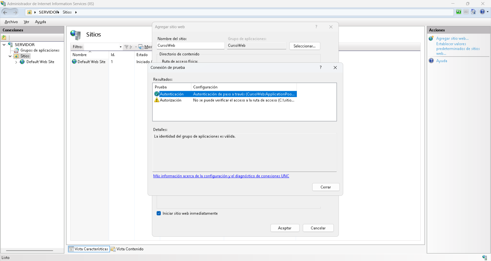

### Permisos de la carpeta

Tres identidades distintas tocan la carpeta publicada, cada una con un permiso distinto:

| Quién | Para qué | Permiso |
|---|---|---|
| El grupo de aplicaciones: `IIS AppPool\CursoWeb` | Lee el `web.config` y ejecuta la aplicación | **Lectura y ejecución** |
| El usuario **anónimo** del sitio (`IUSR` por omisión) | IIS comprueba con él que el visitante puede pedir cada archivo | **Lectura y ejecución**, o usar la identidad del grupo (ver abajo) |
| **Tú**, quien publica | Visual Studio copia los archivos | **Modificar** |

La aplicación **no** necesita escribir en su propia carpeta: por eso ni el grupo ni el anónimo llevan escritura.

**1. Mira qué permisos trae la carpeta.** Clic derecho en `C:\sitios\CursoWeb` → *Propiedades → Seguridad*.

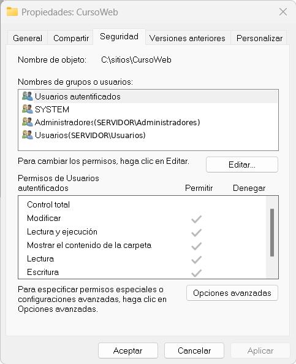

En *Opciones avanzadas* la columna **Heredada de** dice `C:\`: la carpeta recibió estos permisos de la raíz del disco.

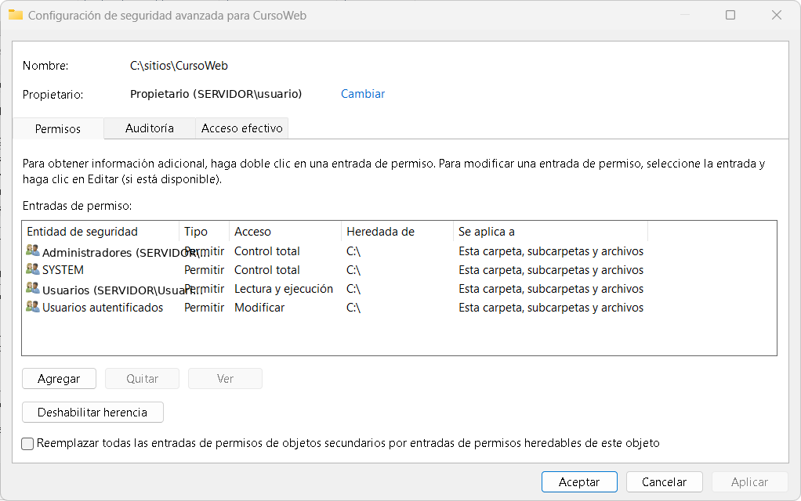

Por eso **el sitio ya abre sin que hayas dado ningún permiso**: el grupo de aplicaciones entra por los permisos heredados de *Usuarios* o *Usuarios autenticados*. Pero hay un problema de seguridad: *Usuarios autenticados* tiene **Modificar**, así que cualquier cuenta autenticada del equipo —y la propia aplicación— podría escribir en la carpeta del sitio. En un servidor no debemos depender de eso: damos permisos **explícitos y mínimos**.

**2. Quita la herencia.** *Opciones avanzadas → Deshabilitar herencia → Convertir los permisos heredados en permisos explícitos en este objeto*. Quita **Usuarios** y **Usuarios autenticados** (deja *Administradores* y *SYSTEM*) y acepta.

Recarga el sitio con **Ctrl+F5**: ahora sí falla, y es el error que queremos reconocer. **HTTP 500.19**, código `0x80070005`: *«No se puede leer el archivo de configuración porque los permisos son insuficientes»* sobre `web.config`. El grupo de aplicaciones ya no puede leer la carpeta.

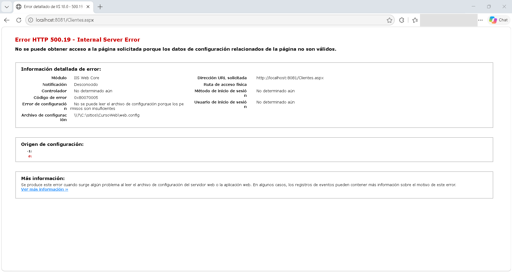

**3. Da permiso al grupo de aplicaciones, desde IIS.** En el Administrador de IIS selecciona el sitio **CursoWeb** → **Editar permisos…** (panel **Acciones**) → *Seguridad → Editar… → Agregar…*. Escribe `IIS AppPool\CursoWeb` **a mano** y pulsa **Comprobar nombres**; con *Ubicaciones* en tu equipo, no en un dominio. Deja marcados **Lectura y ejecución**, **Mostrar el contenido de la carpeta** y **Lectura**.

- **No uses *Avanzadas → Buscar ahora*:** la identidad del grupo es virtual y no aparece en esa lista. Escríbela.
- **Hazlo desde IIS, no desde el Explorador de archivos.** El Administrador de IIS corre como administrador. Con la herencia quitada, el Explorador (sin elevar) no puede recorrer la carpeta y el permiso no se guarda: *«Error al enumerar objetos en el contenedor. Se ha denegado el acceso»*.
- En la lista de seguridad la identidad aparece solo como **CursoWeb**, sin el prefijo `IIS AppPool\`.

**4. Da permiso a quien publica.** En la misma ventana agrega **tu usuario de Windows** con **Modificar**. Sin esto, Visual Studio ya no puede copiar los archivos a la carpeta y publicar falla por permisos: es la consecuencia directa de haber quitado los permisos amplios. Con tu usuario agregado, Visual Studio vuelve a publicar sin error.

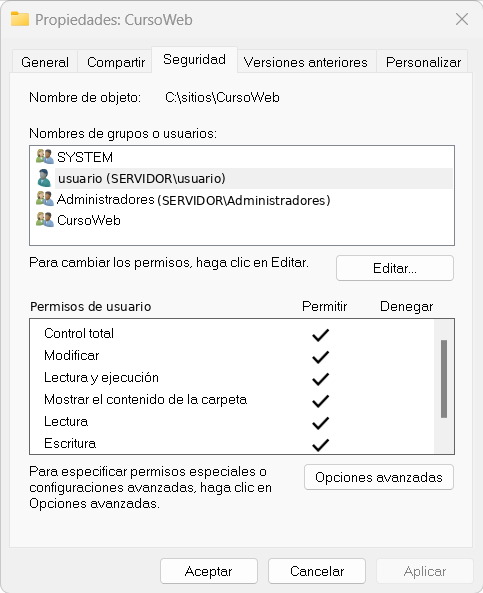

**5. Haz que el visitante anónimo pueda entrar.** Recarga `Clientes.aspx`: ahora el error es otro, **401.3** (*«acceso denegado por las listas de Access Control»*). Es otra comprobación: el grupo de aplicaciones ya lee la carpeta, pero IIS comprueba el acceso al archivo con el usuario **anónimo**.

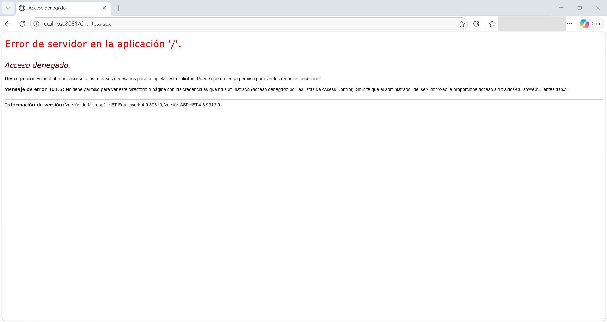

En IIS: sitio **CursoWeb** → ícono **Autenticación** → **Autenticación anónima** → **Modificar…**. Por omisión está en **Usuario específico: `IUSR`**, que no está en la lista de permisos.

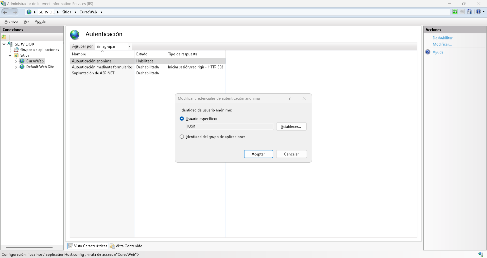

Hay dos salidas:

| Opción | Qué se hace | Ventaja | Desventaja |
|---|---|---|---|
| **A** | Dar **Lectura y ejecución** a `IUSR` en la carpeta | IIS queda como viene | Dos identidades con permisos; `IUSR` la comparten los sitios que la usen |
| **B** (la del curso) | Marcar **Identidad del grupo de aplicaciones** en la autenticación anónima | **Una sola identidad** con permisos, aislada por sitio | Te sales del valor por omisión de IIS |

En el curso usamos la **B**, y con ella el sitio vuelve a cargar con estilos y datos.

**¿Y `icacls`?** Todo lo anterior también se hace por línea de comandos. Si en tu trabajo prefieres un script, el permiso del grupo de aplicaciones es este, en PowerShell como administrador:

```powershell
icacls "C:\sitios\CursoWeb" /grant "IIS AppPool\CursoWeb:(OI)(CI)RX"
```

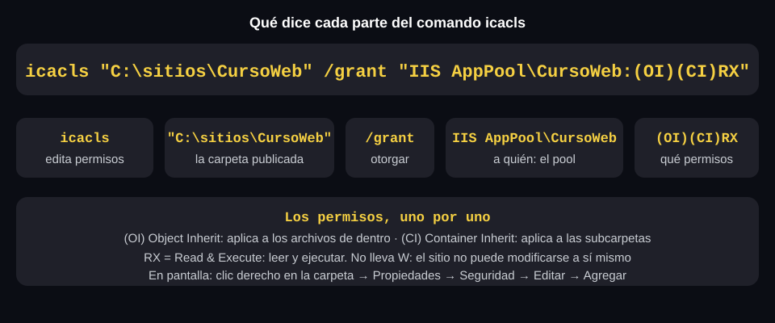

`(OI)(CI)` hace que el permiso se herede a archivos y subcarpetas, y `RX` es *leer y ejecutar*. En el curso no lo usamos.

## 10. SQL Server: con qué identidad entra la aplicación

📖 [Microsoft: `CREATE LOGIN`](https://learn.microsoft.com/es-es/sql/t-sql/statements/create-login-transact-sql) · [Microsoft: `GRANT` permisos de esquema](https://learn.microsoft.com/es-es/sql/t-sql/statements/grant-schema-permissions-transact-sql) · [Microsoft: gMSA (resumen)](https://learn.microsoft.com/es-es/windows-server/security/group-managed-service-accounts/group-managed-service-accounts-overview)

Hasta ahora la aplicación entraba a la base con `usrCursoWeb`, un **usuario de SQL Server** con contraseña en `connectionStrings.config`. En producción hay que decidir **con qué identidad** entra, y la respuesta depende de dónde está IIS, dónde está SQL Server y si hay dominio.

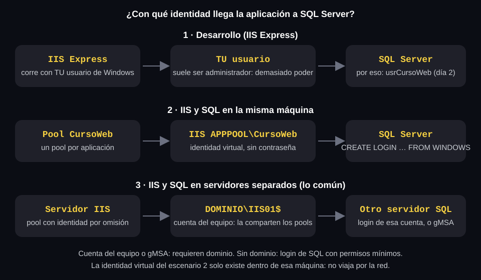

### ¿Por qué usamos `usrCursoWeb` desde el día 2?

En desarrollo, IIS Express corre **con tu usuario de Windows**, que suele ser administrador. Si la cadena usara `Integrated Security`, la aplicación entraría a la base como administrador: si alguien lograra inyectar SQL, tendría todo ese poder. Por eso en el día 2 creamos un usuario propio con lo mínimo: `SELECT`, `INSERT` y `UPDATE`, sin `DELETE`.

En IIS la situación cambia: el pool corre con **su propia identidad**, que no es la tuya ni es administradora. Ya existe una identidad de Windows con pocos privilegios, así que `Integrated Security` deja de ser peligrosa y **evita guardar una contraseña**. Las dos formas que siguen son las dos maneras de resolverlo.

### ¿Por qué hay que crear un login si ya existe el archivo de conexión?

La cadena de conexión solo dice **a quién** se conecta la aplicación (servidor y base) y **cómo** se identifica. No le da permisos a nadie. SQL Server decide quién entra con sus propios logins:

- Con `User ID` y `Password`, la aplicación se identifica como ese login de SQL (`usrCursoWeb`), que ya existe.
- Con `Integrated Security=SSPI`, SQL Server recibe **la identidad de Windows con la que corre la aplicación** (en IIS, la del pool). Esa identidad **no existe** en SQL Server hasta que la das de alta: de ahí el `CREATE LOGIN … FROM WINDOWS`.

### Forma A · Identidad de Windows (sin contraseña en el archivo)

**A1. IIS y SQL Server en la misma máquina** (nuestro caso en clase). En SSMS, como administrador:

```sql
USE master;
GO
CREATE LOGIN [IIS APPPOOL\CursoWeb] FROM WINDOWS;
GO

USE CursoWeb;
GO
CREATE USER [IIS APPPOOL\CursoWeb] FOR LOGIN [IIS APPPOOL\CursoWeb];
GRANT SELECT, INSERT, UPDATE ON SCHEMA::dbo TO [IIS APPPOOL\CursoWeb];
GO
```

| Pieza | Qué hace | Por qué |
|---|---|---|
| `CREATE LOGIN … FROM WINDOWS` | Da de alta en el **servidor** a una identidad de Windows | No hay contraseña que guardar ni filtrar |
| `CREATE USER … FOR LOGIN` | La mapea a un usuario **dentro de la base** | Login = entrar al servidor; usuario = estar en una base |
| `GRANT SELECT, INSERT, UPDATE ON SCHEMA::dbo` | Los mismos permisos de `usrCursoWeb` | Mínimo privilegio, sin `DELETE`. Cubre también la tabla `Lotes` |

Escribe el nombre del login a mano; no uses el botón de búsqueda de SSMS, que no encuentra estas identidades virtuales.

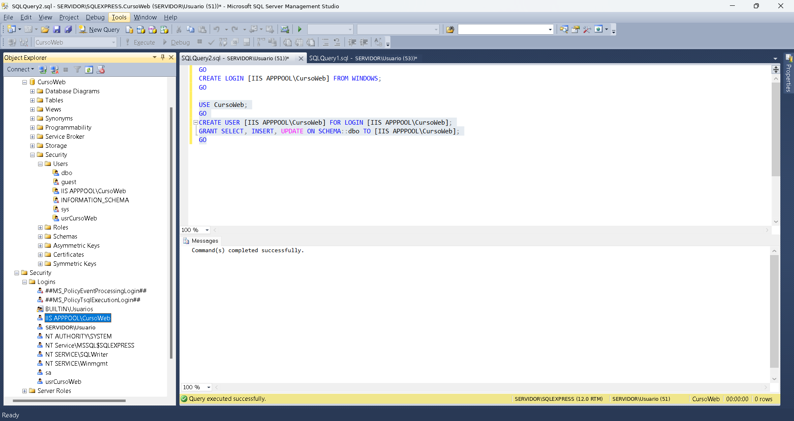

**Una cadena para depurar y otra para publicar.** Al depurar (F5) la aplicación entra con `usrCursoWeb`; publicada, entra con la identidad del pool. Son dos cadenas, y la segunda no se debe editar a mano en el servidor: cada publicación pisaría el cambio. Se resuelve con las **transformaciones de `Web.config`**: el proyecto trae `Web.Debug.config` y `Web.Release.config`, y Visual Studio aplica el de la configuración con que publicas (**Release**) al `Web.config` que copia al destino.

📖 [Microsoft: transformación de `Web.config`](https://learn.microsoft.com/es-es/previous-versions/dd465326(v=vs.110))

1. Abre `Web.Release.config` y agrega, dentro de `<configuration>`, junto a `<system.web>`:

   ```xml
   <connectionStrings xdt:Transform="Replace">
     <add name="CursoWeb"
          connectionString="Data Source=.\SQLEXPRESS;Initial Catalog=CursoWeb;Integrated Security=SSPI"
          providerName="System.Data.SqlClient"/>
   </connectionStrings>
   ```

   `Replace` cambia el elemento `<connectionStrings>` completo. Por eso desaparece el `configSource` y la cadena queda escrita dentro del `Web.config` publicado. Esta cadena **no lleva contraseña**, así que puede vivir en un archivo que sí se sube a Git.

2. En el Explorador de soluciones selecciona `connectionStrings.config`, abre **Propiedades** (F4) y cambia **Acción de compilación** a **Ninguno**. El archivo sigue en el proyecto y `Web.config` lo sigue leyendo al depurar, pero Visual Studio deja de copiarlo al publicar.

3. Borra a mano la copia vieja `C:\sitios\CursoWeb\connectionStrings.config`: publicar no elimina archivos (**Eliminar archivos existentes** está en `false`).

4. Publica de nuevo en **Release**.

5. Abre `C:\sitios\CursoWeb\Web.config`: debe traer la cadena con `Integrated Security=SSPI` dentro de `<connectionStrings>`, sin `configSource`. Y `connectionStrings.config` **no** debe estar en la carpeta.

Con esto, depurar con F5 sigue funcionando con `usrCursoWeb`, y la aplicación publicada entra con `IIS APPPOOL\CursoWeb`. `Web.Debug.config` no se toca: Visual Studio aplica las transformaciones **solo al publicar**; con F5 usa el `Web.config` tal cual, por eso la cadena de depuración se queda en `connectionStrings.config`.

**A2. IIS y SQL Server en servidores separados** (lo habitual en una empresa). La identidad virtual `IIS APPPOOL\CursoWeb` **solo existe dentro del servidor IIS**: SQL Server, en otra máquina, no la conoce. Cuando el pool sale por la red, SQL Server recibe la **cuenta del equipo** IIS, con el formato `DOMINIO\IIS01$`, que **comparten todos los pools** de ese servidor. Esto solo funciona si **ambos servidores están en un dominio**. Hay dos caminos:

| Camino | Qué se da de alta en SQL | Ventaja | Desventaja |
|---|---|---|---|
| Cuenta del equipo (`DOMINIO\IIS01$`) | `CREATE LOGIN [DOMINIO\IIS01$] FROM WINDOWS` | No hay que configurar nada más en IIS | Todas las aplicaciones de ese servidor entran con los mismos permisos |
| **Cuenta de servicio dedicada**, de preferencia una **gMSA** | `CREATE LOGIN [DOMINIO\svc_cursoweb$] FROM WINDOWS` | Cada aplicación tiene su propia identidad y permisos; la contraseña la administra el dominio | Requiere Active Directory y más preparación |

Una **gMSA** (*cuenta de servicio administrada de grupo*) es una cuenta de dominio cuya contraseña Windows genera y rota sola: no se escribe en ningún archivo ni la conoce nadie. Requiere Active Directory y **no existe en un equipo fuera del dominio**. Los pasos generales, que **se explican y no se practican hoy**:

```powershell
# En el controlador de dominio (una vez por dominio)
Add-KdsRootKey -EffectiveImmediately

# Crear la cuenta y decir qué servidores pueden usarla
New-ADServiceAccount -Name svc_cursoweb -DNSHostName svc_cursoweb.dominio.local `
    -PrincipalsAllowedToRetrieveManagedPassword "ServidoresWeb"

# En el servidor IIS
Install-ADServiceAccount svc_cursoweb
Test-ADServiceAccount svc_cursoweb
```

Después: en el pool, *Configuración avanzada → Identidad → Cuenta personalizada* con `DOMINIO\svc_cursoweb$` y la contraseña en blanco; permiso de lectura de la carpeta para esa cuenta (el `icacls` de la sección 9 con su nombre); y el `CREATE LOGIN`, `CREATE USER` y `GRANT` de arriba con su nombre. La cadena de conexión queda igual: `Integrated Security=SSPI`.

Los detalles cambian según el dominio de tu empresa (nombres, grupos, tiempos de replicación de la clave): consulta con quien administre el Active Directory antes de hacerlo.

### Forma B · Login de SQL Server con permisos mínimos (sin dominio, o cuando no hay otra opción)

Si IIS **no está en un dominio**, una identidad de Windows no viaja de un servidor a otro y la Forma A deja de ser una opción. Se queda lo que ya conoces: el login de SQL `usrCursoWeb`. Para que sea responsable en producción:

| Medida | Qué hacer |
|---|---|
| Contraseña fuerte | `CHECK_POLICY = ON` y una contraseña larga y distinta a la de desarrollo |
| Permisos mínimos | Los mismos `GRANT SELECT, INSERT, UPDATE ON SCHEMA::dbo`, sin `DELETE` |
| Cadena cifrada | Cifrar la sección `connectionStrings` del `Web.config` publicado, para que la contraseña no quede en texto plano |
| Conexión cifrada | Agregar `Encrypt=True` a la cadena si SQL Server está en otro servidor, para que el tráfico no viaje en claro |

Para cifrar la sección, en el servidor y como administrador, desde la carpeta de .NET Framework (`C:\Windows\Microsoft.NET\Framework64\v4.0.30319`):

```powershell
.\aspnet_regiis -pe "connectionStrings" -app "/" -site "CursoWeb"
```

📖 [Microsoft: cifrar información de configuración con configuración protegida](https://learn.microsoft.com/es-es/previous-versions/dtkwfdky(v=vs.140))

El cifrado está ligado al equipo donde se hace: un `Web.config` cifrado en un servidor no se puede descifrar en otro.

En esta forma la contraseña **no** puede ir en `Web.Release.config`, porque ese archivo sí se sube a Git. La cadena de producción se escribe en el `Web.config` publicado, en el servidor, y ahí se cifra. ⚠ Sin probar: cada publicación vuelve a escribir `Web.config`, así que habría que repetir el cifrado o publicar sin sobrescribirlo.

### ¿Cuál usar?

| Situación | Recomendación |
|---|---|
| IIS y SQL en la misma máquina (el curso) | **A1**: identidad del pool |
| Servidores separados **con dominio** | **A2** con gMSA; si no se puede, con la cuenta del equipo |
| Servidores separados **sin dominio** | **B** |
| No sabes si hay dominio | Pregúntalo a quien administre la red: de eso depende todo lo anterior |

En los tres casos la regla es la misma: **permisos mínimos y sin `DELETE`**. Lo que cambia es **quién** es la identidad y **dónde** vive su contraseña (en ningún lado, con Windows; en un archivo cifrado, con SQL).

Si al abrir la aplicación publicada aparece *Login failed for user 'IIS APPPOOL\CursoWeb'*, revisa que el login se creó con el nombre exacto del grupo de aplicaciones.

## 11. Probar la aplicación publicada y qué sigue

Abre `http://localhost:8081/`. La aplicación corre **sin Visual Studio**.

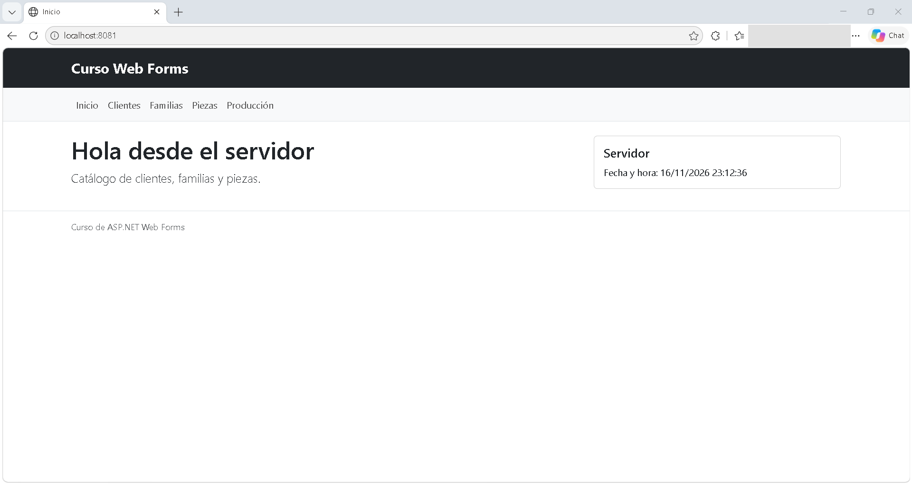

1. `Default.aspx` carga el menú con estilos.
2. Clientes lista, guarda, edita y elimina.
3. **Exportar a Excel** en Piezas y en Producción descarga el archivo, con y sin filtro.
4. Producción registra un lote y lo muestra en la tabla.
5. F12 → Network: las llamadas a los handlers regresan 200.

| Síntoma | Qué revisar |
|---|---|
| **HTTP 500.19** con código `0x80070005` | El grupo de aplicaciones no puede leer la carpeta: permisos de `IIS AppPool\CursoWeb` (sección 9). Si el código es otro, ASP.NET 4.8 activado y el pool en `v4.0.30319` |
| **401.3** *acceso denegado por las listas de Access Control* | El usuario anónimo (`IUSR`) no puede leer el archivo: dale permiso o usa la identidad del grupo (sección 9, paso 5) |
| *Error al enumerar objetos en el contenedor* al guardar permisos | Guárdalos desde IIS (**Editar permisos…**), que corre como administrador |
| Visual Studio no puede publicar | Tu usuario necesita **Modificar** en la carpeta publicada |
| La tabla sale vacía y hay un 500 en Network | La cadena de conexión publicada y el login: busca *Login failed for user 'IIS APPPOOL\CursoWeb'* |
| «Ocurrió un error en el servidor» | Es el `catch` del handler: con `debug="false"` no muestra el detalle. Prueba con `usrCursoWeb` |
| Estilos o scripts no cargan | Que `lib/`, `css/` y `js/` estén en la carpeta publicada |
| «No se puede cargar el archivo o ensamblado» | Que `bin/` tenga las DLL de ClosedXML |
| Producción falla con un error de tabla | Que `sql/04-lotes.sql` se ejecutó en la base `CursoWeb` |

**Qué sigue.** El mismo `Listar()` de Clientes con Entity Framework 6 en lugar de ADO.NET, las migraciones de base de datos y Web API 2 como forma moderna de hacer lo que hicimos con los `.ashx`. No se instala nada hoy: queda como camino para seguir aprendiendo.
