# Guía de instalación

Termina esta guía **antes del día 1** y envía una captura de pantalla con Visual Studio, SSMS y el administrador de IIS abiertos.

> No necesitas crear la base de datos: la construiremos juntos durante el curso.

> Necesitas **permisos de administrador** en tu equipo. Sin ellos no podrás instalar IIS ni publicar la aplicación el día 6.

## 0. Requisitos del equipo

Durante el curso tendrás abiertos al mismo tiempo Visual Studio, SQL Server, el navegador y la videollamada, así que el equipo debe aguantar todo junto.

| Componente | Mínimo | Recomendado |
|---|---|---|
| Sistema operativo | Windows 10 de 64 bits | Windows 11 de 64 bits |
| Procesador | 4 núcleos | 6 núcleos o más |
| Memoria RAM | 8 GB | 16 GB |
| Disco | 40 GB libres | 40 GB libres en SSD |
| Pantalla | 1920 × 1080 | **Dos monitores**: uno para ver al instructor y otro para programar |
| Internet | 10 Mbps estables | Conexión por cable de preferencia|
| Audio | Audífonos con micrófono | Diadema con micrófono |

Verifica la versión de Windows, la arquitectura y la RAM en *Configuración → Sistema → Información*:

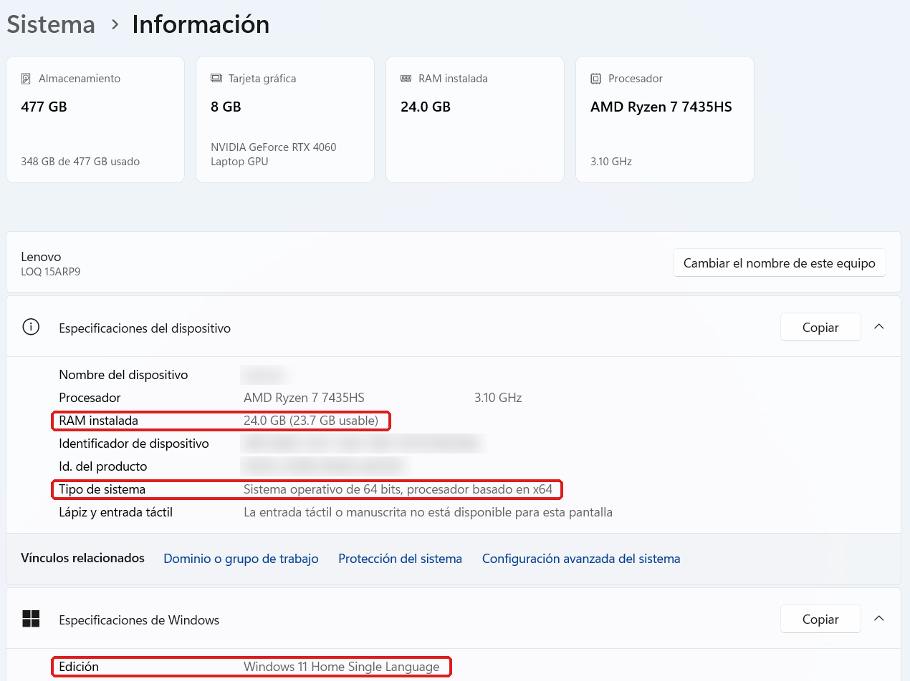

Los núcleos del procesador y el tipo de disco (SSD o HDD) en *Administrador de tareas (Ctrl + Shift + Esc) → Rendimiento*:

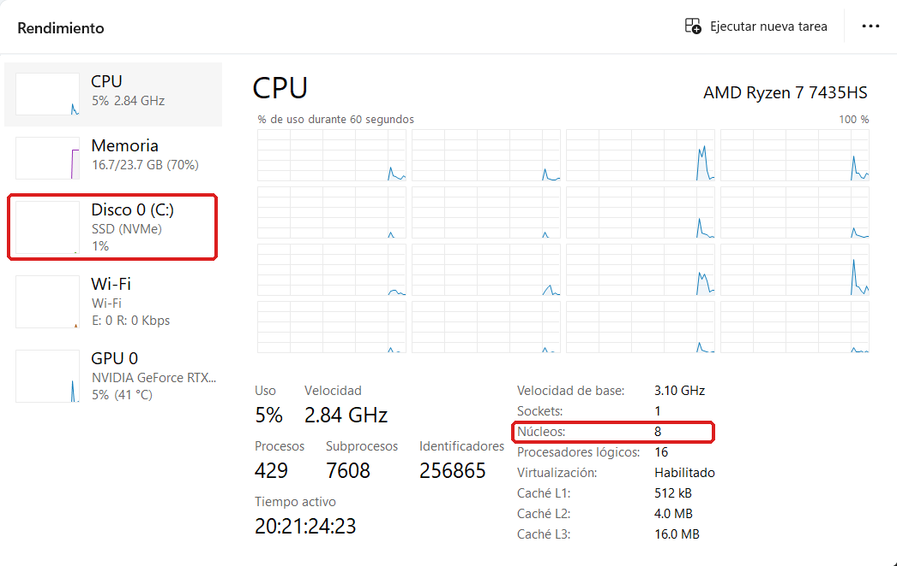

El espacio libre en disco lo ves en el *Explorador de archivos → Este equipo*, debajo de la unidad C:.

> Con 8 GB de RAM funciona, pero cierra todo lo que no uses durante la sesión. Si tu equipo está por debajo del mínimo, avisa al instructor antes del curso.

## 1. Visual Studio 2022 o 2026 (Community o superior)

En el instalador marca la carga de trabajo **Desarrollo de ASP.NET y web** (en Visual Studio 2022 se llama *ASP.NET y desarrollo web*).

> Web Forms no aparece por nombre: se instala con los componentes de **.NET Framework** de esta carga de trabajo. Revísalos en el panel derecho, *Detalles de la instalación*.

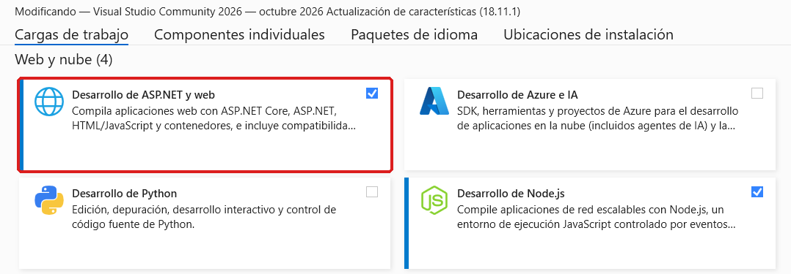

En *Componentes individuales* busca `.NET Framework` y verifica que estén marcados:

- **Plantillas de proyecto y de elemento de .NET Framework** ← *no viene marcado por defecto; sin él no aparece la plantilla de Web Forms*
- Paquete de compatibilidad de .NET Framework 4.8
- SDK de .NET Framework 4.8

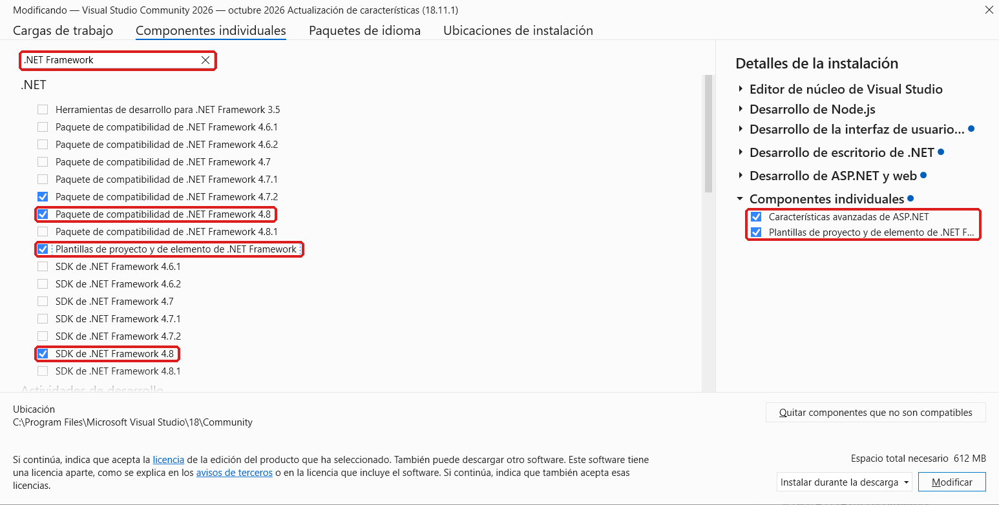

Verificación: *Archivo → Nuevo → Proyecto* y busca **Aplicación web ASP.NET (.NET Framework)** (*ASP.NET Web Application (.NET Framework)* si tu Visual Studio está en inglés). Debe aparecer:

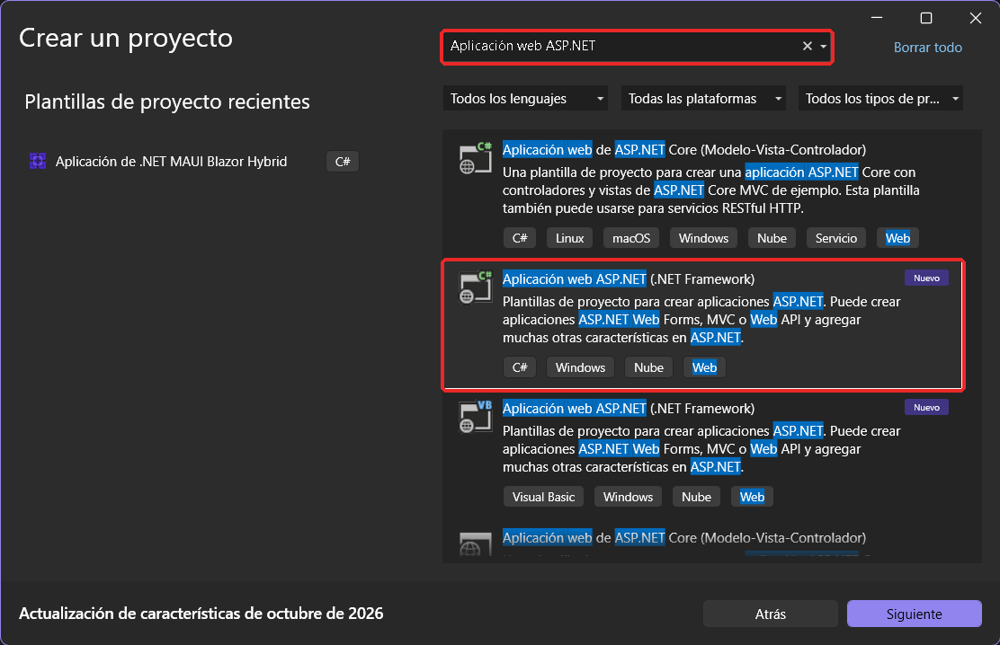

> Usa la plantilla con la etiqueta **C#** y que diga **(.NET Framework)**. No confundir con la de *Visual Basic* ni con las de *ASP.NET Core*.

## 2. SQL Server Express y SSMS

> **Descarga la versión en inglés (ENU).** El instalador en español solo funciona si Windows está en español de España; con español de México marca este error:
>
> 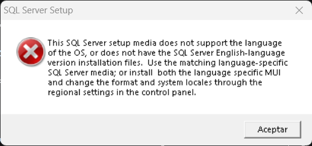
>
> El idioma del instalador no afecta en nada al curso.

### 2.1 Descarga

En la página de descarga de SQL Server Express cambia el idioma a **English**, haz clic en *Download* y marca:

- `SQLEXPR_x64_ENU.exe` (motor de base de datos)
- `SQLManagementStudio_x64_ENU.exe` (SSMS)

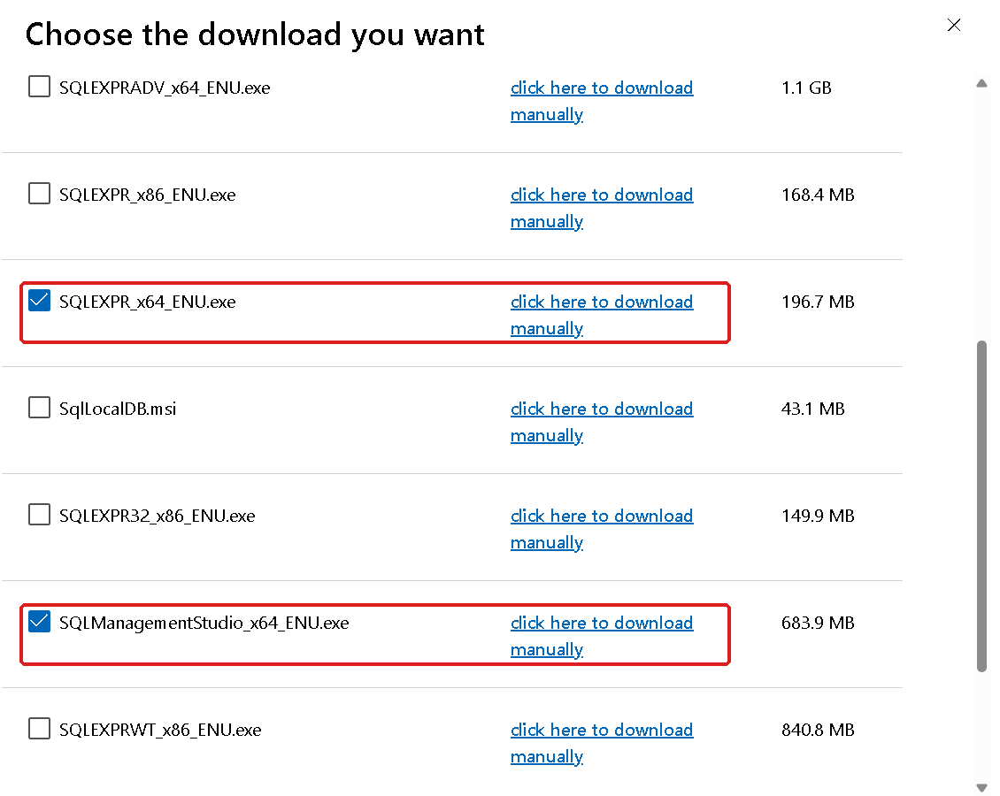

### 2.2 Motor de base de datos

Ejecuta `SQLEXPR_x64_ENU.exe` y en *SQL Server Installation Center* elige **New SQL Server stand-alone installation**:

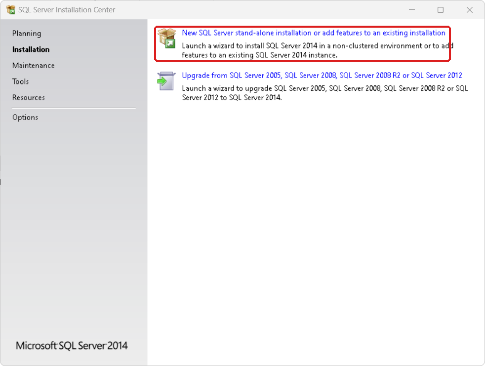

Acepta la licencia:

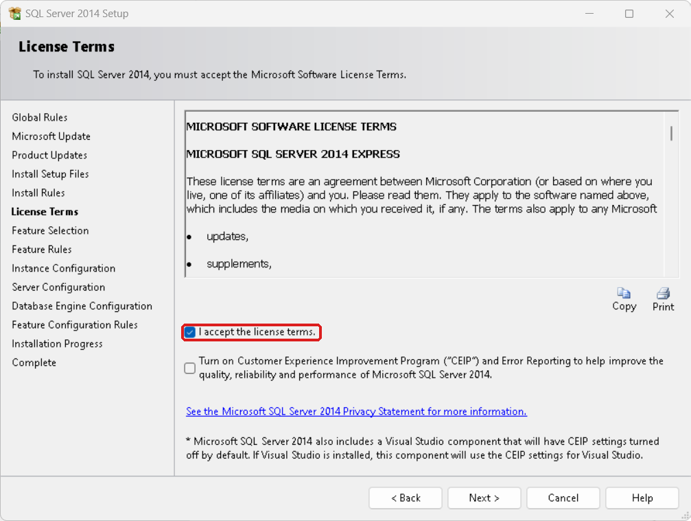

En *Feature Selection* deja marcado **Database Engine Services**:

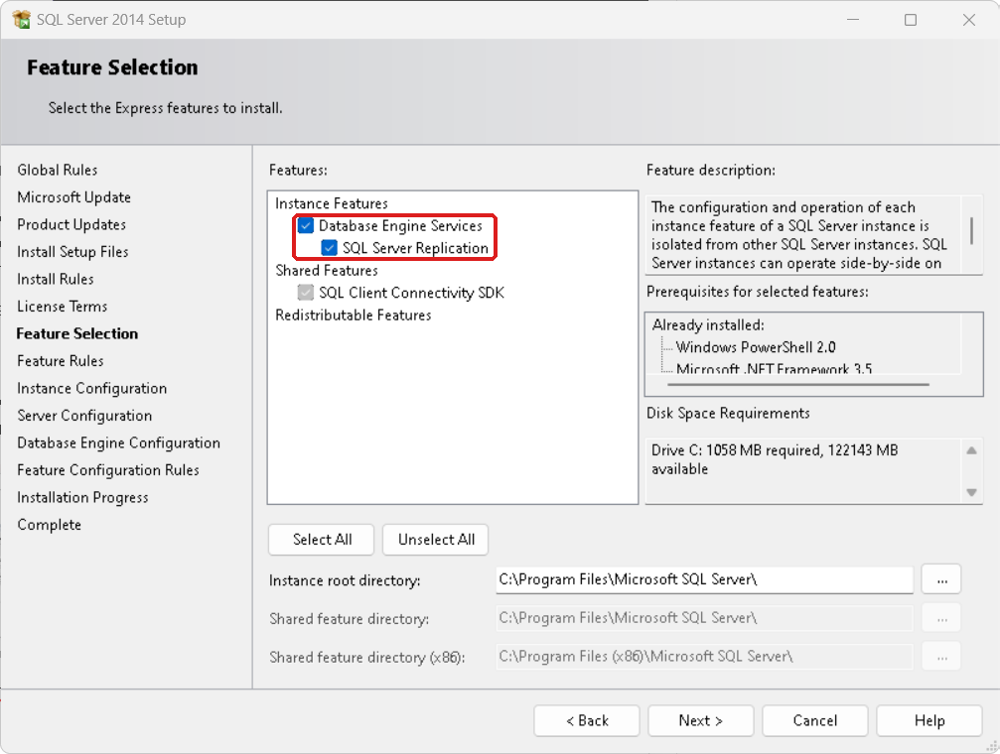

En *Instance Configuration* deja la instancia con nombre **SQLExpress**. Con ella te conectarás como `.\SQLEXPRESS`:

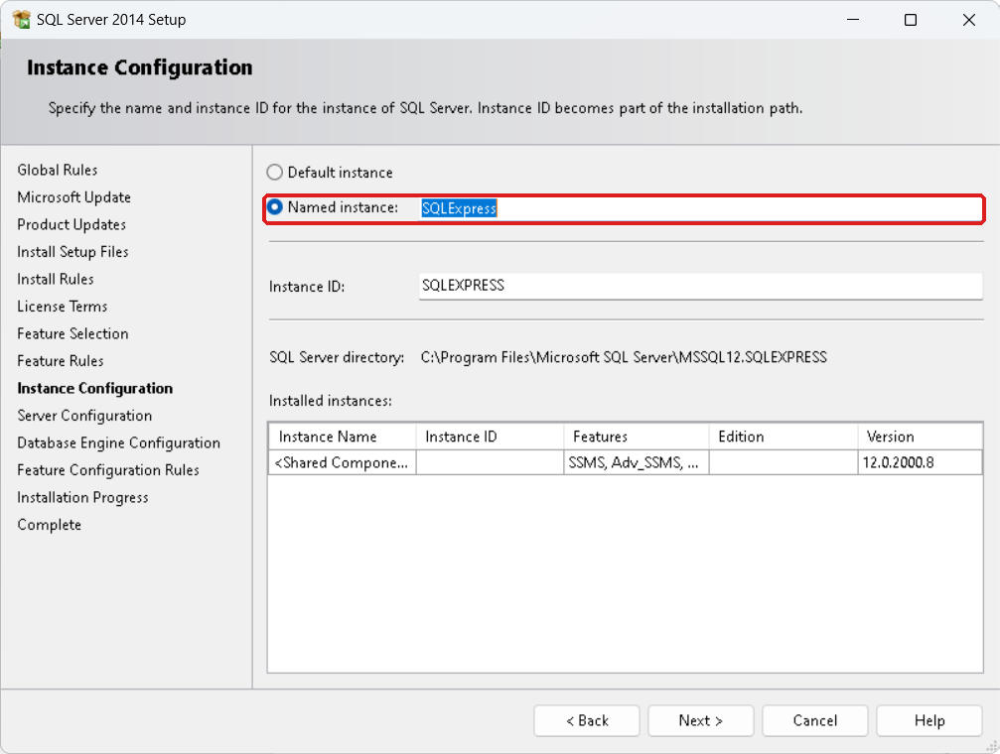

En *Server Configuration* deja los valores por defecto y continúa.

En *Database Engine Configuration* elige **Mixed Mode**, escribe una contraseña para `sa` que recuerdes y verifica que tu usuario aparezca como administrador (si no, usa **Add Current User**):

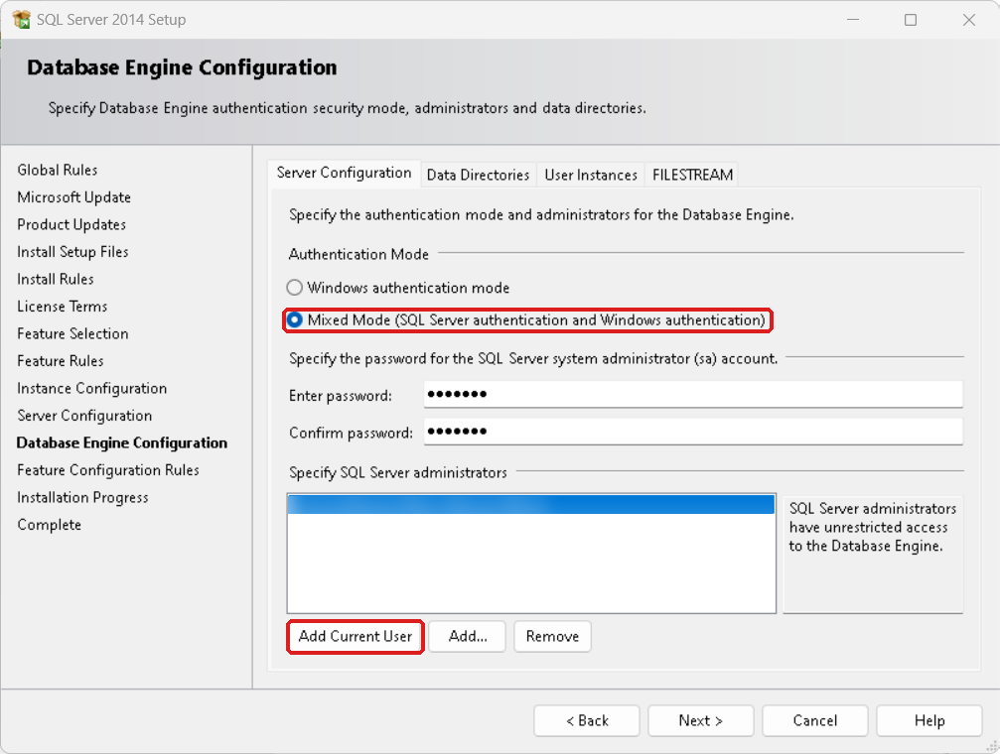

Al terminar, todas las características deben decir *Succeeded*:

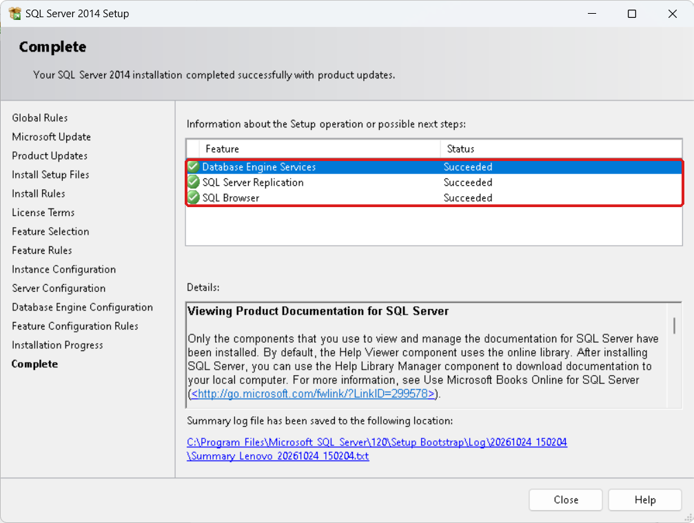

### 2.3 SQL Server Management Studio (SSMS)

Ejecuta `SQLManagementStudio_x64_ENU.exe`, elige otra vez **New SQL Server stand-alone installation** y en *Feature Selection* marca **Management Tools – Basic** y **Management Tools – Complete**:

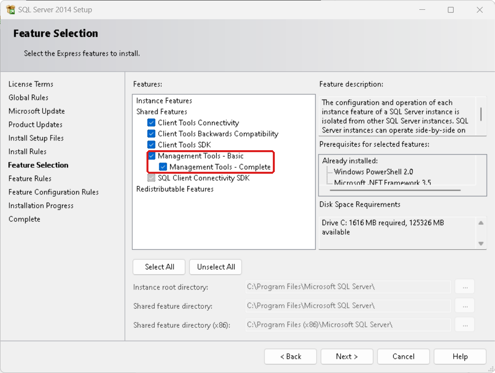

### 2.4 Verificación

Abre SSMS y conéctate con **Windows Authentication**. En *Server name* escribe `.\SQLEXPRESS`, o el nombre de tu equipo seguido de `\SQLEXPRESS` (SSMS suele proponerlo solo):

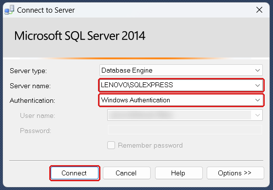

## 3. IIS

*Panel de control → Programas → Activar o desactivar características de Windows*:

- Internet Information Services
  - Herramientas de administración web → **Consola de administración de IIS**
  - Servicios World Wide Web → Características de desarrollo de aplicaciones → **ASP.NET 4.8**, **Extensibilidad .NET 4.8**, **Extensiones ISAPI**, **Filtros ISAPI**

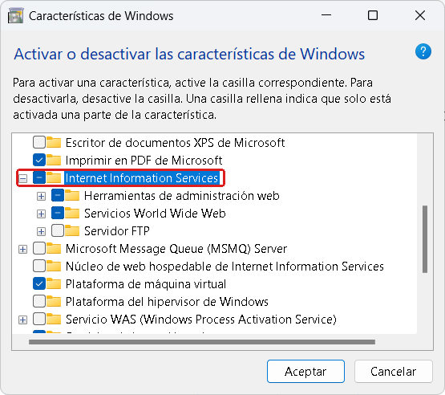

Expande *Herramientas de administración web* y marca **Consola de administración de IIS**:

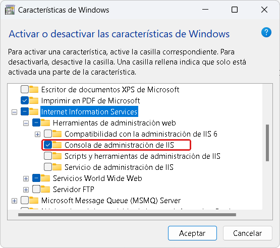

Expande *Servicios World Wide Web → Características de desarrollo de aplicaciones* y marca **ASP.NET 4.8**, **Extensibilidad .NET 4.8**, **Extensiones ISAPI** y **Filtros ISAPI**:

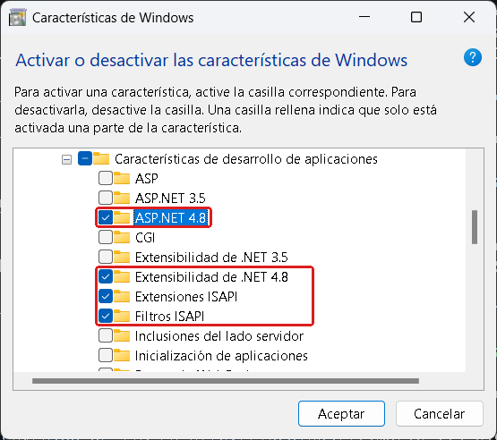

> Puedes agrandar la ventana arrastrando la esquina inferior para ver todo el árbol.

Verificación: abre `http://localhost` en el navegador; debe aparecer la página de bienvenida de IIS:

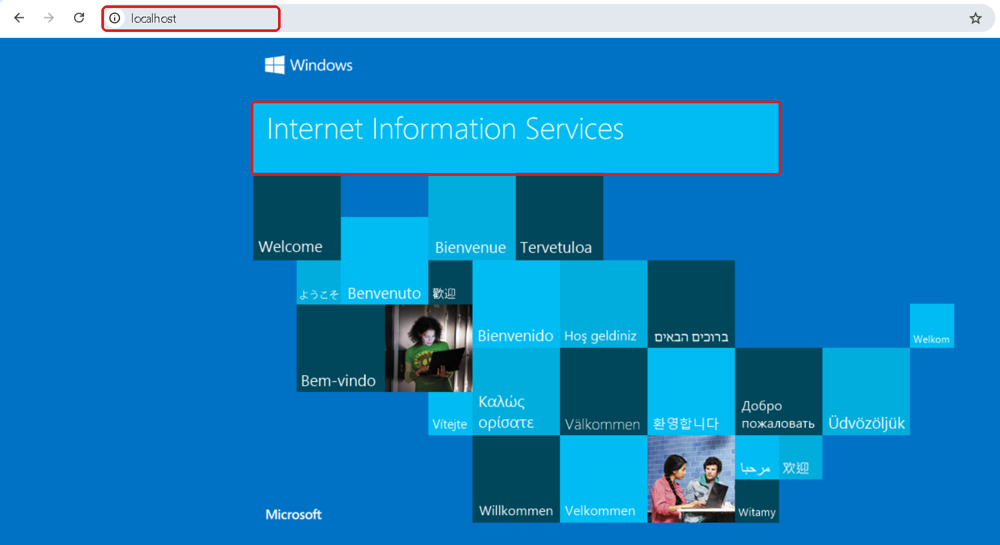

## 4. Navegador

Chrome o Edge actualizado. Usaremos mucho las **herramientas de desarrollo (F12)**.

## 5. Acceso a NuGet

En Visual Studio abre *Herramientas → Administrador de paquetes NuGet → Administrar paquetes para la solución* y busca `Newtonsoft.Json`. Debe aparecer en los resultados:

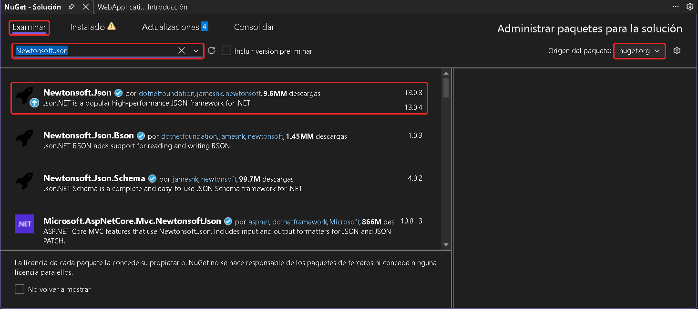

Si no aparecen resultados, tu red bloquea `nuget.org`: avisa al instructor o a tu área de redes antes del curso.

## 6. Acceso al repositorio del curso

Todo el material del curso (guías, scripts y la solución de cada día) está en un repositorio privado de GitHub. En el curso veremos lo básico de Git; aquí solo lo instalas y descargas el repositorio.

### 6.0 Git para Windows

1. Descárgalo de `https://git-scm.com/download/win` e instálalo con las opciones por defecto.
2. Abre una terminal nueva (PowerShell) y verifica:

```powershell
git --version
```

Debe responder con un número de versión.

### 6.1 Cuenta de GitHub

1. Si no tienes cuenta, créala gratis en `https://github.com/signup`.
2. Envía tu **nombre de usuario de GitHub** al instructor.
3. Te llegará una invitación por correo. **Acéptala**; sin eso no podrás ver el repositorio.

### 6.2 Clonar el repositorio desde Visual Studio

1. Abre Visual Studio y en la ventana de inicio elige **Clonar un repositorio**.
2. En *Ubicación del repositorio* escribe `https://github.com/manuel1488/curso-webforms-alumnos`.
3. En *Ruta de acceso* elige tu carpeta de trabajo, por ejemplo `C:\cursos\curso-webforms-alumnos`.
4. Clic en **Clonar**. Si te pide iniciar sesión en GitHub, hazlo con tu cuenta.

> Si prefieres la terminal: `git clone https://github.com/manuel1488/curso-webforms-alumnos.git` dentro de `C:\cursos`.

### 6.3 Traer lo nuevo cada día

Al cierre de cada sesión se publica la solución del día. Para descargarla, en Visual Studio: *Git → Extraer* (*Git → Pull* si lo tienes en inglés). El resto lo vemos en clase el día 1; la referencia está en [Git básico](git-minimo.md).

> **Sin Git:** también puedes entrar al repositorio en el navegador y usar *Code → Download ZIP*. Tendrás que volver a descargarlo cada día.

## 7. Envía tu verificación

Manda al instructor:
- Tu nombre de usuario de GitHub (si no lo enviaste ya).
- Una captura de *Configuración → Sistema → Información* (Windows y RAM).
- Una captura con Visual Studio, SSMS y el administrador de IIS abiertos.
- Una captura de la carpeta del repositorio clonado.
- Una captura de la terminal con `git --version`.
