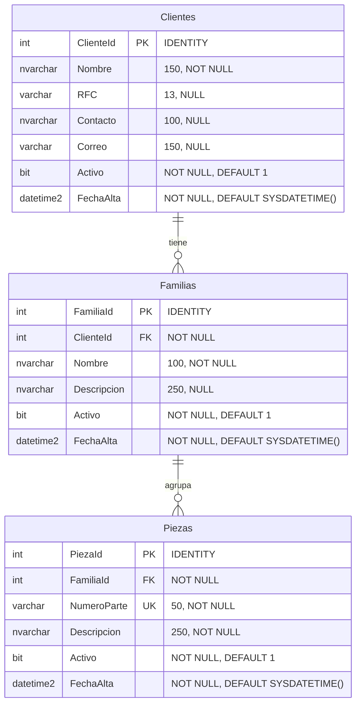

# Scripts de referencia

**No los ejecutes antes del curso.** Las tablas se escriben a mano en clase, una por catálogo:

| Día | Tabla |
|---|---|
| 2 | Base `CursoWeb` y `Clientes` |
| 3 | `Familias` (relacionada con Clientes) |
| 4 | `Piezas` (relacionada con Familias) |

Úsalos para:
- **Comparar** tu script si algo no funciona o te falta una columna o restricción.
- **Ponerte al corriente** si te atrasaste o perdiste tu base de datos.

| Archivo | Contenido |
|---|---|
| [`01-esquema.sql`](01-esquema.sql) | Base de datos y las tres tablas completas |
| [`02-datos-prueba.sql`](02-datos-prueba.sql) | Registros de ejemplo para las tres tablas (requiere el esquema completo) |

## Diagrama entidad-relación

- Un **cliente** tiene cero o muchas **familias**; cada familia pertenece a un solo cliente.
- Una **familia** agrupa cero o muchas **piezas**; cada pieza pertenece a una sola familia.
- El **número de parte** no se repite entre piezas (`UNIQUE`).
- `Activo` permite la eliminación lógica: un registro "eliminado" queda con `Activo = 0`.
